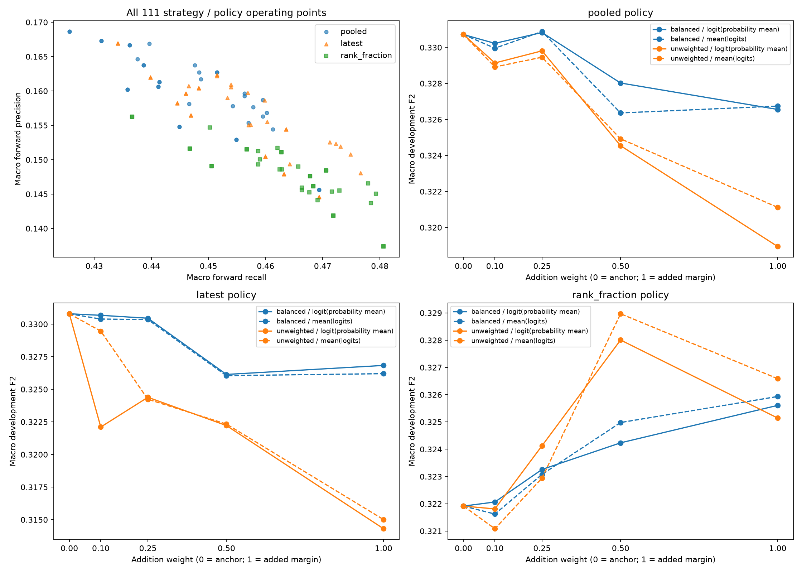

# Fixed bagged-anchor fusion findings

Selected **bagged_anchor_balanced_logit_a25 / pooled**, actual macro chronological development F2 **0.330881**. Positive measured differences against all five fixed references in both scopes: **False**. Completing this finite experiment does not itself establish the broader improvement goal.

## Fixed design and actual work

The existing margin H retains its original arithmetic. Balanced/unweighted three-seed bagged ensembles supply either logit of the probability mean or mean of individually clipped logits. Each is added as `(1-alpha)*H+alpha*G` at weights 0.1/0.25/0.5. The two forms have different scaling and are not interchangeable; no second logit is applied to a margin. Sixty expression-leaf diagnostics were checked without replacing the declared scoring association. Original models, whole-training class weights, train-only preprocessing and sampling settings remain unchanged; internal bags are not exactly class matched. Probability-like scores are not claimed calibrated.

Development used **0 new bagged fits**, **18 bagged reuses**, **15 old-reference reuses**, **0 additive reproductions** and **0 tree reproductions**. The 33 bases, 21 preserved derived results and 66 new calculations produced 120 physical/111 selectable scores, 222 forward operating rows and 947 contrasts. Actual derived reuses/calculations were 21/66. Predictor-only allocation, preserved nine-fit sampling evidence and older ancestry passed with zero new production miniature fits. The full methodological suite passed 1501 tests; its actual fit ledger separates six current-study tiny fits from 69 completed historical-module fits in that invocation (69 attempts, 0 expected failures). Earlier focused checks/retries are retained separately.

Models use earlier months only. Month 5 rules use month 4; month 6 rules use months 4/5 or latest month 5. Selection maximizes actual macro F2 beta=2, then recall/precision and deterministic IDs, with no review quota or precision floor. AP, pooled F2 and diagnostics do not select alternatives. Sources, configurations, software, development files and exact role/DAG/cache bounds were frozen before further consumed-month access.

## Five required reference comparisons

| role | development_f2 | development_difference | consumed_f2 | consumed_difference |
| --- | --- | --- | --- | --- |
| latest_fusion | 0.330793 | 0.000088 | 0.371534 | 0.000706 |
| recent_fusion | 0.329010 | 0.001871 | 0.370248 | 0.001992 |
| fusion | 0.328907 | 0.001974 | 0.372694 | -0.000454 |
| balanced | 0.327802 | 0.003079 | 0.364409 | 0.007831 |
| unweighted | 0.322654 | 0.008227 | 0.376884 | -0.004645 |

## All development operating points

| candidate | policy | f2 | precision | recall | flagged_fraction | average_precision | tp | fp | fn |
| --- | --- | --- | --- | --- | --- | --- | --- | --- | --- |
| bagged_anchor_balanced_logit_a25 | pooled | 0.330881 | 0.162720 | 0.451466 | 0.035935 | 0.189225 | 646.500000 | 3395.000000 | 784.000000 |
| bagged_anchor_balanced_prob_a25 | pooled | 0.330828 | 0.162705 | 0.451466 | 0.035955 | 0.189216 | 646.500000 | 3397.000000 | 784.000000 |
| interaction_blend_spline_c1p0_balanced_a10 | latest | 0.330793 | 0.158659 | 0.459837 | 0.037598 | 0.189693 | 658.500000 | 3569.000000 | 772.000000 |
| interaction_blend_spline_c1p0_balanced_a10 | pooled | 0.330716 | 0.158702 | 0.459493 | 0.037552 | 0.189693 | 658.000000 | 3564.500000 | 772.500000 |
| bagged_anchor_balanced_prob_a10 | latest | 0.330675 | 0.160941 | 0.453928 | 0.036444 | 0.189655 | 650.000000 | 3450.500000 | 780.500000 |
| bagged_anchor_balanced_prob_a25 | latest | 0.330452 | 0.162337 | 0.451466 | 0.036066 | 0.189216 | 646.500000 | 3409.000000 | 784.000000 |
| bagged_anchor_balanced_logit_a10 | latest | 0.330389 | 0.160550 | 0.453928 | 0.036512 | 0.189654 | 650.000000 | 3458.500000 | 780.500000 |
| bagged_anchor_balanced_logit_a25 | latest | 0.330347 | 0.162199 | 0.451466 | 0.036092 | 0.189225 | 646.500000 | 3412.000000 | 784.000000 |
| bagged_anchor_balanced_prob_a10 | pooled | 0.330226 | 0.159657 | 0.456342 | 0.037063 | 0.189655 | 653.500000 | 3514.000000 | 777.000000 |
| bagged_anchor_balanced_logit_a10 | pooled | 0.329957 | 0.159283 | 0.456342 | 0.037126 | 0.189654 | 653.500000 | 3521.500000 | 777.000000 |
| bagged_anchor_unweighted_prob_a25 | pooled | 0.329810 | 0.163758 | 0.447616 | 0.035501 | 0.189337 | 641.000000 | 3350.000000 | 789.500000 |
| bagged_anchor_unweighted_logit_a10 | latest | 0.329462 | 0.159038 | 0.453286 | 0.036570 | 0.189710 | 649.000000 | 3471.500000 | 781.500000 |
| bagged_anchor_unweighted_logit_a25 | pooled | 0.329457 | 0.162713 | 0.448325 | 0.035711 | 0.189350 | 642.000000 | 3374.000000 | 788.500000 |
| bagged_anchor_unweighted_prob_a10 | pooled | 0.329137 | 0.161717 | 0.448679 | 0.035813 | 0.189753 | 642.500000 | 3387.500000 | 788.000000 |
| margin_blend_spline_c0p1_unweighted_a25 | latest | 0.329010 | 0.155537 | 0.460249 | 0.038074 | 0.190366 | 659.000000 | 3628.500000 | 771.500000 |
| bagged_anchor_unweighted_logit_a50 | rank_fraction | 0.328969 | 0.146577 | 0.477937 | 0.041063 | 0.188763 | 683.500000 | 3983.000000 | 747.000000 |
| bagged_anchor_unweighted_logit_a10 | pooled | 0.328915 | 0.156308 | 0.459493 | 0.037985 | 0.189710 | 658.000000 | 3615.500000 | 772.500000 |
| logit_mean_xgb_d4_w1_baseline_balanced_a50 | pooled | 0.328907 | 0.166891 | 0.439609 | 0.034181 | 0.188626 | 629.500000 | 3214.000000 | 801.000000 |
| margin_blend_spline_c0p1_unweighted_a25 | pooled | 0.328205 | 0.154440 | 0.461284 | 0.038527 | 0.190366 | 660.500000 | 3676.000000 | 770.000000 |
| bagged_anchor_balanced_prob_a50 | pooled | 0.328024 | 0.157839 | 0.454273 | 0.037239 | 0.188580 | 650.500000 | 3538.500000 | 780.000000 |
| bagged_anchor_unweighted_prob_a50 | rank_fraction | 0.328006 | 0.145034 | 0.479306 | 0.041630 | 0.188737 | 685.500000 | 4042.000000 | 745.000000 |
| bagged_unweighted_s43 | rank_fraction | 0.327885 | 0.148442 | 0.470590 | 0.039936 | 0.184906 | 673.000000 | 3868.500000 | 757.500000 |
| logit_bagged_unweighted_s43 | rank_fraction | 0.327885 | 0.148442 | 0.470590 | 0.039936 | 0.184906 | 673.000000 | 3868.500000 | 757.500000 |
| baseline_balanced | pooled | 0.327802 | 0.166693 | 0.436170 | 0.033753 | 0.183160 | 624.500000 | 3175.000000 | 806.000000 |
| logit_baseline_balanced | pooled | 0.327802 | 0.166693 | 0.436170 | 0.033753 | 0.183160 | 624.500000 | 3175.000000 | 806.000000 |
| logit_mean_xgb_d4_w1_baseline_balanced_a50 | latest | 0.327582 | 0.159761 | 0.456850 | 0.038092 | 0.188626 | 654.500000 | 3612.000000 | 776.000000 |
| baseline_balanced | latest | 0.327170 | 0.166913 | 0.434101 | 0.033512 | 0.183160 | 621.500000 | 3152.000000 | 809.000000 |
| logit_baseline_balanced | latest | 0.327170 | 0.166913 | 0.434101 | 0.033512 | 0.183160 | 621.500000 | 3152.000000 | 809.000000 |
| bagged_balanced_prob_mean | latest | 0.326831 | 0.160427 | 0.448287 | 0.036477 | 0.185577 | 642.000000 | 3455.500000 | 788.500000 |
| logit_bagged_balanced_prob_mean | latest | 0.326831 | 0.160427 | 0.448287 | 0.036477 | 0.185577 | 642.000000 | 3455.500000 | 788.500000 |
| bagged_balanced_logit_mean | pooled | 0.326742 | 0.164658 | 0.437568 | 0.034318 | 0.185526 | 626.500000 | 3236.000000 | 804.000000 |
| bagged_unweighted_logit_mean | rank_fraction | 0.326588 | 0.148989 | 0.465734 | 0.039359 | 0.185907 | 666.000000 | 3808.000000 | 764.500000 |
| bagged_balanced_prob_mean | pooled | 0.326556 | 0.163773 | 0.438631 | 0.034582 | 0.185577 | 628.000000 | 3264.500000 | 802.500000 |
| logit_bagged_balanced_prob_mean | pooled | 0.326556 | 0.163773 | 0.438631 | 0.034582 | 0.185577 | 628.000000 | 3264.500000 | 802.500000 |
| bagged_anchor_balanced_logit_a50 | pooled | 0.326362 | 0.155358 | 0.457031 | 0.038305 | 0.188580 | 654.500000 | 3650.000000 | 776.000000 |
| bagged_balanced_logit_mean | latest | 0.326200 | 0.160732 | 0.446534 | 0.036315 | 0.185526 | 639.500000 | 3439.000000 | 791.000000 |
| bagged_anchor_balanced_prob_a50 | latest | 0.326141 | 0.155087 | 0.457376 | 0.038450 | 0.188580 | 655.000000 | 3665.000000 | 775.500000 |
| bagged_anchor_balanced_logit_a50 | latest | 0.326049 | 0.155077 | 0.457031 | 0.038402 | 0.188580 | 654.500000 | 3660.500000 | 776.000000 |
| bagged_balanced_s29 | pooled | 0.325981 | 0.161325 | 0.441400 | 0.035221 | 0.184499 | 632.000000 | 3334.000000 | 798.500000 |
| logit_bagged_balanced_s29 | pooled | 0.325981 | 0.161325 | 0.441400 | 0.035221 | 0.184499 | 632.000000 | 3334.000000 | 798.500000 |
| bagged_balanced_logit_mean | rank_fraction | 0.325935 | 0.151721 | 0.462075 | 0.038658 | 0.185526 | 660.500000 | 3757.000000 | 770.000000 |
| bagged_balanced_s17 | rank_fraction | 0.325694 | 0.147591 | 0.467803 | 0.039980 | 0.184784 | 669.000000 | 3883.000000 | 761.500000 |
| logit_bagged_balanced_s17 | rank_fraction | 0.325694 | 0.147591 | 0.467803 | 0.039980 | 0.184784 | 669.000000 | 3883.000000 | 761.500000 |
| bagged_balanced_prob_mean | rank_fraction | 0.325609 | 0.151100 | 0.462774 | 0.038884 | 0.185577 | 661.500000 | 3782.000000 | 769.000000 |
| logit_bagged_balanced_prob_mean | rank_fraction | 0.325609 | 0.151100 | 0.462774 | 0.038884 | 0.185577 | 661.500000 | 3782.000000 | 769.000000 |
| bagged_balanced_s43 | pooled | 0.325592 | 0.167277 | 0.431228 | 0.033374 | 0.184458 | 617.500000 | 3136.500000 | 813.000000 |
| logit_bagged_balanced_s43 | pooled | 0.325592 | 0.167277 | 0.431228 | 0.033374 | 0.184458 | 617.500000 | 3136.500000 | 813.000000 |
| bagged_unweighted_prob_mean | rank_fraction | 0.325144 | 0.151522 | 0.456702 | 0.037953 | 0.185800 | 653.000000 | 3666.000000 | 777.500000 |
| logit_bagged_unweighted_prob_mean | rank_fraction | 0.325144 | 0.151522 | 0.456702 | 0.037953 | 0.185800 | 653.000000 | 3666.000000 | 777.500000 |
| bagged_anchor_balanced_logit_a50 | rank_fraction | 0.324980 | 0.143686 | 0.478424 | 0.042151 | 0.188580 | 684.000000 | 4126.500000 | 746.500000 |
| bagged_anchor_unweighted_logit_a50 | pooled | 0.324925 | 0.157651 | 0.457827 | 0.039097 | 0.188763 | 656.000000 | 3717.500000 | 774.500000 |
| bagged_anchor_unweighted_prob_a50 | pooled | 0.324542 | 0.156816 | 0.460222 | 0.039692 | 0.188737 | 659.500000 | 3778.000000 | 771.000000 |
| bagged_anchor_unweighted_prob_a25 | latest | 0.324388 | 0.151912 | 0.473133 | 0.042481 | 0.189337 | 678.000000 | 4068.000000 | 752.500000 |
| bagged_anchor_balanced_prob_a50 | rank_fraction | 0.324236 | 0.145505 | 0.472907 | 0.041238 | 0.188580 | 676.000000 | 4035.500000 | 754.500000 |
| bagged_anchor_unweighted_logit_a25 | latest | 0.324236 | 0.150802 | 0.474876 | 0.042839 | 0.189350 | 680.500000 | 4106.500000 | 750.000000 |
| bagged_anchor_unweighted_prob_a25 | rank_fraction | 0.324129 | 0.151236 | 0.458674 | 0.038400 | 0.189337 | 655.500000 | 3732.500000 | 775.000000 |
| bagged_balanced_s29 | latest | 0.324051 | 0.158235 | 0.444503 | 0.036432 | 0.184499 | 636.500000 | 3460.500000 | 794.000000 |
| logit_bagged_balanced_s29 | latest | 0.324051 | 0.158235 | 0.444503 | 0.036432 | 0.184499 | 636.500000 | 3460.500000 | 794.000000 |
| logit_mean_xgb_d4_w1_baseline_balanced_a50 | rank_fraction | 0.323872 | 0.154697 | 0.450255 | 0.036859 | 0.188626 | 643.500000 | 3568.000000 | 787.000000 |
| bagged_unweighted_s29 | pooled | 0.323621 | 0.168641 | 0.425635 | 0.032838 | 0.184988 | 609.500000 | 3081.500000 | 821.000000 |
| logit_bagged_unweighted_s29 | pooled | 0.323621 | 0.168641 | 0.425635 | 0.032838 | 0.184988 | 609.500000 | 3081.500000 | 821.000000 |
| bagged_balanced_s17 | latest | 0.323488 | 0.161980 | 0.439839 | 0.035769 | 0.184784 | 630.000000 | 3382.500000 | 800.500000 |
| logit_bagged_balanced_s17 | latest | 0.323488 | 0.161980 | 0.439839 | 0.035769 | 0.184784 | 630.000000 | 3382.500000 | 800.500000 |
| bagged_balanced_s43 | latest | 0.323277 | 0.159647 | 0.446056 | 0.037118 | 0.184458 | 639.000000 | 3520.000000 | 791.500000 |
| logit_bagged_balanced_s43 | latest | 0.323277 | 0.159647 | 0.446056 | 0.037118 | 0.184458 | 639.000000 | 3520.000000 | 791.500000 |
| bagged_anchor_balanced_prob_a25 | rank_fraction | 0.323259 | 0.148593 | 0.462821 | 0.039496 | 0.189216 | 661.500000 | 3852.000000 | 769.000000 |
| bagged_balanced_s29 | rank_fraction | 0.323080 | 0.146147 | 0.468367 | 0.040676 | 0.184499 | 669.500000 | 3978.500000 | 761.000000 |
| logit_bagged_balanced_s29 | rank_fraction | 0.323080 | 0.146147 | 0.468367 | 0.040676 | 0.184499 | 669.500000 | 3978.500000 | 761.000000 |
| bagged_anchor_balanced_logit_a25 | rank_fraction | 0.323078 | 0.148588 | 0.462477 | 0.039475 | 0.189225 | 661.000000 | 3850.500000 | 769.500000 |
| margin_blend_spline_c0p1_unweighted_a25 | rank_fraction | 0.323057 | 0.145341 | 0.471623 | 0.041219 | 0.190366 | 674.000000 | 4040.000000 | 756.500000 |
| bagged_anchor_unweighted_logit_a25 | rank_fraction | 0.322942 | 0.150053 | 0.459038 | 0.038786 | 0.189350 | 656.000000 | 3778.000000 | 774.500000 |
| baseline_lgbm | pooled | 0.322654 | 0.145630 | 0.469348 | 0.041789 | 0.182014 | 672.000000 | 4028.500000 | 758.500000 |
| logit_baseline_lgbm | pooled | 0.322654 | 0.145630 | 0.469348 | 0.041789 | 0.182014 | 672.000000 | 4028.500000 | 758.500000 |
| bagged_balanced_s17 | pooled | 0.322544 | 0.160642 | 0.441219 | 0.036347 | 0.184784 | 632.000000 | 3443.000000 | 798.500000 |
| logit_bagged_balanced_s17 | pooled | 0.322544 | 0.160642 | 0.441219 | 0.036347 | 0.184784 | 632.000000 | 3443.000000 | 798.500000 |
| bagged_anchor_unweighted_logit_a50 | latest | 0.322333 | 0.152350 | 0.472310 | 0.042993 | 0.188763 | 677.000000 | 4118.000000 | 753.500000 |
| bagged_anchor_unweighted_prob_a50 | latest | 0.322219 | 0.152573 | 0.471257 | 0.042780 | 0.188737 | 675.500000 | 4096.000000 | 755.000000 |
| bagged_anchor_unweighted_prob_a10 | latest | 0.322107 | 0.148054 | 0.476610 | 0.043833 | 0.189753 | 683.000000 | 4214.500000 | 747.500000 |
| bagged_anchor_balanced_prob_a10 | rank_fraction | 0.322066 | 0.145949 | 0.466327 | 0.040507 | 0.189655 | 666.500000 | 3962.500000 | 764.000000 |
| bagged_unweighted_s17 | rank_fraction | 0.322021 | 0.141860 | 0.471846 | 0.041988 | 0.182286 | 675.000000 | 4084.000000 | 755.500000 |
| logit_bagged_unweighted_s17 | rank_fraction | 0.322021 | 0.141860 | 0.471846 | 0.041988 | 0.182286 | 675.000000 | 4084.000000 | 755.500000 |
| interaction_blend_spline_c1p0_balanced_a10 | rank_fraction | 0.321916 | 0.145238 | 0.467697 | 0.040846 | 0.189693 | 668.500000 | 3999.000000 | 762.000000 |
| bagged_anchor_unweighted_prob_a10 | rank_fraction | 0.321813 | 0.149315 | 0.458683 | 0.039041 | 0.189753 | 655.500000 | 3810.000000 | 775.000000 |
| bagged_anchor_balanced_logit_a10 | rank_fraction | 0.321624 | 0.145560 | 0.466327 | 0.040634 | 0.189654 | 666.500000 | 3977.500000 | 764.000000 |
| baseline_lgbm | latest | 0.321424 | 0.144608 | 0.469348 | 0.042196 | 0.182014 | 672.000000 | 4072.500000 | 758.500000 |
| logit_baseline_lgbm | latest | 0.321424 | 0.144608 | 0.469348 | 0.042196 | 0.182014 | 672.000000 | 4072.500000 | 758.500000 |
| bagged_unweighted_logit_mean | pooled | 0.321115 | 0.158151 | 0.446621 | 0.037781 | 0.185907 | 640.000000 | 3588.000000 | 790.500000 |
| bagged_anchor_unweighted_logit_a10 | rank_fraction | 0.321086 | 0.144120 | 0.469124 | 0.041343 | 0.189710 | 670.500000 | 4056.000000 | 760.000000 |
| bagged_unweighted_s29 | latest | 0.320462 | 0.154420 | 0.463566 | 0.041746 | 0.184988 | 664.500000 | 3990.000000 | 766.000000 |
| logit_bagged_unweighted_s29 | latest | 0.320462 | 0.154420 | 0.463566 | 0.041746 | 0.184988 | 664.500000 | 3990.000000 | 766.000000 |
| bagged_unweighted_s29 | rank_fraction | 0.319643 | 0.156255 | 0.436654 | 0.035306 | 0.184988 | 624.000000 | 3408.500000 | 806.500000 |
| logit_bagged_unweighted_s29 | rank_fraction | 0.319643 | 0.156255 | 0.436654 | 0.035306 | 0.184988 | 624.000000 | 3408.500000 | 806.500000 |
| bagged_balanced_s43 | rank_fraction | 0.319541 | 0.151630 | 0.446740 | 0.037369 | 0.184458 | 638.500000 | 3632.500000 | 792.000000 |
| logit_bagged_balanced_s43 | rank_fraction | 0.319541 | 0.151630 | 0.446740 | 0.037369 | 0.184458 | 638.500000 | 3632.500000 | 792.000000 |
| bagged_unweighted_prob_mean | pooled | 0.318942 | 0.160216 | 0.435836 | 0.036158 | 0.185800 | 624.500000 | 3425.000000 | 806.000000 |
| logit_bagged_unweighted_prob_mean | pooled | 0.318942 | 0.160216 | 0.435836 | 0.036158 | 0.185800 | 624.500000 | 3425.000000 | 806.000000 |
| baseline_balanced | rank_fraction | 0.318771 | 0.149056 | 0.450543 | 0.038377 | 0.183160 | 644.000000 | 3742.000000 | 786.500000 |
| logit_baseline_balanced | rank_fraction | 0.318771 | 0.149056 | 0.450543 | 0.038377 | 0.183160 | 644.000000 | 3742.000000 | 786.500000 |
| baseline_lgbm | rank_fraction | 0.318729 | 0.137376 | 0.480665 | 0.044290 | 0.182014 | 687.000000 | 4372.000000 | 743.500000 |
| logit_baseline_lgbm | rank_fraction | 0.318729 | 0.137376 | 0.480665 | 0.044290 | 0.182014 | 687.000000 | 4372.000000 | 743.500000 |
| bagged_unweighted_s17 | latest | 0.318727 | 0.156477 | 0.446938 | 0.038618 | 0.182286 | 640.500000 | 3676.500000 | 790.000000 |
| logit_bagged_unweighted_s17 | latest | 0.318727 | 0.156477 | 0.446938 | 0.038618 | 0.182286 | 640.500000 | 3676.500000 | 790.000000 |
| bagged_unweighted_s43 | pooled | 0.318075 | 0.154800 | 0.444926 | 0.038309 | 0.184906 | 637.500000 | 3652.000000 | 793.000000 |
| logit_bagged_unweighted_s43 | pooled | 0.318075 | 0.154800 | 0.444926 | 0.038309 | 0.184906 | 637.500000 | 3652.000000 | 793.000000 |
| bagged_unweighted_s17 | pooled | 0.316656 | 0.152926 | 0.454869 | 0.040989 | 0.182286 | 652.000000 | 3921.500000 | 778.500000 |
| logit_bagged_unweighted_s17 | pooled | 0.316656 | 0.152926 | 0.454869 | 0.040989 | 0.182286 | 652.000000 | 3921.500000 | 778.500000 |
| bagged_unweighted_logit_mean | latest | 0.315010 | 0.149366 | 0.464208 | 0.043578 | 0.185907 | 665.500000 | 4189.500000 | 765.000000 |
| bagged_unweighted_s43 | latest | 0.314786 | 0.147940 | 0.463202 | 0.043301 | 0.184906 | 664.000000 | 4165.500000 | 766.500000 |
| logit_bagged_unweighted_s43 | latest | 0.314786 | 0.147940 | 0.463202 | 0.043301 | 0.184906 | 664.000000 | 4165.500000 | 766.500000 |
| bagged_unweighted_prob_mean | latest | 0.314308 | 0.150496 | 0.459974 | 0.042787 | 0.185800 | 659.500000 | 4107.000000 | 771.000000 |
| logit_bagged_unweighted_prob_mean | latest | 0.314308 | 0.150496 | 0.459974 | 0.042787 | 0.185800 | 659.500000 | 4107.000000 | 771.000000 |

## All twelve blends and complete matched effects

| candidate | policy | f2 | precision | recall | flagged_fraction |
| --- | --- | --- | --- | --- | --- |
| bagged_anchor_balanced_logit_a25 | pooled | 0.330881 | 0.162720 | 0.451466 | 0.035935 |
| bagged_anchor_balanced_prob_a25 | pooled | 0.330828 | 0.162705 | 0.451466 | 0.035955 |
| bagged_anchor_balanced_prob_a10 | latest | 0.330675 | 0.160941 | 0.453928 | 0.036444 |
| bagged_anchor_balanced_prob_a25 | latest | 0.330452 | 0.162337 | 0.451466 | 0.036066 |
| bagged_anchor_balanced_logit_a10 | latest | 0.330389 | 0.160550 | 0.453928 | 0.036512 |
| bagged_anchor_balanced_logit_a25 | latest | 0.330347 | 0.162199 | 0.451466 | 0.036092 |
| bagged_anchor_balanced_prob_a10 | pooled | 0.330226 | 0.159657 | 0.456342 | 0.037063 |
| bagged_anchor_balanced_logit_a10 | pooled | 0.329957 | 0.159283 | 0.456342 | 0.037126 |
| bagged_anchor_unweighted_prob_a25 | pooled | 0.329810 | 0.163758 | 0.447616 | 0.035501 |
| bagged_anchor_unweighted_logit_a10 | latest | 0.329462 | 0.159038 | 0.453286 | 0.036570 |
| bagged_anchor_unweighted_logit_a25 | pooled | 0.329457 | 0.162713 | 0.448325 | 0.035711 |
| bagged_anchor_unweighted_prob_a10 | pooled | 0.329137 | 0.161717 | 0.448679 | 0.035813 |
| bagged_anchor_unweighted_logit_a50 | rank_fraction | 0.328969 | 0.146577 | 0.477937 | 0.041063 |
| bagged_anchor_unweighted_logit_a10 | pooled | 0.328915 | 0.156308 | 0.459493 | 0.037985 |
| bagged_anchor_balanced_prob_a50 | pooled | 0.328024 | 0.157839 | 0.454273 | 0.037239 |
| bagged_anchor_unweighted_prob_a50 | rank_fraction | 0.328006 | 0.145034 | 0.479306 | 0.041630 |
| bagged_anchor_balanced_logit_a50 | pooled | 0.326362 | 0.155358 | 0.457031 | 0.038305 |
| bagged_anchor_balanced_prob_a50 | latest | 0.326141 | 0.155087 | 0.457376 | 0.038450 |
| bagged_anchor_balanced_logit_a50 | latest | 0.326049 | 0.155077 | 0.457031 | 0.038402 |
| bagged_anchor_balanced_logit_a50 | rank_fraction | 0.324980 | 0.143686 | 0.478424 | 0.042151 |
| bagged_anchor_unweighted_logit_a50 | pooled | 0.324925 | 0.157651 | 0.457827 | 0.039097 |
| bagged_anchor_unweighted_prob_a50 | pooled | 0.324542 | 0.156816 | 0.460222 | 0.039692 |
| bagged_anchor_unweighted_prob_a25 | latest | 0.324388 | 0.151912 | 0.473133 | 0.042481 |
| bagged_anchor_balanced_prob_a50 | rank_fraction | 0.324236 | 0.145505 | 0.472907 | 0.041238 |
| bagged_anchor_unweighted_logit_a25 | latest | 0.324236 | 0.150802 | 0.474876 | 0.042839 |
| bagged_anchor_unweighted_prob_a25 | rank_fraction | 0.324129 | 0.151236 | 0.458674 | 0.038400 |
| bagged_anchor_balanced_prob_a25 | rank_fraction | 0.323259 | 0.148593 | 0.462821 | 0.039496 |
| bagged_anchor_balanced_logit_a25 | rank_fraction | 0.323078 | 0.148588 | 0.462477 | 0.039475 |
| bagged_anchor_unweighted_logit_a25 | rank_fraction | 0.322942 | 0.150053 | 0.459038 | 0.038786 |
| bagged_anchor_unweighted_logit_a50 | latest | 0.322333 | 0.152350 | 0.472310 | 0.042993 |
| bagged_anchor_unweighted_prob_a50 | latest | 0.322219 | 0.152573 | 0.471257 | 0.042780 |
| bagged_anchor_unweighted_prob_a10 | latest | 0.322107 | 0.148054 | 0.476610 | 0.043833 |
| bagged_anchor_balanced_prob_a10 | rank_fraction | 0.322066 | 0.145949 | 0.466327 | 0.040507 |
| bagged_anchor_unweighted_prob_a10 | rank_fraction | 0.321813 | 0.149315 | 0.458683 | 0.039041 |
| bagged_anchor_balanced_logit_a10 | rank_fraction | 0.321624 | 0.145560 | 0.466327 | 0.040634 |
| bagged_anchor_unweighted_logit_a10 | rank_fraction | 0.321086 | 0.144120 | 0.469124 | 0.041343 |

Every fixed-reference, own-policy, blend-versus-anchor/member, higher/lower weight, matched weighting/form, logit/native, aggregate/constituent and randomized/unbagged factor is retained in `contrasts.csv`. The table below covers all factor groups and preserves ties and negative effects. These are otherwise-matched finite comparisons, not universal or causal claims. Eighteen diversity rows, 36 decision overlaps, 39 clipping rows and all original preprocessing/numerical evidence accompany results. High correlation or different errors alone do not establish a benefit.

| contrast | rows | minimum | maximum | mean_difference | positive | negative | tied |
| --- | --- | --- | --- | --- | --- | --- | --- |
| added mean-logit minus logit-mean-probability | 6 | -0.000632 | 0.002173 | 0.000700 | 5 | 1 | 0 |
| blend balanced minus unweighted | 18 | -0.003989 | 0.008568 | 0.001728 | 15 | 3 | 0 |
| blend mean-logit minus logit-mean-probability | 18 | -0.001662 | 0.007355 | 0.000219 | 6 | 12 | 0 |
| blend minus added margin | 36 | -0.005503 | 0.014452 | 0.003086 | 23 | 13 | 0 |
| blend minus anchor | 36 | -0.008686 | 0.007052 | -0.001474 | 11 | 25 | 0 |
| fixed reference balanced | 111 | -0.013493 | 0.003079 | -0.003731 | 23 | 86 | 2 |
| fixed reference fusion | 111 | -0.014598 | 0.001974 | -0.004836 | 17 | 93 | 1 |
| fixed reference latest_fusion | 111 | -0.016485 | 0.000088 | -0.006723 | 2 | 108 | 1 |
| fixed reference recent_fusion | 111 | -0.014701 | 0.001871 | -0.004939 | 14 | 96 | 1 |
| fixed reference unweighted | 111 | -0.008345 | 0.008227 | 0.001417 | 71 | 38 | 2 |
| higher minus lower blend weight | 36 | -0.007129 | 0.007883 | -0.000593 | 18 | 18 | 0 |
| logit balanced minus unweighted | 15 | -0.008344 | 0.012523 | 0.004194 | 14 | 1 | 0 |
| logit-probability aggregate minus logit member | 18 | -0.006153 | 0.006068 | 0.000947 | 12 | 6 | 0 |
| mean-logit aggregate minus logit member | 18 | -0.005452 | 0.006945 | 0.001647 | 14 | 4 | 0 |
| native balanced minus unweighted | 15 | -0.008344 | 0.012523 | 0.004542 | 13 | 2 | 0 |
| policy minus own pooled | 74 | -0.009031 | 0.009810 | -0.001824 | 22 | 52 | 0 |
| probability aggregate minus native member | 18 | -0.006153 | 0.006068 | 0.000947 | 12 | 6 | 0 |
| randomized minus matched unbagged | 54 | -0.007115 | 0.009156 | -0.000413 | 20 | 34 | 0 |
| transformed minus native | 30 | 0.000000 | 0.000000 | 0.000000 | 0 | 0 | 30 |

## Conditional development uncertainty

| scope | reference | difference | ci_low | ci_high | replicates |
| --- | --- | --- | --- | --- | --- |
| 5 | latest_fusion | -0.000840 | -0.004637 | 0.002489 | 500 |
| 5 | recent_fusion | 0.001853 | -0.003473 | 0.006974 | 500 |
| 5 | fusion | 0.001277 | -0.003038 | 0.005570 | 500 |
| 5 | balanced | 0.002602 | -0.003448 | 0.009499 | 500 |
| 5 | unweighted | 0.002736 | -0.005570 | 0.010544 | 500 |
| 5 | same_strategy | 0.000000 | 0.000000 | 0.000000 | 500 |
| 5 | member_s17 | 0.005985 | -0.000582 | 0.012652 | 500 |
| 5 | member_logit_s17 | 0.005985 | -0.000582 | 0.012652 | 500 |
| 5 | member_s29 | 0.005211 | -0.001623 | 0.011934 | 500 |
| 5 | member_logit_s29 | 0.005211 | -0.001623 | 0.011934 | 500 |
| 5 | member_s43 | 0.005819 | -0.000374 | 0.012748 | 500 |
| 5 | member_logit_s43 | 0.005819 | -0.000374 | 0.012748 | 500 |
| 5 | probability_mean | 0.002392 | -0.003871 | 0.008383 | 500 |
| 5 | probability_mean_logit | 0.002392 | -0.003871 | 0.008383 | 500 |
| 5 | logit_mean | 0.002908 | -0.002934 | 0.009021 | 500 |
| 5 | unbagged_member | 0.002602 | -0.003448 | 0.009499 | 500 |
| 5 | unbagged_logit | 0.002602 | -0.003448 | 0.009499 | 500 |
| 5 | anchor_at_policy | -0.000840 | -0.004637 | 0.002489 | 500 |
| 5 | added_member_native | 0.002908 | -0.002934 | 0.009021 | 500 |
| 5 | added_member_margin | 0.002908 | -0.002934 | 0.009021 | 500 |
| 5 | matched_weight | 0.001174 | -0.002723 | 0.005079 | 500 |
| 5 | matched_form | -0.000147 | -0.000326 | -0.000035 | 500 |
| 5 | alpha_a10 | 0.000795 | -0.002041 | 0.002984 | 500 |
| 5 | alpha_a25 | 0.000000 | 0.000000 | 0.000000 | 500 |
| 5 | alpha_a50 | 0.002381 | -0.001008 | 0.005983 | 500 |
| 6 | latest_fusion | 0.001015 | -0.002629 | 0.003982 | 500 |
| 6 | recent_fusion | 0.001889 | -0.002886 | 0.006768 | 500 |
| 6 | fusion | 0.002672 | -0.001358 | 0.006677 | 500 |
| 6 | balanced | 0.003557 | -0.002109 | 0.010343 | 500 |
| 6 | unweighted | 0.013718 | 0.006917 | 0.021031 | 500 |
| 6 | same_strategy | 0.000000 | 0.000000 | 0.000000 | 500 |
| 6 | member_s17 | 0.010690 | 0.005617 | 0.016528 | 500 |
| 6 | member_logit_s17 | 0.010690 | 0.005617 | 0.016528 | 500 |
| 6 | member_s29 | 0.004589 | -0.001070 | 0.010785 | 500 |
| 6 | member_logit_s29 | 0.004589 | -0.001070 | 0.010785 | 500 |
| 6 | member_s43 | 0.004760 | -0.001658 | 0.011320 | 500 |
| 6 | member_logit_s43 | 0.004760 | -0.001658 | 0.011320 | 500 |
| 6 | probability_mean | 0.006258 | 0.000835 | 0.011881 | 500 |
| 6 | probability_mean_logit | 0.006258 | 0.000835 | 0.011881 | 500 |
| 6 | logit_mean | 0.005370 | -0.000058 | 0.010926 | 500 |
| 6 | unbagged_member | 0.003557 | -0.002109 | 0.010343 | 500 |
| 6 | unbagged_logit | 0.003557 | -0.002109 | 0.010343 | 500 |
| 6 | anchor_at_policy | 0.001170 | -0.002380 | 0.004043 | 500 |
| 6 | added_member_native | 0.005370 | -0.000058 | 0.010926 | 500 |
| 6 | added_member_margin | 0.005370 | -0.000058 | 0.010926 | 500 |
| 6 | matched_weight | 0.001674 | -0.002416 | 0.005446 | 500 |
| 6 | matched_form | 0.000252 | 0.000097 | 0.000439 | 500 |
| 6 | alpha_a10 | 0.001054 | -0.001806 | 0.003317 | 500 |
| 6 | alpha_a25 | 0.000000 | 0.000000 | 0.000000 | 500 |
| 6 | alpha_a50 | 0.006658 | 0.003260 | 0.009627 | 500 |
| macro | latest_fusion | 0.000088 | -0.002631 | 0.002345 | 500 |
| macro | recent_fusion | 0.001871 | -0.001891 | 0.005283 | 500 |
| macro | fusion | 0.001974 | -0.001161 | 0.005014 | 500 |
| macro | balanced | 0.003079 | -0.000952 | 0.007659 | 500 |
| macro | unweighted | 0.008227 | 0.002848 | 0.013327 | 500 |
| macro | same_strategy | 0.000000 | 0.000000 | 0.000000 | 500 |
| macro | member_s17 | 0.008337 | 0.004174 | 0.012826 | 500 |
| macro | member_logit_s17 | 0.008337 | 0.004174 | 0.012826 | 500 |
| macro | member_s29 | 0.004900 | 0.000658 | 0.009274 | 500 |
| macro | member_logit_s29 | 0.004900 | 0.000658 | 0.009274 | 500 |
| macro | member_s43 | 0.005289 | 0.000751 | 0.010149 | 500 |
| macro | member_logit_s43 | 0.005289 | 0.000751 | 0.010149 | 500 |
| macro | probability_mean | 0.004325 | 0.000347 | 0.008421 | 500 |
| macro | probability_mean_logit | 0.004325 | 0.000347 | 0.008421 | 500 |
| macro | logit_mean | 0.004139 | 0.000440 | 0.008490 | 500 |
| macro | unbagged_member | 0.003079 | -0.000952 | 0.007659 | 500 |
| macro | unbagged_logit | 0.003079 | -0.000952 | 0.007659 | 500 |
| macro | anchor_at_policy | 0.000165 | -0.002493 | 0.002410 | 500 |
| macro | added_member_native | 0.004139 | 0.000440 | 0.008490 | 500 |
| macro | added_member_margin | 0.004139 | 0.000440 | 0.008490 | 500 |
| macro | matched_weight | 0.001424 | -0.001577 | 0.003999 | 500 |
| macro | matched_form | 0.000053 | -0.000066 | 0.000165 | 500 |
| macro | alpha_a10 | 0.000924 | -0.001065 | 0.002531 | 500 |
| macro | alpha_a25 | 0.000000 | 0.000000 | 0.000000 | 500 |
| macro | alpha_a50 | 0.004519 | 0.002139 | 0.006635 | 500 |

## Already-consumed month 7: frozen exploratory transfer

| role | candidate | policy | f2 | precision | recall | flagged_fraction | tp | fp | fn |
| --- | --- | --- | --- | --- | --- | --- | --- | --- | --- |
| selected | bagged_anchor_balanced_logit_a25 | pooled | 0.372240 | 0.186414 | 0.495798 | 0.039218 | 708 | 3090 | 720 |
| latest_fusion | interaction_blend_spline_c1p0_balanced_a10 | latest | 0.371534 | 0.194886 | 0.480392 | 0.036347 | 686 | 2834 | 742 |
| recent_fusion | margin_blend_spline_c0p1_unweighted_a25 | latest | 0.370248 | 0.200839 | 0.469188 | 0.034448 | 670 | 2666 | 758 |
| fusion | logit_mean_xgb_d4_w1_baseline_balanced_a50 | pooled | 0.372694 | 0.192414 | 0.486695 | 0.037297 | 695 | 2917 | 733 |
| balanced | baseline_balanced | pooled | 0.364409 | 0.181747 | 0.486695 | 0.039487 | 695 | 3129 | 733 |
| unweighted | baseline_lgbm | pooled | 0.376884 | 0.168248 | 0.546218 | 0.047871 | 780 | 3856 | 648 |
| same_strategy | bagged_anchor_balanced_logit_a25 | pooled | 0.372240 | 0.186414 | 0.495798 | 0.039218 | 708 | 3090 | 720 |
| member_s17 | bagged_balanced_s17 | pooled | 0.365766 | 0.178141 | 0.496499 | 0.041097 | 709 | 3271 | 719 |
| member_logit_s17 | logit_bagged_balanced_s17 | pooled | 0.365766 | 0.178141 | 0.496499 | 0.041097 | 709 | 3271 | 719 |
| member_s29 | bagged_balanced_s29 | pooled | 0.370828 | 0.180180 | 0.504202 | 0.041263 | 720 | 3276 | 708 |
| member_logit_s29 | logit_bagged_balanced_s29 | pooled | 0.370828 | 0.180180 | 0.504202 | 0.041263 | 720 | 3276 | 708 |
| member_s43 | bagged_balanced_s43 | pooled | 0.364702 | 0.179063 | 0.492297 | 0.040540 | 703 | 3223 | 725 |
| member_logit_s43 | logit_bagged_balanced_s43 | pooled | 0.364702 | 0.179063 | 0.492297 | 0.040540 | 703 | 3223 | 725 |
| probability_mean | bagged_balanced_prob_mean | pooled | 0.368117 | 0.183625 | 0.491597 | 0.039476 | 702 | 3121 | 726 |
| probability_mean_logit | logit_bagged_balanced_prob_mean | pooled | 0.368117 | 0.183625 | 0.491597 | 0.039476 | 702 | 3121 | 726 |
| logit_mean | bagged_balanced_logit_mean | pooled | 0.367353 | 0.183851 | 0.489496 | 0.039259 | 699 | 3103 | 729 |
| unbagged_member | baseline_balanced | pooled | 0.364409 | 0.181747 | 0.486695 | 0.039487 | 695 | 3129 | 733 |
| unbagged_logit | logit_baseline_balanced | pooled | 0.364409 | 0.181747 | 0.486695 | 0.039487 | 695 | 3129 | 733 |
| anchor_at_policy | interaction_blend_spline_c1p0_balanced_a10 | pooled | 0.374974 | 0.184777 | 0.504902 | 0.040292 | 721 | 3181 | 707 |
| added_member_native | bagged_balanced_logit_mean | pooled | 0.367353 | 0.183851 | 0.489496 | 0.039259 | 699 | 3103 | 729 |
| added_member_margin | bagged_balanced_logit_mean | pooled | 0.367353 | 0.183851 | 0.489496 | 0.039259 | 699 | 3103 | 729 |
| matched_weight | bagged_anchor_unweighted_logit_a25 | pooled | 0.375432 | 0.186865 | 0.502101 | 0.039621 | 717 | 3120 | 711 |
| matched_form | bagged_anchor_balanced_prob_a25 | pooled | 0.372240 | 0.186414 | 0.495798 | 0.039218 | 708 | 3090 | 720 |
| alpha_a10 | bagged_anchor_balanced_logit_a10 | pooled | 0.374192 | 0.184956 | 0.502801 | 0.040085 | 718 | 3164 | 710 |
| alpha_a25 | bagged_anchor_balanced_logit_a25 | pooled | 0.372240 | 0.186414 | 0.495798 | 0.039218 | 708 | 3090 | 720 |
| alpha_a50 | bagged_anchor_balanced_logit_a50 | pooled | 0.372696 | 0.180955 | 0.507003 | 0.041314 | 724 | 3277 | 704 |

Exactly 26 visible roles transferred, including aliases, with 11 unique base results and 27 physical scores. Actual new bagged fits/reuses were 6/0; reference reuses/additive reproductions/tree reproductions were 5/0/0. Only the frozen deduplicated DAG was evaluated; no losing-grid sweep, hindsight cutoff or winner replacement occurred.

| scope | reference | difference | ci_low | ci_high | replicates |
| --- | --- | --- | --- | --- | --- |
| 7_consumed | latest_fusion | 0.000706 | -0.003961 | 0.005732 | 500 |
| 7_consumed | recent_fusion | 0.001992 | -0.004487 | 0.007265 | 500 |
| 7_consumed | fusion | -0.000454 | -0.004482 | 0.003701 | 500 |
| 7_consumed | balanced | 0.007831 | 0.000679 | 0.013801 | 500 |
| 7_consumed | unweighted | -0.004645 | -0.012565 | 0.003035 | 500 |
| 7_consumed | same_strategy | 0.000000 | 0.000000 | 0.000000 | 500 |
| 7_consumed | member_s17 | 0.006474 | -0.000729 | 0.013083 | 500 |
| 7_consumed | member_logit_s17 | 0.006474 | -0.000729 | 0.013083 | 500 |
| 7_consumed | member_s29 | 0.001412 | -0.004717 | 0.007789 | 500 |
| 7_consumed | member_logit_s29 | 0.001412 | -0.004717 | 0.007789 | 500 |
| 7_consumed | member_s43 | 0.007538 | 0.001187 | 0.013717 | 500 |
| 7_consumed | member_logit_s43 | 0.007538 | 0.001187 | 0.013717 | 500 |
| 7_consumed | probability_mean | 0.004122 | -0.001392 | 0.008918 | 500 |
| 7_consumed | probability_mean_logit | 0.004122 | -0.001392 | 0.008918 | 500 |
| 7_consumed | logit_mean | 0.004886 | -0.000729 | 0.009991 | 500 |
| 7_consumed | unbagged_member | 0.007831 | 0.000679 | 0.013801 | 500 |
| 7_consumed | unbagged_logit | 0.007831 | 0.000679 | 0.013801 | 500 |
| 7_consumed | anchor_at_policy | -0.002734 | -0.007124 | 0.001316 | 500 |
| 7_consumed | added_member_native | 0.004886 | -0.000729 | 0.009991 | 500 |
| 7_consumed | added_member_margin | 0.004886 | -0.000729 | 0.009991 | 500 |
| 7_consumed | matched_weight | -0.003192 | -0.007096 | 0.000892 | 500 |
| 7_consumed | matched_form | 0.000000 | 0.000000 | 0.000000 | 500 |
| 7_consumed | alpha_a10 | -0.001952 | -0.005829 | 0.001400 | 500 |
| 7_consumed | alpha_a25 | 0.000000 | 0.000000 | 0.000000 | 500 |
| 7_consumed | alpha_a50 | -0.000457 | -0.004712 | 0.003507 | 500 |

## Limits and reproduction

All 1500 paired fixed-decision draws and every interval/quantile were independently reconstructed, retaining aliases. Intervals condition on fixed models/rules and exclude training-seed/retraining, adaptive source/weight/search/selection, temporal/generative uncertainty and multiplicity correction. They are not uncertainty over all training seeds. Clear-gain language requires positive conditional lower bounds on the named scope. Eight synthetic months, one variant, unknown label delays and adaptively reused development limit generalization. Month 7 was already consumed and cannot provide independent confirmation.

All sixteen completed histories, separate Newton identities and the stopped attempt remain preserved. Settings are analyst-selected and open to group review. README documents data/pins, sixteen exact selection restores and ordered execution; frozen execution/test/access/report records must not be overwritten. Codex assisted with design, implementation, execution, independent audits and interpretation using pinned repository APIs. No public notebook was copied; the group must acknowledge assistance and explain the submitted work.

