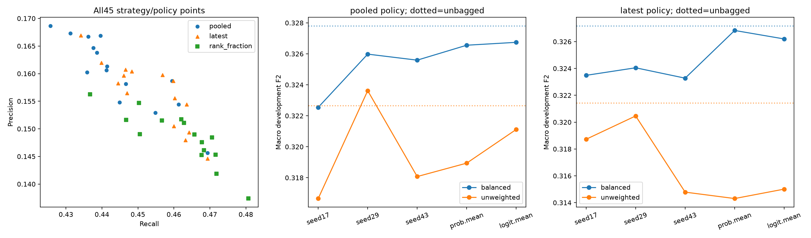

# Bagged LightGBM seed findings

Selected **interaction_blend_spline_c1p0_balanced_a10 / latest**, macro chronological development F2 **0.330793**. Positive measured differences against all five references on both scopes: **False**. Finite experiment completion does not itself establish the broader performance goal.

## Design and actual work

Original 200-round/15-leaf LightGBM preprocessing and tree settings are retained, with uniform row fraction0.8/frequency1 and explicit bagging seeds17/29/43. Balanced and unweighted training each contribute three individual scores, an equal probability mean and an equal clipped-logit mean. The five original references remain fixed. Sampling is without replacement within an iteration; bags are not exactly class-matched. Balanced weights use whole eligible training class counts. Row sampling changes source models; this is not a renamed deterministic blend. Mean logits remain finite margins; probability-like scores are not asserted calibrated.

Development made 18 new full bagged fits, 15 reference reuses and 0 exact reference reproductions. The33 bases and21 derived results give54 physical/45 selectable scores,90 forward rows and342 complete matched contrasts. The nine-fit synthetic gate checked active/inactive sampling, designed-fixture diversity, same-seed repeatability and serialization. The full suite passed 1070 tests, with two current-study tiny cache-format fits per invocation counted separately from the gate and historical test modules. Actual-host predictor-only allocation and preserved source-miniature gates passed.

Models/preprocessing use only earlier months; month5 rules use4, month6 rules use4/5 or latest5. Actual macro positive-class F2 beta2 selects the winner, without a quota or precision floor; AP, pooled F2 and diagnostics do not select alternatives.

## Complete development results

| candidate | policy | f2 | precision | recall | flagged_fraction | average_precision |
| --- | --- | --- | --- | --- | --- | --- |
| interaction_blend_spline_c1p0_balanced_a10 | latest | 0.330793 | 0.158659 | 0.459837 | 0.037598 | 0.189693 |
| interaction_blend_spline_c1p0_balanced_a10 | pooled | 0.330716 | 0.158702 | 0.459493 | 0.037552 | 0.189693 |
| margin_blend_spline_c0p1_unweighted_a25 | latest | 0.329010 | 0.155537 | 0.460249 | 0.038074 | 0.190366 |
| logit_mean_xgb_d4_w1_baseline_balanced_a50 | pooled | 0.328907 | 0.166891 | 0.439609 | 0.034181 | 0.188626 |
| margin_blend_spline_c0p1_unweighted_a25 | pooled | 0.328205 | 0.154440 | 0.461284 | 0.038527 | 0.190366 |
| bagged_unweighted_s43 | rank_fraction | 0.327885 | 0.148442 | 0.470590 | 0.039936 | 0.184906 |
| baseline_balanced | pooled | 0.327802 | 0.166693 | 0.436170 | 0.033753 | 0.183160 |
| logit_mean_xgb_d4_w1_baseline_balanced_a50 | latest | 0.327582 | 0.159761 | 0.456850 | 0.038092 | 0.188626 |
| baseline_balanced | latest | 0.327170 | 0.166913 | 0.434101 | 0.033512 | 0.183160 |
| bagged_balanced_prob_mean | latest | 0.326831 | 0.160427 | 0.448287 | 0.036477 | 0.185577 |
| bagged_balanced_logit_mean | pooled | 0.326742 | 0.164658 | 0.437568 | 0.034318 | 0.185526 |
| bagged_unweighted_logit_mean | rank_fraction | 0.326588 | 0.148989 | 0.465734 | 0.039359 | 0.185907 |
| bagged_balanced_prob_mean | pooled | 0.326556 | 0.163773 | 0.438631 | 0.034582 | 0.185577 |
| bagged_balanced_logit_mean | latest | 0.326200 | 0.160732 | 0.446534 | 0.036315 | 0.185526 |
| bagged_balanced_s29 | pooled | 0.325981 | 0.161325 | 0.441400 | 0.035221 | 0.184499 |
| bagged_balanced_logit_mean | rank_fraction | 0.325935 | 0.151721 | 0.462075 | 0.038658 | 0.185526 |
| bagged_balanced_s17 | rank_fraction | 0.325694 | 0.147591 | 0.467803 | 0.039980 | 0.184784 |
| bagged_balanced_prob_mean | rank_fraction | 0.325609 | 0.151100 | 0.462774 | 0.038884 | 0.185577 |
| bagged_balanced_s43 | pooled | 0.325592 | 0.167277 | 0.431228 | 0.033374 | 0.184458 |
| bagged_unweighted_prob_mean | rank_fraction | 0.325144 | 0.151522 | 0.456702 | 0.037953 | 0.185800 |
| bagged_balanced_s29 | latest | 0.324051 | 0.158235 | 0.444503 | 0.036432 | 0.184499 |
| logit_mean_xgb_d4_w1_baseline_balanced_a50 | rank_fraction | 0.323872 | 0.154697 | 0.450255 | 0.036859 | 0.188626 |
| bagged_unweighted_s29 | pooled | 0.323621 | 0.168641 | 0.425635 | 0.032838 | 0.184988 |
| bagged_balanced_s17 | latest | 0.323488 | 0.161980 | 0.439839 | 0.035769 | 0.184784 |
| bagged_balanced_s43 | latest | 0.323277 | 0.159647 | 0.446056 | 0.037118 | 0.184458 |
| bagged_balanced_s29 | rank_fraction | 0.323080 | 0.146147 | 0.468367 | 0.040676 | 0.184499 |
| margin_blend_spline_c0p1_unweighted_a25 | rank_fraction | 0.323057 | 0.145341 | 0.471623 | 0.041219 | 0.190366 |
| baseline_lgbm | pooled | 0.322654 | 0.145630 | 0.469348 | 0.041789 | 0.182014 |
| bagged_balanced_s17 | pooled | 0.322544 | 0.160642 | 0.441219 | 0.036347 | 0.184784 |
| bagged_unweighted_s17 | rank_fraction | 0.322021 | 0.141860 | 0.471846 | 0.041988 | 0.182286 |
| interaction_blend_spline_c1p0_balanced_a10 | rank_fraction | 0.321916 | 0.145238 | 0.467697 | 0.040846 | 0.189693 |
| baseline_lgbm | latest | 0.321424 | 0.144608 | 0.469348 | 0.042196 | 0.182014 |
| bagged_unweighted_logit_mean | pooled | 0.321115 | 0.158151 | 0.446621 | 0.037781 | 0.185907 |
| bagged_unweighted_s29 | latest | 0.320462 | 0.154420 | 0.463566 | 0.041746 | 0.184988 |
| bagged_unweighted_s29 | rank_fraction | 0.319643 | 0.156255 | 0.436654 | 0.035306 | 0.184988 |
| bagged_balanced_s43 | rank_fraction | 0.319541 | 0.151630 | 0.446740 | 0.037369 | 0.184458 |
| bagged_unweighted_prob_mean | pooled | 0.318942 | 0.160216 | 0.435836 | 0.036158 | 0.185800 |
| baseline_balanced | rank_fraction | 0.318771 | 0.149056 | 0.450543 | 0.038377 | 0.183160 |
| baseline_lgbm | rank_fraction | 0.318729 | 0.137376 | 0.480665 | 0.044290 | 0.182014 |
| bagged_unweighted_s17 | latest | 0.318727 | 0.156477 | 0.446938 | 0.038618 | 0.182286 |
| bagged_unweighted_s43 | pooled | 0.318075 | 0.154800 | 0.444926 | 0.038309 | 0.184906 |
| bagged_unweighted_s17 | pooled | 0.316656 | 0.152926 | 0.454869 | 0.040989 | 0.182286 |
| bagged_unweighted_logit_mean | latest | 0.315010 | 0.149366 | 0.464208 | 0.043578 | 0.185907 |
| bagged_unweighted_s43 | latest | 0.314786 | 0.147940 | 0.463202 | 0.043301 | 0.184906 |
| bagged_unweighted_prob_mean | latest | 0.314308 | 0.150496 | 0.459974 | 0.042787 | 0.185800 |

## Matched effects

All five-reference, own-policy, randomized-versus-unbagged, ensemble-versus-each-member, aggregation and matched-weighting factors retain ties and negative effects. Seed-score diversity has18 rows, decision overlap36 and base clipping33. New training/preprocessing/parameter/resource evidence and original reference numerical evidence accompany every source. These finite seed perturbations do not estimate uncertainty over all training seeds.

| contrast | candidate | policy | reference | reference_policy | f2_difference | recall_difference | precision_difference | flagged_fraction_difference | average_precision_difference |
| --- | --- | --- | --- | --- | --- | --- | --- | --- | --- |
| fixed reference latest_fusion | interaction_blend_spline_c1p0_balanced_a10 | pooled | interaction_blend_spline_c1p0_balanced_a10 | latest | -0.000078 | -0.000345 | 0.000043 | -0.000046 | 0.000000 |
| fixed reference recent_fusion | interaction_blend_spline_c1p0_balanced_a10 | pooled | margin_blend_spline_c0p1_unweighted_a25 | latest | 0.001706 | -0.000756 | 0.003165 | -0.000522 | -0.000673 |
| fixed reference fusion | interaction_blend_spline_c1p0_balanced_a10 | pooled | logit_mean_xgb_d4_w1_baseline_balanced_a50 | pooled | 0.001809 | 0.019884 | -0.008189 | 0.003371 | 0.001067 |
| fixed reference balanced | interaction_blend_spline_c1p0_balanced_a10 | pooled | baseline_balanced | pooled | 0.002914 | 0.023323 | -0.007991 | 0.003800 | 0.006533 |
| fixed reference unweighted | interaction_blend_spline_c1p0_balanced_a10 | pooled | baseline_lgbm | pooled | 0.008062 | -0.009855 | 0.013072 | -0.004237 | 0.007679 |
| fixed reference latest_fusion | interaction_blend_spline_c1p0_balanced_a10 | latest | interaction_blend_spline_c1p0_balanced_a10 | latest | 0.000000 | 0.000000 | 0.000000 | 0.000000 | 0.000000 |
| fixed reference recent_fusion | interaction_blend_spline_c1p0_balanced_a10 | latest | margin_blend_spline_c0p1_unweighted_a25 | latest | 0.001783 | -0.000412 | 0.003122 | -0.000476 | -0.000673 |
| fixed reference fusion | interaction_blend_spline_c1p0_balanced_a10 | latest | logit_mean_xgb_d4_w1_baseline_balanced_a50 | pooled | 0.001887 | 0.020229 | -0.008232 | 0.003417 | 0.001067 |
| fixed reference balanced | interaction_blend_spline_c1p0_balanced_a10 | latest | baseline_balanced | pooled | 0.002992 | 0.023667 | -0.008034 | 0.003846 | 0.006533 |
| fixed reference unweighted | interaction_blend_spline_c1p0_balanced_a10 | latest | baseline_lgbm | pooled | 0.008140 | -0.009510 | 0.013029 | -0.004190 | 0.007679 |
| policy minus own pooled | interaction_blend_spline_c1p0_balanced_a10 | latest | interaction_blend_spline_c1p0_balanced_a10 | pooled | 0.000078 | 0.000345 | -0.000043 | 0.000046 | 0.000000 |
| fixed reference latest_fusion | interaction_blend_spline_c1p0_balanced_a10 | rank_fraction | interaction_blend_spline_c1p0_balanced_a10 | latest | -0.008877 | 0.007859 | -0.013421 | 0.003248 | 0.000000 |
| fixed reference recent_fusion | interaction_blend_spline_c1p0_balanced_a10 | rank_fraction | margin_blend_spline_c0p1_unweighted_a25 | latest | -0.007094 | 0.007448 | -0.010299 | 0.002772 | -0.000673 |
| fixed reference fusion | interaction_blend_spline_c1p0_balanced_a10 | rank_fraction | logit_mean_xgb_d4_w1_baseline_balanced_a50 | pooled | -0.006990 | 0.028088 | -0.021653 | 0.006665 | 0.001067 |
| fixed reference balanced | interaction_blend_spline_c1p0_balanced_a10 | rank_fraction | baseline_balanced | pooled | -0.005885 | 0.031527 | -0.021455 | 0.007094 | 0.006533 |
| fixed reference unweighted | interaction_blend_spline_c1p0_balanced_a10 | rank_fraction | baseline_lgbm | pooled | -0.000737 | -0.001651 | -0.000392 | -0.000942 | 0.007679 |
| policy minus own pooled | interaction_blend_spline_c1p0_balanced_a10 | rank_fraction | interaction_blend_spline_c1p0_balanced_a10 | pooled | -0.008799 | 0.008204 | -0.013464 | 0.003294 | 0.000000 |

## Conditional development uncertainty

| scope | reference | difference | ci_low | ci_high | replicates |
| --- | --- | --- | --- | --- | --- |
| 5 | latest_fusion | 0.000000 | 0.000000 | 0.000000 | 500 |
| 5 | recent_fusion | 0.002693 | -0.002074 | 0.007141 | 500 |
| 5 | fusion | 0.002117 | -0.003197 | 0.006887 | 500 |
| 5 | balanced | 0.003442 | -0.003273 | 0.010204 | 500 |
| 5 | unweighted | 0.003576 | -0.003940 | 0.010777 | 500 |
| 5 | same_strategy | 0.000000 | 0.000000 | 0.000000 | 500 |
| 6 | latest_fusion | 0.000000 | 0.000000 | 0.000000 | 500 |
| 6 | recent_fusion | 0.000874 | -0.002837 | 0.004524 | 500 |
| 6 | fusion | 0.001657 | -0.003068 | 0.007168 | 500 |
| 6 | balanced | 0.002542 | -0.004038 | 0.009650 | 500 |
| 6 | unweighted | 0.012703 | 0.006049 | 0.020528 | 500 |
| 6 | same_strategy | 0.000155 | -0.000429 | 0.001129 | 500 |
| macro | latest_fusion | 0.000000 | 0.000000 | 0.000000 | 500 |
| macro | recent_fusion | 0.001783 | -0.001322 | 0.005006 | 500 |
| macro | fusion | 0.001887 | -0.001847 | 0.006004 | 500 |
| macro | balanced | 0.002992 | -0.001442 | 0.008094 | 500 |
| macro | unweighted | 0.008140 | 0.003097 | 0.013272 | 500 |
| macro | same_strategy | 0.000078 | -0.000215 | 0.000564 | 500 |

## Already-consumed month7

| role | candidate | policy | f2 | precision | recall | flagged_fraction | tp | fp | fn |
| --- | --- | --- | --- | --- | --- | --- | --- | --- | --- |
| selected | interaction_blend_spline_c1p0_balanced_a10 | latest | 0.371534 | 0.194886 | 0.480392 | 0.036347 | 686 | 2834 | 742 |
| latest_fusion | interaction_blend_spline_c1p0_balanced_a10 | latest | 0.371534 | 0.194886 | 0.480392 | 0.036347 | 686 | 2834 | 742 |
| recent_fusion | margin_blend_spline_c0p1_unweighted_a25 | latest | 0.370248 | 0.200839 | 0.469188 | 0.034448 | 670 | 2666 | 758 |
| fusion | logit_mean_xgb_d4_w1_baseline_balanced_a50 | pooled | 0.372694 | 0.192414 | 0.486695 | 0.037297 | 695 | 2917 | 733 |
| balanced | baseline_balanced | pooled | 0.364409 | 0.181747 | 0.486695 | 0.039487 | 695 | 3129 | 733 |
| unweighted | baseline_lgbm | pooled | 0.376884 | 0.168248 | 0.546218 | 0.047871 | 780 | 3856 | 648 |
| same_strategy | interaction_blend_spline_c1p0_balanced_a10 | pooled | 0.374974 | 0.184777 | 0.504902 | 0.040292 | 721 | 3181 | 707 |

Exactly 7 frozen roles transferred using 0 new bagged fits, 5 reference reuses, 0 additive reproductions and 0 tree reproductions. Only their deduplicated frozen DAG was evaluated; losing-grid settings and hindsight cutoff/winner replacement were excluded.

| scope | reference | difference | ci_low | ci_high | replicates |
| --- | --- | --- | --- | --- | --- |
| 7_consumed | latest_fusion | 0.000000 | 0.000000 | 0.000000 | 500 |
| 7_consumed | recent_fusion | 0.001286 | -0.003943 | 0.005301 | 500 |
| 7_consumed | fusion | -0.001160 | -0.004637 | 0.001898 | 500 |
| 7_consumed | balanced | 0.007125 | -0.000200 | 0.013949 | 500 |
| 7_consumed | unweighted | -0.005351 | -0.014823 | 0.003437 | 500 |
| 7_consumed | same_strategy | -0.003440 | -0.009837 | 0.002028 | 500 |

## Limitations and reproduction

All1500 paired fixed-decision draws and quantiles were independently reconstructed using seed1027. Intervals condition on fixed models/policies and exclude training-seed/retraining, selection, repeated adaptive search, temporal/generative uncertainty and multiplicity correction. A positive conditional lower bound is required for clear-gain language on the named scope. The adaptive source choice, three seeds, fraction and aggregation forms are analyst-selected. Month7 was already consumed and cannot provide independent confirmation. Synthetic data and eight monthly periods limit generalization.

All fifteen predecessor identities, separate Newton histories and the stopped attempt remain preserved. README gives pinned environment/data identity, fifteen selection restores and ordered reproduction into an isolated destination. Do not overwrite frozen test/audit/selection/report evidence. Codex assisted with declaration, implementation, execution, independent audits, figures and interpretation using preserved repository interfaces and pinned APIs, including the official [LightGBM parameter definitions](https://lightgbm.readthedocs.io/en/stable/Parameters.html). No public notebook was copied; the group must acknowledge assistance and understand submitted work.

