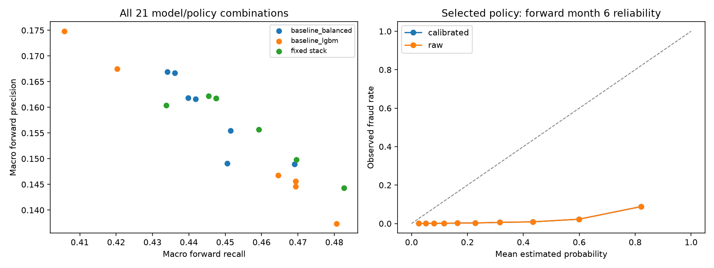

# Calibrated F2 policy findings

The finite policy study is complete. Selected **baseline_balanced / pooled** has actual macro development F2 **0.327802**, versus balanced **0.327802** and unweighted **0.322654**. The best calibrated policy is **baseline_balanced / isotonic_pooled**, F2 **0.327150**. Performance goal achieved by this study: **False**. No 1% quota or precision floor is imposed; beta=2 remains analyst-selected.

## Forward operating comparisons

| candidate | policy | f2 | precision | recall | flagged_fraction | average_precision |
| --- | --- | --- | --- | --- | --- | --- |
| baseline_balanced | pooled | 0.3278 | 0.1667 | 0.4362 | 0.0338 | 0.1832 |
| baseline_balanced | latest | 0.3272 | 0.1669 | 0.4341 | 0.0335 | 0.1832 |
| baseline_balanced | isotonic_pooled | 0.3271 | 0.1616 | 0.4418 | 0.0349 | 0.1832 |
| stack_logit_percentile_c0p01_w1 | pooled | 0.3268 | 0.1618 | 0.4475 | 0.0363 | 0.1894 |
| stack_logit_percentile_c0p01_w1 | isotonic_pooled | 0.3268 | 0.1617 | 0.4475 | 0.0363 | 0.1894 |
| baseline_balanced | isotonic_latest | 0.3265 | 0.1619 | 0.4398 | 0.0347 | 0.1832 |
| stack_logit_percentile_c0p01_w1 | isotonic_latest | 0.3265 | 0.1622 | 0.4454 | 0.0360 | 0.1894 |
| stack_logit_percentile_c0p01_w1 | sigmoid_pooled | 0.3258 | 0.1498 | 0.4695 | 0.0410 | 0.1894 |
| baseline_balanced | sigmoid_pooled | 0.3242 | 0.1555 | 0.4515 | 0.0378 | 0.1832 |
| stack_logit_percentile_c0p01_w1 | latest | 0.3238 | 0.1557 | 0.4592 | 0.0397 | 0.1894 |
| baseline_lgbm | pooled | 0.3227 | 0.1456 | 0.4693 | 0.0418 | 0.1820 |
| baseline_lgbm | isotonic_pooled | 0.3226 | 0.1456 | 0.4693 | 0.0418 | 0.1820 |
| stack_logit_percentile_c0p01_w1 | sigmoid_latest | 0.3226 | 0.1443 | 0.4826 | 0.0447 | 0.1894 |
| baseline_lgbm | isotonic_latest | 0.3224 | 0.1467 | 0.4645 | 0.0409 | 0.1820 |
| baseline_balanced | sigmoid_latest | 0.3221 | 0.1489 | 0.4691 | 0.0422 | 0.1832 |
| stack_logit_percentile_c0p01_w1 | rank_fraction | 0.3221 | 0.1604 | 0.4337 | 0.0342 | 0.1894 |
| baseline_lgbm | latest | 0.3214 | 0.1446 | 0.4693 | 0.0422 | 0.1820 |
| baseline_lgbm | sigmoid_pooled | 0.3188 | 0.1748 | 0.4058 | 0.0301 | 0.1820 |
| baseline_balanced | rank_fraction | 0.3188 | 0.1491 | 0.4505 | 0.0384 | 0.1832 |
| baseline_lgbm | rank_fraction | 0.3187 | 0.1374 | 0.4807 | 0.0443 | 0.1820 |
| baseline_lgbm | sigmoid_latest | 0.3180 | 0.1675 | 0.4202 | 0.0333 | 0.1820 |

All 42 rows on identical month-5/6 cases are in crossfit.csv. Four calibration policies use unweighted sigmoid-logit or isotonic calibration fitted on pooled/latest earlier predictions, alongside three empirical policies. Month 5 calibration uses month 4; month 6 uses 4/5 or 5. Current labels determine neither calibration nor batch flagged count. Scores and all five prior studies retain their frozen recipes. Source reuse is adaptive reuse of development evidence.

The batch surrogate S(k)=5*sum(top-k p)/(4*sum(p)+k) is a ratio of estimated counts, not exact expected F2 or achieved F2. Batch inference sorts calibrated probability, then raw score, then stable ID; the selected k may vary by unlabeled batch. Calibration does not guarantee transfer under temporal drift. reliability.csv and crossfit.csv include ten equal-frequency bins, raw/calibrated Brier/log-loss, estimated positives/TP/surrogate and actual confusion counts. Calibrated policy ranking and actual performance are separate evidence.

## Paired development differences

| scope | reference | difference | ci_low | ci_high | replicates |
| --- | --- | --- | --- | --- | --- |
| 5 | balanced | 0.0000 | 0.0000 | 0.0000 | 500 |
| 5 | unweighted | 0.0001 | -0.0096 | 0.0089 | 500 |
| 5 | same_model | 0.0000 | 0.0000 | 0.0000 | 500 |
| 6 | balanced | 0.0000 | 0.0000 | 0.0000 | 500 |
| 6 | unweighted | 0.0102 | 0.0019 | 0.0186 | 500 |
| 6 | same_model | 0.0000 | 0.0000 | 0.0000 | 500 |
| macro | balanced | 0.0000 | 0.0000 | 0.0000 | 500 |
| macro | unweighted | 0.0051 | -0.0008 | 0.0102 | 500 |
| macro | same_model | 0.0000 | 0.0000 | 0.0000 | 500 |

## Consumed month 7: exploratory transfer

| role | candidate | policy | f2 | precision | recall | flagged_fraction | tp | fp | fn |
| --- | --- | --- | --- | --- | --- | --- | --- | --- | --- |
| selected | baseline_balanced | pooled | 0.3644 | 0.1817 | 0.4867 | 0.0395 | 695 | 3129 | 733 |
| balanced | baseline_balanced | pooled | 0.3644 | 0.1817 | 0.4867 | 0.0395 | 695 | 3129 | 733 |
| unweighted | baseline_lgbm | pooled | 0.3769 | 0.1682 | 0.5462 | 0.0479 | 780 | 3856 | 648 |
| same_model | baseline_balanced | pooled | 0.3644 | 0.1817 | 0.4867 | 0.0395 | 695 | 3129 | 733 |

| scope | reference | difference | ci_low | ci_high | replicates |
| --- | --- | --- | --- | --- | --- |
| 7_consumed | balanced | 0.0000 | 0.0000 | 0.0000 | 500 |
| 7_consumed | unweighted | -0.0125 | -0.0222 | -0.0040 | 500 |
| 7_consumed | same_model | 0.0000 | 0.0000 | 0.0000 | 500 |

Selection and dependencies were frozen before further access. This period was previously consumed and is not independent confirmation. Only the selected policy, both old raw pooled baselines and its same-model pooled comparator are evaluated; no losing calibrated policies or month-7 hindsight optimum are swept. A development gain that fails this transfer is not out-of-time improvement.

## Diagnostic limits and reproduction

Six hindsight.csv rows were generated only after selection freeze. They are label-aware optimistic optima for the fixed deterministic rankings on development months, excluded from selection and calibration. They are not deployable gains or general model ceilings.

Intervals use 500 paired fixed-decision row-bootstrap draws, seed 1027, with within-month draws averaged for development macro F2. Batch choices remain fixed in each draw. Intervals exclude recalibration, retraining, selection, between-month/generative uncertainty and multiplicity correction. An interval overlapping zero does not support a clear-gain claim. All failed policies and contrasts remain visible; AP, Brier or surrogate improvement alone does not satisfy the user's objective.

See config.json, calibration_records.csv, pooled.csv, contrasts.csv, validation_complete.json, transfer_complete.json and audit.json for identities, counts and checked evidence. README documents dependencies, Base access, five-record restoration and missing-cache refits in new destinations. Codex assisted with study design, code, execution, tests, figures and interpretation; no external notebook was copied. These outputs support the eventual course report.

