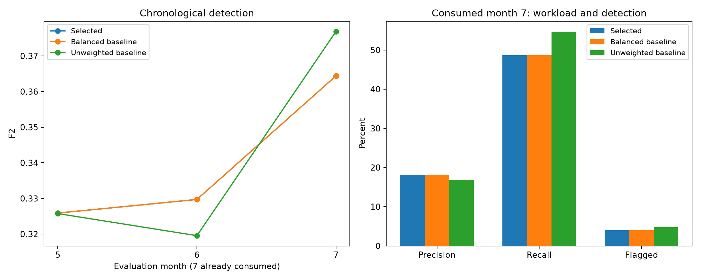

# Chronological score stacking for recall-weighted detection

This adaptive study optimizes positive-class **F2=5TP/(5TP+4FN+FP)** (beta=2), with no imposed review quota or precision floor. It is distinct from support-weighted F1. The finite settings are analyst-selected, not group-approved. Four earlier studies and their negative results remain frozen.

## Measured result

Development selected **baseline_balanced / pooled** at macro month-5/6 F2 **0.3278**, versus balanced LightGBM **0.3278** (difference **+0.0000**). On consumed month 7, selected F2 is **0.3644**, versus balanced **0.3644** and unweighted **0.3769**. The frozen selection does not improve on both consumed-period baseline policies. The requested performance improvement remains unachieved.

| reference | difference | ci_low | ci_high |
| --- | --- | --- | --- |
| balanced | 0.0000 | 0.0000 | 0.0000 |
| unweighted | -0.0125 | -0.0222 | -0.0040 |

These are conditional paired intervals at fixed models and decisions. Intervals overlapping zero preclude clear-gain claims. Repeated development tuning and already-consumed month 7 prevent independent confirmation, even when an interval excludes zero.

## Precision, recall and workload

| candidate | policy | f2 | f1 | f3 | precision | recall | flagged_fraction | tp | fp | fn |
| --- | --- | --- | --- | --- | --- | --- | --- | --- | --- | --- |
| baseline_balanced | pooled | 0.3644 | 0.2647 | 0.4168 | 0.1817 | 0.4867 | 0.0395 | 695 | 3129 | 733 |
| baseline_lgbm | pooled | 0.3769 | 0.2573 | 0.4460 | 0.1682 | 0.5462 | 0.0479 | 780 | 3856 | 648 |

The selected policy catches **695** frauds, misses **733**, flags **3,129** legitimate applications and reviews **3.95%** of applications. Other policies are diagnostics, not replacements selected after seeing month 7. A better F2 need not make these operating costs acceptable.

## Search, chronology and controls

The 27 base development results comprise 12 new fits and 15 verified reuses. Four fixed members use unchanged recipes: balanced LightGBM, native LightGBM, engineered CatBoost and engineered logistic regression. Their 1/2/3 predictions train only on earlier applicant months; 4/5/6 predictions are verified against their frozen sources. Missing caches refit into new directories.

The 24 learned presets cross four-member/single-balanced-member inputs, logit/logit-plus-percentile representations, C 0.001/0.01/0.1 and positive weights 1/5. They generate 72 combiner/control fits. Month-4 combiners train on out-of-time base predictions 1/2/3, month-5 combiners on 1-4 and month-6 combiners on 1-5. Threshold evaluation on month 5 uses out-of-time combiner predictions from 4; month 6 uses 4/5. No scored month's labels enter base fitting, combiner/scaler fitting or operating-rule selection.

Percentile features use only the unlabeled prediction-month score batch, with average ties. This representation requires batch inference and is not a calibrated probability claim. Scalers use only earlier training rows; fixed member/column order and clip bounds are recorded. Single-member controls isolate transformation/decision effects from combination effects.

| candidate | policy | f2 | precision | recall | flagged_fraction |
| --- | --- | --- | --- | --- | --- |
| baseline_balanced | pooled | 0.3278 | 0.1667 | 0.4362 | 0.0338 |
| baseline_balanced | latest | 0.3272 | 0.1669 | 0.4341 | 0.0335 |
| single_logit_percentile_c0p01_w1 | latest | 0.3271 | 0.1606 | 0.4459 | 0.0358 |
| stack_logit_percentile_c0p01_w1 | pooled | 0.3268 | 0.1618 | 0.4475 | 0.0363 |
| stack_logit_percentile_c0p001_w1 | pooled | 0.3268 | 0.1630 | 0.4444 | 0.0357 |
| single_logit_percentile_c0p01_w5 | latest | 0.3266 | 0.1609 | 0.4449 | 0.0358 |
| single_logit_percentile_c0p001_w5 | latest | 0.3266 | 0.1582 | 0.4484 | 0.0364 |
| stack_logit_percentile_c0p01_w5 | pooled | 0.3265 | 0.1596 | 0.4520 | 0.0373 |
| single_logit_c0p001_w5 | latest | 0.3262 | 0.1597 | 0.4463 | 0.0362 |
| stack_logit_percentile_c0p1_w1 | pooled | 0.3260 | 0.1604 | 0.4499 | 0.0370 |
| single_logit_percentile_c0p1_w1 | latest | 0.3260 | 0.1611 | 0.4434 | 0.0357 |
| single_logit_percentile_c0p1_w1 | pooled | 0.3260 | 0.1611 | 0.4434 | 0.0357 |

There are 26 strategies and 156 forward operating comparisons. Both old macro F2 baselines reproduce. Macro monthly F2 determines selection; [pooled_development.csv](pooled_development.csv) reports pooled confusion-count F2 separately.

## Contrasts and uncertainty

[Matched contrasts](matched_contrasts.csv) compare stack versus its single-member control, percentile inputs, positive weighting and regularization under the same policy. [Policy contrasts](policy_contrasts.csv) hold predictions fixed. Negative results remain visible; a gain due to a single-model control is not attributed to stacking. The selected strategy is compared to its matched control when it is a four-member stack.

| eval_month | reference | difference | ci_low | ci_high |
| --- | --- | --- | --- | --- |
| 5 | balanced | 0.0000 | 0.0000 | 0.0000 |
| 5 | unweighted | 0.0001 | -0.0096 | 0.0089 |
| 6 | balanced | 0.0000 | 0.0000 | 0.0000 |
| 6 | unweighted | 0.0102 | 0.0019 | 0.0186 |
| macro | balanced | 0.0000 | 0.0000 | 0.0000 |
| macro | unweighted | 0.0051 | -0.0008 | 0.0102 |

Intervals use 500 paired row-bootstrap draws, seed 1027, with within-month resampling for development macro differences. They condition on realized decisions, including batch/rank decisions, and exclude retraining, selection, between-month/generative uncertainty and multiplicity adjustment. A point gain supports only its named exploratory scope.

## Freeze, verification and reproduction

Final fitting used 0 frozen selected/control combiners trained on out-of-time base predictions 1-6 before further month-7 access. Transfer needed 0 new base fits and 2 verified reuses. Only frozen dependencies and both original baselines were scored. Source/config/software/data, training hashes/class counts, future IDs/labels, score/model hashes, scaler means/column order, earlier-only policy inputs, deterministic selection, freeze-before-access and unchanged selection were audited. Reported metrics were rebuilt from saved predictions and frozen rules.

Use the [README](../../README.md) validate/freeze/exploratory/report sequence, [protocol](../../docs/chronological-stacking-protocol.md), [exact config](config.json), [frozen selection](selection.json) and [audit](audit.json). Small exported freeze records enable fresh-clone prerequisites; ignored caches can be refitted into this study's destination without writing old studies. New tuning requires another study.

One synthetic variant, eight coarse months, only two operating-policy evaluation months, unknown label delays and adaptive reuse limit generalization. Month 7 cannot become a fresh holdout again. Independent confirmation requires new data.

Codex assisted with design, implementation, execution, checks, figures and interpretation. Acknowledge BAF, scikit-learn, LightGBM and CatBoost in the eventual course report. This is a supporting experiment export, not the final 8-12 page submission.
