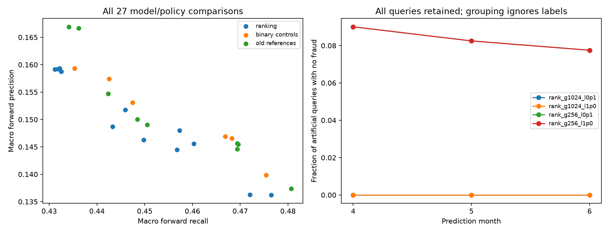

# Direct fraud-ranking study findings

Selected **baseline_balanced / pooled** scores actual macro chronological F2 **0.327802**, against balanced **0.327802** and unweighted **0.322654**. Best ranker: **rank_g256_l1p0 / rank_fraction**, F2 **0.321311**. Positive measured gain against both old references on development and consumed transfer: **False**. Search completion alone does not establish the performance objective.

## Design and integration

Six new presets produce 18 full development fits; three old references provide nine results. Four miniature integration fits are counted separately and verify deterministic repeats and zero initialization. Models fit only earlier months. Native categorical levels are training-fitted; numeric NaNs remain missing. The four rank_xendcg presets cross artificial query size 256/1024 with lambda 0.1/1; two matched binary-logistic controls use the same ordered rows and lambda values. Training weights and effective regularization are not bank costs. Beta remains 2 without a fixed quota or precision floor; settings are analyst-selected.

Queries use month/IDs/seed only, keep every row once and retain all-negative groups. Single-row tails merge with the previous group without using labels; month boundaries remain intact. queries.csv and group_summary.csv reconstruct from training identities, with class counts added after grouping. These artificial queries are optimization devices, not real bank sessions or review batches. group_summary.csv marks controls' descriptive group metadata as unused by their objective. Query size and loss scale interact with regularization, so matched differences do not isolate a universal ranking effect.

Saved models reproduce raw finite predictions. Thresholds and AP/ROC use raw scores directly, including negative values; no sigmoid/clipping or fraud-probability claim is made. Old references retain original score scales, and policies fit within each candidate. No cross-model score average, Brier or log loss is reported. NDCG training motivation and higher AP do not substitute for actual F2.

## Forward actual performance

| candidate | policy | f2 | precision | recall | flagged_fraction | average_precision |
| --- | --- | --- | --- | --- | --- | --- |
| baseline_balanced | pooled | 0.3278 | 0.1667 | 0.4362 | 0.0338 | 0.1832 |
| baseline_balanced | latest | 0.3272 | 0.1669 | 0.4341 | 0.0335 | 0.1832 |
| binary_l1p0 | rank_fraction | 0.3232 | 0.1531 | 0.4475 | 0.0369 | 0.1832 |
| baseline_lgbm | pooled | 0.3227 | 0.1456 | 0.4693 | 0.0418 | 0.1820 |
| binary_l0p1 | pooled | 0.3221 | 0.1469 | 0.4668 | 0.0416 | 0.1839 |
| binary_l0p1 | latest | 0.3220 | 0.1465 | 0.4682 | 0.0419 | 0.1839 |
| baseline_lgbm | latest | 0.3214 | 0.1446 | 0.4693 | 0.0422 | 0.1820 |
| rank_g256_l1p0 | rank_fraction | 0.3213 | 0.1456 | 0.4603 | 0.0399 | 0.1782 |
| binary_l0p1 | rank_fraction | 0.3198 | 0.1398 | 0.4754 | 0.0430 | 0.1839 |
| rank_g1024_l1p0 | pooled | 0.3197 | 0.1517 | 0.4459 | 0.0378 | 0.1782 |
| native31 | rank_fraction | 0.3195 | 0.1500 | 0.4485 | 0.0377 | 0.1842 |
| rank_g1024_l1p0 | latest | 0.3195 | 0.1480 | 0.4573 | 0.0403 | 0.1782 |
| native31 | pooled | 0.3191 | 0.1547 | 0.4424 | 0.0375 | 0.1842 |
| rank_g256_l0p1 | rank_fraction | 0.3189 | 0.1445 | 0.4568 | 0.0399 | 0.1782 |
| baseline_balanced | rank_fraction | 0.3188 | 0.1491 | 0.4505 | 0.0384 | 0.1832 |
| baseline_lgbm | rank_fraction | 0.3187 | 0.1374 | 0.4807 | 0.0443 | 0.1820 |
| rank_g1024_l1p0 | rank_fraction | 0.3161 | 0.1362 | 0.4765 | 0.0443 | 0.1782 |
| native31 | latest | 0.3161 | 0.1454 | 0.4696 | 0.0443 | 0.1842 |
| rank_g1024_l0p1 | rank_fraction | 0.3160 | 0.1363 | 0.4720 | 0.0436 | 0.1781 |
| rank_g256_l1p0 | pooled | 0.3155 | 0.1593 | 0.4322 | 0.0363 | 0.1782 |
| binary_l1p0 | pooled | 0.3150 | 0.1593 | 0.4353 | 0.0372 | 0.1832 |
| binary_l1p0 | latest | 0.3150 | 0.1574 | 0.4426 | 0.0387 | 0.1832 |
| rank_g256_l1p0 | latest | 0.3149 | 0.1587 | 0.4325 | 0.0365 | 0.1782 |
| rank_g256_l0p1 | pooled | 0.3141 | 0.1592 | 0.4319 | 0.0367 | 0.1782 |
| rank_g256_l0p1 | latest | 0.3138 | 0.1592 | 0.4312 | 0.0367 | 0.1782 |
| rank_g1024_l0p1 | pooled | 0.3130 | 0.1487 | 0.4432 | 0.0394 | 0.1781 |
| rank_g1024_l0p1 | latest | 0.3121 | 0.1463 | 0.4498 | 0.0411 | 0.1781 |

All 54 monthly operating rows, 27 macro summaries, pooled confusion-count summaries and unsuccessful contrasts remain visible. Policy fitting uses only earlier out-of-time predictions; all decisions and confusion/F2 values reconstruct independently. Development evidence has been adaptively reused across seven earlier studies.

## Matched comparisons

| contrast | candidate | policy | reference | f2_difference | recall_difference | flagged_fraction_difference |
| --- | --- | --- | --- | --- | --- | --- |
| rank minus binary | rank_g256_l0p1 | pooled | binary_l0p1 | -0.0079 | -0.0350 | -0.0049 |
| rank minus binary | rank_g256_l0p1 | latest | binary_l0p1 | -0.0082 | -0.0371 | -0.0052 |
| rank minus binary | rank_g256_l0p1 | rank_fraction | binary_l0p1 | -0.0009 | -0.0186 | -0.0030 |
| rank minus binary | rank_g256_l1p0 | pooled | binary_l1p0 | 0.0004 | -0.0031 | -0.0009 |
| lambda 1 minus 0.1 | rank_g256_l1p0 | pooled | rank_g256_l0p1 | 0.0013 | 0.0003 | -0.0004 |
| rank minus binary | rank_g256_l1p0 | latest | binary_l1p0 | -0.0001 | -0.0100 | -0.0022 |
| lambda 1 minus 0.1 | rank_g256_l1p0 | latest | rank_g256_l0p1 | 0.0010 | 0.0014 | -0.0001 |
| rank minus binary | rank_g256_l1p0 | rank_fraction | binary_l1p0 | -0.0018 | 0.0128 | 0.0030 |
| lambda 1 minus 0.1 | rank_g256_l1p0 | rank_fraction | rank_g256_l0p1 | 0.0025 | 0.0035 | -0.0001 |
| rank minus binary | rank_g1024_l0p1 | pooled | binary_l0p1 | -0.0091 | -0.0236 | -0.0022 |
| group 1024 minus 256 | rank_g1024_l0p1 | pooled | rank_g256_l0p1 | -0.0012 | 0.0114 | 0.0027 |
| rank minus binary | rank_g1024_l0p1 | latest | binary_l0p1 | -0.0100 | -0.0184 | -0.0008 |
| group 1024 minus 256 | rank_g1024_l0p1 | latest | rank_g256_l0p1 | -0.0018 | 0.0186 | 0.0044 |
| rank minus binary | rank_g1024_l0p1 | rank_fraction | binary_l0p1 | -0.0038 | -0.0034 | 0.0007 |
| group 1024 minus 256 | rank_g1024_l0p1 | rank_fraction | rank_g256_l0p1 | -0.0029 | 0.0153 | 0.0037 |
| rank minus binary | rank_g1024_l1p0 | pooled | binary_l1p0 | 0.0046 | 0.0106 | 0.0006 |
| group 1024 minus 256 | rank_g1024_l1p0 | pooled | rank_g256_l1p0 | 0.0042 | 0.0137 | 0.0016 |
| lambda 1 minus 0.1 | rank_g1024_l1p0 | pooled | rank_g1024_l0p1 | 0.0067 | 0.0027 | -0.0016 |
| rank minus binary | rank_g1024_l1p0 | latest | binary_l1p0 | 0.0045 | 0.0148 | 0.0015 |
| group 1024 minus 256 | rank_g1024_l1p0 | latest | rank_g256_l1p0 | 0.0046 | 0.0248 | 0.0037 |
| lambda 1 minus 0.1 | rank_g1024_l1p0 | latest | rank_g1024_l0p1 | 0.0074 | 0.0075 | -0.0008 |
| rank minus binary | rank_g1024_l1p0 | rank_fraction | binary_l1p0 | -0.0071 | 0.0290 | 0.0074 |
| group 1024 minus 256 | rank_g1024_l1p0 | rank_fraction | rank_g256_l1p0 | -0.0052 | 0.0162 | 0.0044 |
| lambda 1 minus 0.1 | rank_g1024_l1p0 | rank_fraction | rank_g1024_l0p1 | 0.0001 | 0.0044 | 0.0006 |
| lambda 1 minus 0.1 | binary_l1p0 | pooled | binary_l0p1 | -0.0070 | -0.0315 | -0.0044 |
| lambda 1 minus 0.1 | binary_l1p0 | latest | binary_l0p1 | -0.0070 | -0.0257 | -0.0032 |
| lambda 1 minus 0.1 | binary_l1p0 | rank_fraction | binary_l0p1 | 0.0034 | -0.0279 | -0.0061 |

## Paired conditional development differences

| scope | reference | difference | ci_low | ci_high | replicates |
| --- | --- | --- | --- | --- | --- |
| 5 | balanced | 0.0000 | 0.0000 | 0.0000 | 500 |
| 5 | unweighted | 0.0001 | -0.0096 | 0.0089 | 500 |
| 5 | same_model | 0.0000 | 0.0000 | 0.0000 | 500 |
| 6 | balanced | 0.0000 | 0.0000 | 0.0000 | 500 |
| 6 | unweighted | 0.0102 | 0.0019 | 0.0186 | 500 |
| 6 | same_model | 0.0000 | 0.0000 | 0.0000 | 500 |
| macro | balanced | 0.0000 | 0.0000 | 0.0000 | 500 |
| macro | unweighted | 0.0051 | -0.0008 | 0.0102 | 500 |
| macro | same_model | 0.0000 | 0.0000 | 0.0000 | 500 |

## Already-consumed month 7: exploratory transfer

| role | candidate | policy | f2 | precision | recall | flagged_fraction | tp | fp | fn |
| --- | --- | --- | --- | --- | --- | --- | --- | --- | --- |
| selected | baseline_balanced | pooled | 0.3644 | 0.1817 | 0.4867 | 0.0395 | 695 | 3129 | 733 |
| balanced | baseline_balanced | pooled | 0.3644 | 0.1817 | 0.4867 | 0.0395 | 695 | 3129 | 733 |
| unweighted | baseline_lgbm | pooled | 0.3769 | 0.1682 | 0.5462 | 0.0479 | 780 | 3856 | 648 |
| same_model | baseline_balanced | pooled | 0.3644 | 0.1817 | 0.4867 | 0.0395 | 695 | 3129 | 733 |

| scope | reference | difference | ci_low | ci_high | replicates |
| --- | --- | --- | --- | --- | --- |
| 7_consumed | balanced | 0.0000 | 0.0000 | 0.0000 | 500 |
| 7_consumed | unweighted | -0.0125 | -0.0222 | -0.0040 | 500 |
| 7_consumed | same_model | 0.0000 | 0.0000 | 0.0000 | 500 |

Selection preceded further access and all hashes agree. Only frozen selected/matched controls, same-model pooled and both old pooled references were evaluated. No losing-preset sweep, hindsight threshold optimum or month-7 retuning occurred. A development gain that fails transfer is not out-of-time improvement. This consumed period cannot provide fresh independent confirmation.

## Uncertainty, preservation and reproduction

Intervals use 500 paired fixed-decision row draws, seed1027. Development resamples each month separately and averages F2 differences. Models, selection and decisions remain fixed; intervals exclude adaptive selection, retraining, temporal/generative uncertainty and multiplicity correction. Zero overlap precludes clear/confirmed gain claims; statistical significance is not silently added as a requirement for a positive measured difference. All seven old source/config/software/selection identities remain preserved. Exact provenance, group/model identities, config, freeze/access records and audit are exported. README gives pinned dependencies, verified Base access, seven-record restoration and missing-cache reproduction in new destinations. Codex assisted with design, code, execution, methodological checks, figures and interpretation. The official LightGBM ranker documentation and Bruch ranking paper inform the method; no public notebook was copied, and retrieval benchmark gains are not BAF evidence.

