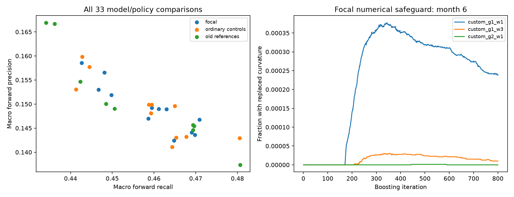

# Focal-loss study findings

Selected **baseline_balanced / pooled** has actual macro development F2 **0.327802**, versus balanced **0.327802** and unweighted **0.322654**. Best focal policy: **custom_g2_w1 / rank_fraction**, F2 **0.323007**. Goal achieved by this study: **False**. Completing this search alone is not achieving the performance objective.

## Design and numerical checks

Eight matched new presets make 24 development fits; three frozen references supply nine prediction results. Four miniature integration fits are separate checks. The gamma=0 custom/built-in probability gate passes at the declared 1e-6 tolerance. Native feature handling, tree settings, positive weights and zero initialization are matched across new loss presets. Every model uses earlier training months; policy evaluation on months 5/6 uses earlier out-of-time predictions only. The user objective remains positive-class F2 beta=2, with no review quota or precision floor. All settings are analyst-selected, not approved bank cost ratios.

The custom objective consumes raw margins. Saved boosters predict raw margins and apply expit exactly once; all predictions and actual confusion/F2 metrics reconstruct. Focal Hessians below 1e-6 are replaced while gradients remain unchanged: this is approximate positive-curvature boosting, not exact Newton optimization. Gamma=0 uses its actual logistic curvature. numeric_traces.csv/numeric_summary.csv retain safeguard use and training losses. A changed loss also changes gradient/Hessian scale and regularization interaction; comparisons cannot attribute effects solely to hard-example emphasis. Focal scores are not claimed calibrated; Brier/log-loss are descriptive. Ordinary score discrepancies from full fits are exported rather than assuming bitwise equivalence after hundreds of rounds.

## Forward actual performance

| candidate | policy | f2 | precision | recall | flagged_fraction | average_precision |
| --- | --- | --- | --- | --- | --- | --- |
| baseline_balanced | pooled | 0.3278 | 0.1667 | 0.4362 | 0.0338 | 0.1832 |
| baseline_balanced | latest | 0.3272 | 0.1669 | 0.4341 | 0.0335 | 0.1832 |
| builtin_w3 | pooled | 0.3238 | 0.1496 | 0.4650 | 0.0406 | 0.1852 |
| custom_g2_w1 | rank_fraction | 0.3230 | 0.1436 | 0.4698 | 0.0412 | 0.1857 |
| baseline_lgbm | pooled | 0.3227 | 0.1456 | 0.4693 | 0.0418 | 0.1820 |
| custom_g1_w3 | pooled | 0.3224 | 0.1585 | 0.4426 | 0.0366 | 0.1854 |
| custom_g2_w3 | rank_fraction | 0.3222 | 0.1519 | 0.4498 | 0.0373 | 0.1847 |
| builtin_w1 | rank_fraction | 0.3218 | 0.1432 | 0.4677 | 0.0411 | 0.1839 |
| baseline_lgbm | latest | 0.3214 | 0.1446 | 0.4693 | 0.0422 | 0.1820 |
| custom_g2_w3 | pooled | 0.3213 | 0.1565 | 0.4481 | 0.0381 | 0.1847 |
| custom_g0_w3 | pooled | 0.3213 | 0.1599 | 0.4428 | 0.0369 | 0.1838 |
| custom_g1_w3 | rank_fraction | 0.3210 | 0.1530 | 0.4467 | 0.0370 | 0.1854 |
| custom_g0_w3 | rank_fraction | 0.3200 | 0.1530 | 0.4413 | 0.0363 | 0.1838 |
| builtin_w3 | latest | 0.3198 | 0.1429 | 0.4805 | 0.0453 | 0.1852 |
| native31 | rank_fraction | 0.3195 | 0.1500 | 0.4485 | 0.0377 | 0.1842 |
| custom_g0_w3 | latest | 0.3194 | 0.1577 | 0.4445 | 0.0379 | 0.1838 |
| native31 | pooled | 0.3191 | 0.1547 | 0.4424 | 0.0375 | 0.1842 |
| custom_g1_w1 | rank_fraction | 0.3191 | 0.1424 | 0.4648 | 0.0412 | 0.1856 |
| builtin_w3 | rank_fraction | 0.3190 | 0.1430 | 0.4653 | 0.0411 | 0.1852 |
| custom_g0_w1 | latest | 0.3188 | 0.1481 | 0.4593 | 0.0410 | 0.1839 |
| custom_g0_w1 | pooled | 0.3188 | 0.1481 | 0.4593 | 0.0410 | 0.1839 |
| baseline_balanced | rank_fraction | 0.3188 | 0.1491 | 0.4505 | 0.0384 | 0.1832 |
| baseline_lgbm | rank_fraction | 0.3187 | 0.1374 | 0.4807 | 0.0443 | 0.1820 |
| custom_g1_w1 | pooled | 0.3180 | 0.1470 | 0.4587 | 0.0411 | 0.1856 |
| custom_g0_w1 | rank_fraction | 0.3180 | 0.1411 | 0.4643 | 0.0415 | 0.1839 |
| builtin_w1 | pooled | 0.3176 | 0.1499 | 0.4594 | 0.0414 | 0.1839 |
| custom_g1_w1 | latest | 0.3175 | 0.1441 | 0.4690 | 0.0435 | 0.1856 |
| builtin_w1 | latest | 0.3174 | 0.1499 | 0.4588 | 0.0414 | 0.1839 |
| custom_g1_w3 | latest | 0.3173 | 0.1489 | 0.4630 | 0.0425 | 0.1854 |
| native31 | latest | 0.3161 | 0.1454 | 0.4696 | 0.0443 | 0.1842 |
| custom_g2_w1 | latest | 0.3160 | 0.1490 | 0.4612 | 0.0425 | 0.1857 |
| custom_g2_w1 | pooled | 0.3158 | 0.1492 | 0.4594 | 0.0422 | 0.1857 |
| custom_g2_w3 | latest | 0.3152 | 0.1467 | 0.4709 | 0.0450 | 0.1847 |

All 66 forward rows, 33 pooled summaries and all unsuccessful contrasts remain visible. AP and training loss do not replace F2. The three empirical policies retain their original ties and fraction rounding. Development evidence has been adaptively reused across six previous studies.

## Matched loss comparisons

| contrast | candidate | policy | reference | f2_difference | recall_difference | flagged_fraction_difference |
| --- | --- | --- | --- | --- | --- | --- |
| custom minus built-in logistic | custom_g0_w1 | pooled | builtin_w1 | 0.0011 | -0.0001 | -0.0004 |
| custom minus built-in logistic | custom_g0_w1 | latest | builtin_w1 | 0.0014 | 0.0005 | -0.0004 |
| custom minus built-in logistic | custom_g0_w1 | rank_fraction | builtin_w1 | -0.0039 | -0.0034 | 0.0003 |
| custom minus built-in logistic | custom_g0_w3 | pooled | builtin_w3 | -0.0025 | -0.0222 | -0.0037 |
| custom minus built-in logistic | custom_g0_w3 | latest | builtin_w3 | -0.0005 | -0.0360 | -0.0074 |
| custom minus built-in logistic | custom_g0_w3 | rank_fraction | builtin_w3 | 0.0010 | -0.0240 | -0.0048 |
| focal minus custom logistic | custom_g1_w1 | pooled | custom_g0_w1 | -0.0008 | -0.0006 | 0.0001 |
| focal minus custom logistic | custom_g1_w1 | latest | custom_g0_w1 | -0.0013 | 0.0097 | 0.0025 |
| focal minus custom logistic | custom_g1_w1 | rank_fraction | custom_g0_w1 | 0.0011 | 0.0004 | -0.0003 |
| focal minus custom logistic | custom_g1_w3 | pooled | custom_g0_w3 | 0.0011 | -0.0001 | -0.0004 |
| focal minus custom logistic | custom_g1_w3 | latest | custom_g0_w3 | -0.0021 | 0.0185 | 0.0046 |
| focal minus custom logistic | custom_g1_w3 | rank_fraction | custom_g0_w3 | 0.0010 | 0.0054 | 0.0006 |
| focal minus custom logistic | custom_g2_w1 | pooled | custom_g0_w1 | -0.0030 | 0.0001 | 0.0012 |
| focal minus custom logistic | custom_g2_w1 | latest | custom_g0_w1 | -0.0028 | 0.0019 | 0.0015 |
| focal minus custom logistic | custom_g2_w1 | rank_fraction | custom_g0_w1 | 0.0050 | 0.0054 | -0.0003 |
| focal minus custom logistic | custom_g2_w3 | pooled | custom_g0_w3 | 0.0000 | 0.0053 | 0.0011 |
| focal minus custom logistic | custom_g2_w3 | latest | custom_g0_w3 | -0.0042 | 0.0264 | 0.0071 |
| focal minus custom logistic | custom_g2_w3 | rank_fraction | custom_g0_w3 | 0.0022 | 0.0085 | 0.0010 |

## Paired conditional development differences

| scope | reference | difference | ci_low | ci_high | replicates |
| --- | --- | --- | --- | --- | --- |
| 5 | balanced | 0.0000 | 0.0000 | 0.0000 | 500 |
| 5 | unweighted | 0.0001 | -0.0096 | 0.0089 | 500 |
| 5 | same_model | 0.0000 | 0.0000 | 0.0000 | 500 |
| 6 | balanced | 0.0000 | 0.0000 | 0.0000 | 500 |
| 6 | unweighted | 0.0102 | 0.0019 | 0.0186 | 500 |
| 6 | same_model | 0.0000 | 0.0000 | 0.0000 | 500 |
| macro | balanced | 0.0000 | 0.0000 | 0.0000 | 500 |
| macro | unweighted | 0.0051 | -0.0008 | 0.0102 | 500 |
| macro | same_model | 0.0000 | 0.0000 | 0.0000 | 500 |

## Already-consumed month 7: exploratory transfer

| role | candidate | policy | f2 | precision | recall | flagged_fraction | tp | fp | fn |
| --- | --- | --- | --- | --- | --- | --- | --- | --- | --- |
| selected | baseline_balanced | pooled | 0.3644 | 0.1817 | 0.4867 | 0.0395 | 695 | 3129 | 733 |
| balanced | baseline_balanced | pooled | 0.3644 | 0.1817 | 0.4867 | 0.0395 | 695 | 3129 | 733 |
| unweighted | baseline_lgbm | pooled | 0.3769 | 0.1682 | 0.5462 | 0.0479 | 780 | 3856 | 648 |
| same_model | baseline_balanced | pooled | 0.3644 | 0.1817 | 0.4867 | 0.0395 | 695 | 3129 | 733 |

| scope | reference | difference | ci_low | ci_high | replicates |
| --- | --- | --- | --- | --- | --- |
| 7_consumed | balanced | 0.0000 | 0.0000 | 0.0000 | 500 |
| 7_consumed | unweighted | -0.0125 | -0.0222 | -0.0040 | 500 |
| 7_consumed | same_model | 0.0000 | 0.0000 | 0.0000 | 500 |

Freeze and access hashes agree, with selection before further access. Only selected/required matched controls, same-model pooled policy and both old pooled baselines are evaluated. Losing focal settings are not swept; no month-7 hindsight optimum or threshold retuning is performed. A development gain failing this transfer is not out-of-time improvement. This consumed period cannot supply independent confirmation.

## Uncertainty, preservation and reproduction

Intervals use 500 paired fixed-decision row draws, seed 1027; development resamples within each month and averages differences for macro F2. Models and decisions remain fixed, with no reselection or refitting. Intervals exclude model-selection, retraining, temporal/generative uncertainty and multiplicity correction. An interval overlapping zero does not establish a clear gain. Six earlier frozen studies remain unchanged. The exact config, integration gate, run provenance, selection/access records and audit accompany these findings; README describes pinned dependencies, Base access, six-record restoration and new-destination missing-cache reproduction. Codex assisted with design, code, execution, numerical/methodological verification, plots and interpretation; no public notebook was copied.

