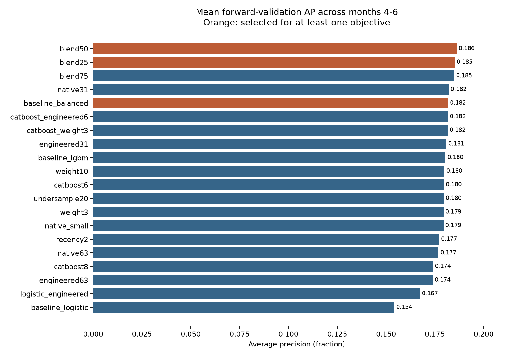
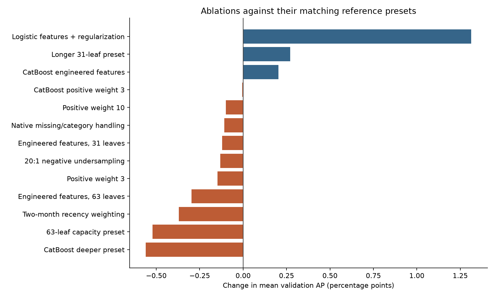
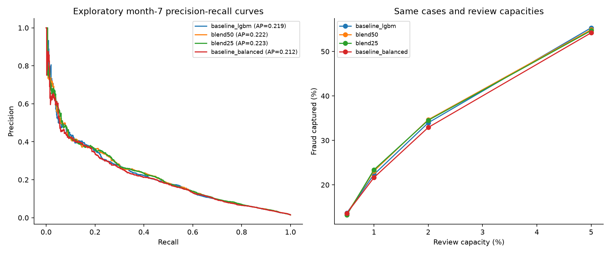
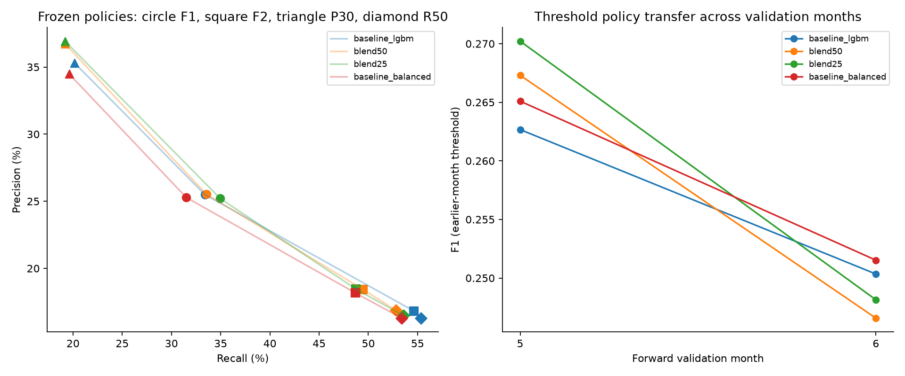

# BAF: exploratory strategies, feature engineering and operating metrics

Report generated on 11 October 2026. Codex assisted with design, implementation, execution and interpretation. Group review is required before submission.

## Main findings

For logistic regression, the engineered/regularized preset improves mean forward AP from **0.1542** to **0.1674**, mean precision at 1% review from **24.14%** to **25.55%**, and mean recall from **19.84%** to **21.00%** across months 4-6. Cross-fitted F1 across months 5/6 changes from **0.2295** to **0.2415**. The fixed-C diagnostic below separates the feature effect from regularization.

The validation-selected AP candidate **blend50** has month-7 AP **0.2225**, versus **0.2186** for unchanged unweighted LightGBM.

The validation-selected capacity candidate **blend25** captures **23.39%** of fraud at 1% review, versus **22.34%** (+1.05 pp). Precision is **34.47%**, versus **32.92%**. Both are reviewed at the same quota, so any capture gain improves both precision and recall at that quota.

The cross-fitted validation F1 candidate **blend25** achieves month-7 F1 **0.2929**, versus **0.2892** for the baseline under its own development-selected F1 policy (+0.0037). Its precision/recall are **25.21% / 34.94%**; baseline precision/recall are **25.49% / 33.40%**.

The recall-focused validation F2 candidate **baseline_balanced** achieves month-7 F2 **0.3644**, precision **18.17%** and recall **48.67%**, flagging **3.95%** of applications. The baseline's own F2 policy scores **0.3769** and flags **4.79%**. This policy has a different review load from the 1% capacity comparison.

1 selected-candidate metric interval lies above zero under this conditional bootstrap; see the full table for which comparisons. This is descriptive uncertainty, not fresh confirmation or a search-adjusted significance test.

**Evidence status:** Month 7 was already evaluated in study v1. These new comparisons are exploratory even though their new selections and thresholds were frozen before this run's month-7 scoring. Search over development folds, a single synthetic variant and one consumed future month prevent a confirmatory generalization claim.

## What was tested

Seventeen presets produced 51 forward fits (months 4/5/6). Three blends contributed nine additional comparisons. The search includes model capacity, native categorical handling, 36 row-local engineered features, moderate positive weights, recency weighting, random undersampling with prior correction, logistic transformations and CatBoost. Original baselines were rerun and their metrics match study v1. Read the [protocol](../../docs/improvement-protocol.md) and [exact configuration](../../configs/improvements.json).

Metric tables use fractions (0.30 means 30%) unless marked pp. AP is non-interpolated average precision. F1 balances precision/recall; F2 emphasizes recall. MCC and balanced accuracy add class-aware context. Fixed review capacity gives a separate operating constraint. Accuracy and ROC AUC alone can obscure poor minority-class detection. Brier scores are descriptive, especially for weighted models whose outputs are not calibrated probabilities.

| objective | candidate |
|---|---|
| average_precision | blend50 |
| recall_at_1pct | blend25 |
| crossfit_f1 | blend25 |
| crossfit_f2 | baseline_balanced |

## Forward validation and strategy ablations

Rank metrics average the three forward months equally. Cross-fitted F1/F2 use month 5 thresholds learned from month 4, and month 6 thresholds learned from months 4/5; neither threshold is selected on its evaluation month's labels. Final policy thresholds pool development predictions only. Choosing model presets and blend members with these same development folds can still be optimistic.

Recency weights can also change effective class composition, so their contrast evaluates the practical strategy rather than a pure recency mechanism. Fit times are measured elapsed times under the current host load/power state; they are descriptive and not a controlled speed benchmark.

Blends average raw prediction scores. A weighted member can have a different score scale from an unweighted member, so the nominal blend weights do not imply calibrated fraud probabilities.

A blend's recorded fit_seconds is zero because it adds no new base-model fit; training it from scratch still requires both member models. Their fit times are shown separately, and shared members are reused across blend weights.

| candidate | average_precision | roc_auc | brier | recall_at_1pct | precision_at_1pct | fit_seconds | crossfit_f1 | crossfit_f2 |
|---|---|---|---|---|---|---|---|---|
| blend50 | 0.1862 | 0.9018 | 0.0109 | 0.2242 | 0.2723 | 0.0000 | 0.2569 | 0.3243 |
| blend25 | 0.1851 | 0.9014 | 0.0109 | 0.2242 | 0.2724 | 0.0000 | 0.2592 | 0.3173 |
| blend75 | 0.1849 | 0.9014 | 0.0109 | 0.2216 | 0.2693 | 0.0000 | 0.2551 | 0.3169 |
| native31 | 0.1821 | 0.8998 | 0.0109 | 0.2205 | 0.2680 | 14.9255 | 0.2545 | 0.3191 |
| baseline_balanced | 0.1818 | 0.8996 | 0.1277 | 0.2212 | 0.2685 | 5.7409 | 0.2583 | 0.3278 |
| catboost_engineered6 | 0.1817 | 0.9001 | 0.0109 | 0.2184 | 0.2653 | 114.3548 | 0.2547 | 0.3179 |
| catboost_weight3 | 0.1816 | 0.9000 | 0.0119 | 0.2193 | 0.2667 | 112.9603 | 0.2572 | 0.3123 |
| engineered31 | 0.1809 | 0.8995 | 0.0109 | 0.2193 | 0.2666 | 22.8915 | 0.2567 | 0.3181 |
| baseline_lgbm | 0.1805 | 0.8991 | 0.0109 | 0.2198 | 0.2670 | 5.4734 | 0.2565 | 0.3227 |
| weight10 | 0.1799 | 0.8982 | 0.0204 | 0.2146 | 0.2613 | 45.6149 | 0.2442 | 0.3153 |
| catboost6 | 0.1796 | 0.8960 | 0.0109 | 0.2227 | 0.2707 | 183.8733 | 0.2519 | 0.3086 |
| undersample20 | 0.1796 | 0.8993 | 0.0109 | 0.2151 | 0.2616 | 19.0255 | 0.2544 | 0.3169 |
| weight3 | 0.1794 | 0.8992 | 0.0120 | 0.2163 | 0.2632 | 36.9209 | 0.2547 | 0.3170 |
| native_small | 0.1794 | 0.8995 | 0.0109 | 0.2194 | 0.2665 | 3.8229 | 0.2585 | 0.3203 |
| recency2 | 0.1772 | 0.8979 | 0.0110 | 0.2176 | 0.2650 | 65.5954 | 0.2489 | 0.3131 |
| native63 | 0.1769 | 0.8980 | 0.0109 | 0.2160 | 0.2624 | 24.8101 | 0.2539 | 0.3166 |
| catboost8 | 0.1740 | 0.8952 | 0.0110 | 0.2141 | 0.2600 | 78.2939 | 0.2429 | 0.3102 |
| engineered63 | 0.1739 | 0.8972 | 0.0110 | 0.2165 | 0.2633 | 36.9758 | 0.2507 | 0.3181 |
| logistic_engineered | 0.1674 | 0.8911 | 0.0110 | 0.2100 | 0.2555 | 23.0044 | 0.2415 | 0.3019 |
| baseline_logistic | 0.1542 | 0.8877 | 0.0111 | 0.1984 | 0.2414 | 2.7407 | 0.2295 | 0.3036 |

The largest positive mean-AP ablation is **Logistic features + regularization** (+1.31 pp); the lowest is **CatBoost deeper preset** (-0.56 pp). These are matched preset contrasts, not claims that every feature or method helps. Native-small changes both missingness handling and categorical encoding; logistic engineering also changes regularization. Model-capacity presets change several hyperparameters together.

| strategy | candidate | reference | ap_difference | recall_1pct_difference | crossfit_f1_difference | months_ap_better | min_month_ap_difference | max_month_ap_difference |
|---|---|---|---|---|---|---|---|---|
| Native missing/category handling | native_small | baseline_lgbm | -0.0011 | -0.0005 | 0.0020 | 1 | -0.0035 | 0.0015 |
| Longer 31-leaf preset | native31 | native_small | 0.0027 | 0.0011 | -0.0039 | 2 | -0.0002 | 0.0067 |
| 63-leaf capacity preset | native63 | native31 | -0.0052 | -0.0045 | -0.0006 | 0 | -0.0061 | -0.0043 |
| Engineered features, 31 leaves | engineered31 | native31 | -0.0012 | -0.0012 | 0.0021 | 0 | -0.0023 | -0.0002 |
| Engineered features, 63 leaves | engineered63 | native63 | -0.0030 | 0.0005 | -0.0033 | 0 | -0.0039 | -0.0020 |
| Positive weight 3 | weight3 | engineered31 | -0.0015 | -0.0030 | -0.0020 | 0 | -0.0023 | -0.0002 |
| Positive weight 10 | weight10 | engineered31 | -0.0010 | -0.0047 | -0.0125 | 1 | -0.0030 | 0.0018 |
| Two-month recency weighting | recency2 | engineered31 | -0.0037 | -0.0017 | -0.0078 | 1 | -0.0083 | 0.0017 |
| 20:1 negative undersampling | undersample20 | engineered31 | -0.0013 | -0.0042 | -0.0022 | 0 | -0.0029 | -0.0000 |
| Logistic features + regularization | logistic_engineered | baseline_logistic | 0.0131 | 0.0116 | 0.0120 | 3 | 0.0119 | 0.0147 |
| CatBoost deeper preset | catboost8 | catboost6 | -0.0056 | -0.0086 | -0.0090 | 0 | -0.0068 | -0.0047 |
| CatBoost engineered features | catboost_engineered6 | catboost6 | 0.0020 | -0.0043 | 0.0028 | 3 | 0.0001 | 0.0045 |
| CatBoost positive weight 3 | catboost_weight3 | catboost_engineered6 | -0.0001 | 0.0009 | 0.0025 | 2 | -0.0023 | 0.0015 |

An additional adaptive development-only diagnostic was added after the first-fold engineered-logistic gain. It fits raw logistic at C=0.1 on the same three folds, isolating feature effects at fixed C=0.1 from the original C=1-to-C=0.1 regularization change. It was excluded from the candidate competition and never evaluated on month 7. Differences below average identical forward months; this diagnostic is not a predeclared search winner.

| metric | raw_c1 | raw_c01 | engineered_c01 | regularization_difference | features_at_fixed_c_difference |
|---|---|---|---|---|---|
| average_precision | 0.1542 | 0.1544 | 0.1674 | 0.0001 | 0.0130 |
| precision_at_1pct | 0.2414 | 0.2426 | 0.2555 | 0.0011 | 0.0129 |
| recall_at_1pct | 0.1984 | 0.1993 | 0.2100 | 0.0009 | 0.0106 |
| roc_auc | 0.8877 | 0.8878 | 0.8911 | 0.0001 | 0.0034 |

The corresponding F1-policy comparison below uses thresholds learned on earlier months for every version, and reports macro means across months 5/6. This isolates feature effects at C=0.1 for threshold transfer as well as ranking; it remains an adaptive development diagnostic.

| candidate | precision | recall | f1 | f2 | flagged_fraction |
|---|---|---|---|---|---|
| baseline_logistic | 0.2318 | 0.2345 | 0.2295 | 0.2316 | 0.0134 |
| logistic_engineered | 0.2390 | 0.2483 | 0.2415 | 0.2450 | 0.0135 |
| logistic_raw_c01 | 0.2335 | 0.2290 | 0.2286 | 0.2282 | 0.0128 |

## Consumed month 7: ranking at equal capacity

The evaluation contains 96,843 applications and 1,428 fraud cases. At 1% capacity, 969 cases are reviewed. Review rounding and row-ID tie breaking are identical across models. Candidate identities below were selected from validation, not by the highest month-7 result.

An always-legitimate prediction would achieve **98.53% accuracy** here while detecting zero fraud (recall and F1 both zero). This is why accuracy is supporting context rather than the selection objective. Precision measures how many flagged cases are fraud; recall measures how much of all fraud is caught; F1 is their harmonic mean. Different threshold policies can trade precision against recall even when the model's AP is unchanged.

| candidate | average_precision | roc_auc | recall_at_1pct | precision_at_1pct | tp_at_1pct | fp_at_1pct | fn_at_1pct |
|---|---|---|---|---|---|---|---|
| baseline_balanced | 0.2122 | 0.8966 | 0.2164 | 0.3189 | 309 | 660 | 1119 |
| baseline_lgbm | 0.2186 | 0.8972 | 0.2234 | 0.3292 | 319 | 650 | 1109 |
| baseline_logistic | 0.1888 | 0.8867 | 0.1940 | 0.2859 | 277 | 692 | 1151 |
| blend25 | 0.2228 | 0.8994 | 0.2339 | 0.3447 | 334 | 635 | 1094 |
| blend50 | 0.2225 | 0.8994 | 0.2311 | 0.3406 | 330 | 639 | 1098 |

## F1, F2 and operating thresholds

These policies compare every model with a threshold learned from development, including the baseline. A gain over threshold 0.5 alone is not credited as a model improvement. Optimizing F2 or targeting 50% recall can increase flags and false positives substantially; this is a different review policy from fixed 1% capacity.

| candidate | policy | threshold | precision | recall | f1 | f2 | mcc | balanced_accuracy | flagged_fraction | tp | fp | fn | tn |
|---|---|---|---|---|---|---|---|---|---|---|---|---|---|
| baseline_balanced | f1 | 0.8996 | 0.2528 | 0.3151 | 0.2805 | 0.3003 | 0.2703 | 0.6506 | 0.0184 | 450 | 1330 | 978 | 94085 |
| baseline_balanced | f2 | 0.8395 | 0.1817 | 0.4867 | 0.2647 | 0.3644 | 0.2809 | 0.7270 | 0.0395 | 695 | 3129 | 733 | 92286 |
| baseline_balanced | precision30 | 0.9345 | 0.3448 | 0.1961 | 0.2500 | 0.2146 | 0.2518 | 0.5953 | 0.0084 | 280 | 532 | 1148 | 94883 |
| baseline_balanced | recall50 | 0.8159 | 0.1631 | 0.5336 | 0.2498 | 0.3669 | 0.2771 | 0.7463 | 0.0483 | 762 | 3911 | 666 | 91504 |
| baseline_lgbm | f1 | 0.1013 | 0.2549 | 0.3340 | 0.2892 | 0.3145 | 0.2797 | 0.6597 | 0.0193 | 477 | 1394 | 951 | 94021 |
| baseline_lgbm | f2 | 0.0461 | 0.1682 | 0.5462 | 0.2573 | 0.3769 | 0.2856 | 0.7529 | 0.0479 | 780 | 3856 | 648 | 91559 |
| baseline_lgbm | precision30 | 0.1870 | 0.3529 | 0.2017 | 0.2567 | 0.2206 | 0.2586 | 0.5981 | 0.0084 | 288 | 528 | 1140 | 94887 |
| baseline_lgbm | recall50 | 0.0442 | 0.1629 | 0.5532 | 0.2517 | 0.3740 | 0.2822 | 0.7553 | 0.0501 | 790 | 4059 | 638 | 91356 |
| baseline_logistic | f1 | 0.0910 | 0.2482 | 0.2668 | 0.2572 | 0.2629 | 0.2458 | 0.6274 | 0.0159 | 381 | 1154 | 1047 | 94261 |
| baseline_logistic | f2 | 0.0416 | 0.1520 | 0.4839 | 0.2314 | 0.3368 | 0.2528 | 0.7218 | 0.0469 | 691 | 3854 | 737 | 91561 |
| baseline_logistic | precision30 | 0.1797 | 0.3772 | 0.1064 | 0.1660 | 0.1243 | 0.1944 | 0.5519 | 0.0042 | 152 | 251 | 1276 | 95164 |
| baseline_logistic | recall50 | 0.0398 | 0.1484 | 0.4979 | 0.2287 | 0.3385 | 0.2530 | 0.7276 | 0.0495 | 711 | 4080 | 717 | 91335 |
| blend25 | f1 | 0.0956 | 0.2521 | 0.3494 | 0.2929 | 0.3244 | 0.2845 | 0.6670 | 0.0204 | 499 | 1480 | 929 | 93935 |
| blend25 | f2 | 0.0570 | 0.1846 | 0.4874 | 0.2677 | 0.3670 | 0.2836 | 0.7276 | 0.0389 | 696 | 3075 | 732 | 92340 |
| blend25 | precision30 | 0.1788 | 0.3693 | 0.1919 | 0.2525 | 0.2123 | 0.2585 | 0.5935 | 0.0077 | 274 | 468 | 1154 | 94947 |
| blend25 | recall50 | 0.0472 | 0.1648 | 0.5357 | 0.2521 | 0.3695 | 0.2794 | 0.7475 | 0.0479 | 765 | 3876 | 663 | 91539 |
| blend50 | f1 | 0.0990 | 0.2553 | 0.3354 | 0.2900 | 0.3156 | 0.2805 | 0.6604 | 0.0194 | 479 | 1397 | 949 | 94018 |
| blend50 | f2 | 0.0547 | 0.1843 | 0.4944 | 0.2685 | 0.3699 | 0.2855 | 0.7308 | 0.0395 | 706 | 3124 | 722 | 92291 |
| blend50 | precision30 | 0.1815 | 0.3673 | 0.1919 | 0.2521 | 0.2121 | 0.2577 | 0.5935 | 0.0077 | 274 | 472 | 1154 | 94943 |
| blend50 | recall50 | 0.0472 | 0.1688 | 0.5280 | 0.2558 | 0.3704 | 0.2810 | 0.7445 | 0.0461 | 754 | 3713 | 674 | 91702 |

There are **1 out-of-time precision/recall target violations** among the constraint policies. Targets refer to validation; they are not guaranteed on future applications. The table checks the corresponding target separately for each policy.

| candidate | policy | precision | recall | flagged_fraction | target_met |
|---|---|---|---|---|---|
| baseline_balanced | precision30 | 0.3448 | 0.1961 | 0.0084 | True |
| baseline_balanced | recall50 | 0.1631 | 0.5336 | 0.0483 | True |
| baseline_lgbm | precision30 | 0.3529 | 0.2017 | 0.0084 | True |
| baseline_lgbm | recall50 | 0.1629 | 0.5532 | 0.0501 | True |
| baseline_logistic | precision30 | 0.3772 | 0.1064 | 0.0042 | True |
| baseline_logistic | recall50 | 0.1484 | 0.4979 | 0.0495 | False |
| blend25 | precision30 | 0.3693 | 0.1919 | 0.0077 | True |
| blend25 | recall50 | 0.1648 | 0.5357 | 0.0479 | True |
| blend50 | precision30 | 0.3673 | 0.1919 | 0.0077 | True |
| blend50 | recall50 | 0.1688 | 0.5280 | 0.0461 | True |

## Paired uncertainty

Intervals use 500 paired row-bootstrap replicates on identical month-7 cases, conditional on fixed models and fixed development-selected thresholds. They recompute capacity selection and tie-aware AP, but exclude model selection, retraining and between-month uncertainty and have no multiplicity adjustment. Known holdout outcomes remain a limitation regardless of interval width.

| candidate | baseline | metric | difference | ci_low | ci_high |
|---|---|---|---|---|---|
| baseline_balanced | baseline_lgbm | average_precision | -0.0063 | -0.0126 | 0.0000 |
| baseline_balanced | baseline_lgbm | recall_at_1pct | -0.0070 | -0.0160 | 0.0028 |
| baseline_balanced | baseline_lgbm | f1_policy | -0.0086 | -0.0188 | 0.0009 |
| blend25 | baseline_lgbm | average_precision | 0.0042 | -0.0023 | 0.0108 |
| blend25 | baseline_lgbm | recall_at_1pct | 0.0105 | 0.0014 | 0.0226 |
| blend25 | baseline_lgbm | f1_policy | 0.0037 | -0.0070 | 0.0139 |
| blend50 | baseline_lgbm | average_precision | 0.0039 | -0.0021 | 0.0094 |
| blend50 | baseline_lgbm | recall_at_1pct | 0.0077 | -0.0034 | 0.0192 |
| blend50 | baseline_lgbm | f1_policy | 0.0008 | -0.0095 | 0.0106 |

## Artifacts and checks

| base_validation_fits | adaptive_logistic_diagnostic_fits | validation_blend_comparisons | exploratory_base_fits | exploratory_blends | selected_comparators | all_run_identities_match | temporal_boundaries_and_same_cases | training_sampling_counts_pass | baseline_metrics_match_original_study | original_files_and_selection_preserved | crossfit_threshold_sources_and_metrics_verified | frozen_thresholds_recomputed_from_development | exploratory_metrics_recomputed_from_predictions | freeze_precedes_exploratory_access | convergence_warnings | month7_previously_consumed |
|---|---|---|---|---|---|---|---|---|---|---|---|---|---|---|---|---|
| 51 | 3 | 9 | 5 | 2 | 5 | True | True | True | True | True | True | True | True | True | 0 | True |

Twenty-five methodological tests cover the original sampling/metric/freeze invariants plus engineered row independence, training-only categories/medians, unknown categories, undersampling, recency/prior correction, threshold objectives, metric agreement, tied-score weighted AP, paired-interval identity/fixed-threshold checks, temporal threshold sources, preservation guards and adaptive-diagnostic scope guards. Full-data audits additionally verify all original baselines, all forward/final identities and boundaries, quota accounting, threshold recomputation and final metrics directly from saved predictions.

The original study's source/config/requirements and exported selection hashes are unchanged; its local selection is preserved when present. No raw data or bulk model predictions are exported to git. Feature inventories and selected-model importance/coefficient CSVs are descriptive diagnostics; a bundled feature gain does not identify causal features. CatBoost importance is PredictionValuesChange, LightGBM is split count, and logistic coefficients depend on preprocessing/scaling.

Reproduce with the [README](../../README.md). Small CSVs include per-month validation, cross-fitted policies, all ablations, selected month-7 policies, paired intervals and audits. Full predictions and serialized selected models remain in ignored outputs. The final course report must acknowledge Codex and external software and be explainable by the group. This Markdown study is supporting evidence, not the final 8-12 page submission.

Sources: [BAF datasheet](https://github.com/feedzai/bank-account-fraud/blob/main/documents/datasheet.pdf), [LightGBM tuning](https://lightgbm.readthedocs.io/en/stable/Parameters-Tuning.html), [CatBoost categorical handling](https://catboost.ai/docs/en/features/categorical-features), [CatBoost training parameters](https://catboost.ai/docs/en/references/training-parameters/common).
