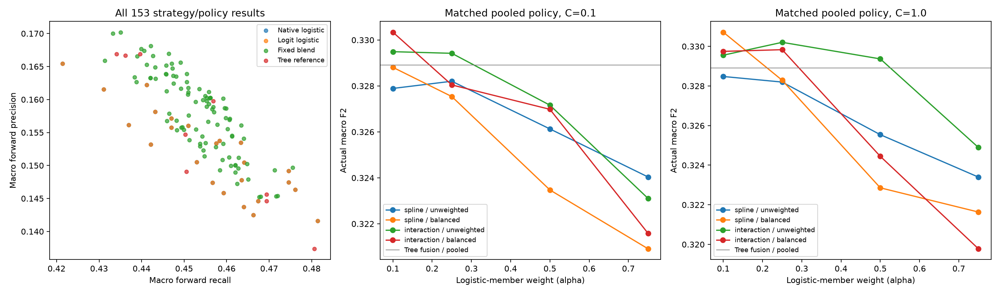

# Interaction-score fusion findings

Selected **interaction_blend_spline_c1p0_balanced_a10 / latest**, macro forward F2 **0.330793**. Positive measured differences against all four original references on both development and consumed transfer: **False**. Finite-search completion does not itself establish the broader performance goal.

## Design and execution

Eight fixed spline/interaction members cross C=0.1/1 with unweighted/balanced training. Native and clipped-log-odds singles plus fixed logistic-member weights 0.10/0.25/0.50/0.75 produce 51 distinct strategies including the original tree references. The already-tested additive C0.1/unweighted/25% blend retains its canonical historical ID and reference precedence. Only probability-like members receive logit clipping (epsilon 1e-6); the existing tree fusion is already a finite margin. Scores are not asserted calibrated probabilities; weights are analyst-selected sensitivities, not confidence or cost estimates.

Development used 33 checked base reuses and 0 new full model fits, producing 156 physical scores, 153 selectable scores, 306 forward rows, 153 macro and pooled summaries and 1,386 complete contrasts. Three canonical recent-score reuses were checked against own parent arithmetic. The new cache tests made four genuine tiny fits per full invocation; historical test-module fits are separate. The recorded full suite passed 619 tests. No new production miniature fits were required; the preserved eight-fit source gate remains checked. Actual resource preflight covers all 903,157 eligible months-0–6 training predictors. Historical fit resource values and current verification/composition measurements are labelled separately.

Models and preprocessing use only earlier months. Month-5 policies learn on month 4; month-6 policies use months 4/5 or latest month 5. Selection maximizes actual macro positive-class F2 beta=2, then recall, precision and deterministic IDs, with no review quota or precision floor. AP, pooled F2, diversity and joint-error counts remain descriptive. Equal nominal C does not mean equal effective complexity across representations.

## Complete forward results

| candidate | policy | f2 | precision | recall | flagged_fraction | average_precision |
| --- | --- | --- | --- | --- | --- | --- |
| interaction_blend_spline_c1p0_balanced_a10 | latest | 0.330793 | 0.158659 | 0.459837 | 0.037598 | 0.189693 |
| interaction_blend_spline_c1p0_balanced_a10 | pooled | 0.330716 | 0.158702 | 0.459493 | 0.037552 | 0.189693 |
| interaction_blend_interaction_c0p1_balanced_a10 | pooled | 0.330340 | 0.160560 | 0.454915 | 0.036733 | 0.189707 |
| interaction_blend_interaction_c1p0_unweighted_a25 | pooled | 0.330205 | 0.164696 | 0.447243 | 0.035330 | 0.190088 |
| interaction_blend_interaction_c1p0_unweighted_a50 | latest | 0.329884 | 0.160262 | 0.455307 | 0.037039 | 0.189601 |
| interaction_blend_interaction_c1p0_balanced_a25 | pooled | 0.329833 | 0.166977 | 0.446400 | 0.035343 | 0.190169 |
| interaction_blend_interaction_c1p0_balanced_a10 | pooled | 0.329747 | 0.163896 | 0.450624 | 0.036165 | 0.189630 |
| interaction_blend_interaction_c1p0_unweighted_a10 | pooled | 0.329555 | 0.167368 | 0.440624 | 0.034205 | 0.189555 |
| interaction_blend_interaction_c0p1_unweighted_a10 | pooled | 0.329492 | 0.167654 | 0.439935 | 0.034093 | 0.189575 |
| interaction_blend_interaction_c0p1_unweighted_a25 | pooled | 0.329421 | 0.165189 | 0.445787 | 0.035266 | 0.190267 |
| interaction_blend_interaction_c1p0_unweighted_a50 | pooled | 0.329367 | 0.159781 | 0.455307 | 0.037197 | 0.189601 |
| interaction_blend_spline_c1p0_balanced_a25 | latest | 0.329192 | 0.165628 | 0.449150 | 0.036092 | 0.190314 |
| margin_blend_spline_c0p1_unweighted_a25 | latest | 0.329010 | 0.155537 | 0.460249 | 0.038074 | 0.190366 |
| logit_mean_xgb_d4_w1_baseline_balanced_a50 | pooled | 0.328907 | 0.166891 | 0.439609 | 0.034181 | 0.188626 |
| interaction_blend_spline_c0p1_balanced_a10 | latest | 0.328810 | 0.157229 | 0.459771 | 0.038164 | 0.189627 |
| interaction_blend_spline_c0p1_balanced_a10 | pooled | 0.328810 | 0.158112 | 0.457012 | 0.037605 | 0.189627 |
| interaction_blend_spline_c1p0_unweighted_a25 | latest | 0.328716 | 0.156202 | 0.457816 | 0.037670 | 0.190327 |
| interaction_blend_interaction_c0p1_balanced_a10 | latest | 0.328646 | 0.157106 | 0.460777 | 0.038430 | 0.189707 |
| interaction_blend_interaction_c1p0_balanced_a10 | latest | 0.328543 | 0.161176 | 0.455797 | 0.037580 | 0.189630 |
| interaction_blend_spline_c1p0_unweighted_a10 | pooled | 0.328479 | 0.162639 | 0.450615 | 0.036523 | 0.189613 |
| interaction_blend_spline_c1p0_balanced_a25 | pooled | 0.328288 | 0.165469 | 0.447081 | 0.035949 | 0.190314 |
| margin_blend_spline_c0p1_unweighted_a25 | pooled | 0.328205 | 0.154440 | 0.461284 | 0.038527 | 0.190366 |
| interaction_blend_spline_c1p0_unweighted_a25 | pooled | 0.328197 | 0.154545 | 0.461264 | 0.038525 | 0.190327 |
| interaction_blend_interaction_c0p1_balanced_a25 | pooled | 0.328044 | 0.168103 | 0.442158 | 0.035005 | 0.190348 |
| interaction_blend_spline_c0p1_unweighted_a10 | pooled | 0.327892 | 0.161781 | 0.450959 | 0.036747 | 0.189627 |
| baseline_balanced | pooled | 0.327802 | 0.166693 | 0.436170 | 0.033753 | 0.183160 |
| interaction_blend_interaction_c1p0_unweighted_a10 | latest | 0.327587 | 0.160245 | 0.456141 | 0.037949 | 0.189555 |
| logit_mean_xgb_d4_w1_baseline_balanced_a50 | latest | 0.327582 | 0.159761 | 0.456850 | 0.038092 | 0.188626 |
| interaction_blend_spline_c0p1_balanced_a25 | pooled | 0.327539 | 0.163489 | 0.448153 | 0.036348 | 0.190397 |
| interaction_blend_interaction_c0p1_unweighted_a10 | latest | 0.327528 | 0.160290 | 0.456141 | 0.037980 | 0.189575 |
| interaction_blend_spline_c0p1_balanced_a25 | latest | 0.327412 | 0.163596 | 0.447464 | 0.036246 | 0.190397 |
| baseline_balanced | latest | 0.327170 | 0.166913 | 0.434101 | 0.033512 | 0.183160 |
| interaction_blend_interaction_c0p1_unweighted_a50 | pooled | 0.327163 | 0.161631 | 0.449264 | 0.036661 | 0.189856 |
| interaction_blend_interaction_c0p1_unweighted_a50 | rank_fraction | 0.327105 | 0.153287 | 0.459202 | 0.037839 | 0.189856 |
| interaction_blend_interaction_c0p1_unweighted_a50 | latest | 0.327076 | 0.159949 | 0.454436 | 0.037747 | 0.189856 |
| interaction_blend_spline_c1p0_unweighted_a50 | rank_fraction | 0.327000 | 0.155459 | 0.452823 | 0.036711 | 0.189970 |
| interaction_blend_interaction_c0p1_balanced_a50 | pooled | 0.326983 | 0.162431 | 0.447492 | 0.036335 | 0.189742 |
| interaction_blend_interaction_c0p1_balanced_a50 | latest | 0.326748 | 0.161119 | 0.450940 | 0.037112 | 0.189742 |
| interaction_blend_spline_c0p1_balanced_a25 | rank_fraction | 0.326660 | 0.150220 | 0.464795 | 0.039041 | 0.190397 |
| interaction_blend_spline_c0p1_unweighted_a10 | latest | 0.326607 | 0.158884 | 0.456822 | 0.038342 | 0.189627 |
| interaction_blend_spline_c0p1_unweighted_a50 | rank_fraction | 0.326600 | 0.154425 | 0.454231 | 0.037080 | 0.189952 |
| interaction_blend_spline_c1p0_unweighted_a10 | latest | 0.326518 | 0.159331 | 0.455787 | 0.038187 | 0.189613 |
| interaction_blend_interaction_c1p0_balanced_a25 | latest | 0.326308 | 0.160132 | 0.459159 | 0.039041 | 0.190169 |
| interaction_blend_interaction_c1p0_unweighted_a25 | latest | 0.326154 | 0.156093 | 0.463449 | 0.039897 | 0.190088 |
| interaction_blend_spline_c1p0_balanced_a25 | rank_fraction | 0.326149 | 0.151255 | 0.460590 | 0.038383 | 0.190314 |
| interaction_blend_spline_c0p1_unweighted_a50 | pooled | 0.326129 | 0.163873 | 0.445654 | 0.036236 | 0.189952 |
| interaction_blend_interaction_c1p0_balanced_a25 | rank_fraction | 0.326060 | 0.152805 | 0.457487 | 0.037770 | 0.190169 |
| interaction_blend_interaction_c1p0_balanced_a50 | rank_fraction | 0.325929 | 0.155758 | 0.449299 | 0.036342 | 0.189573 |
| interaction_blend_interaction_c0p1_balanced_a25 | rank_fraction | 0.325844 | 0.153404 | 0.454997 | 0.037386 | 0.190348 |
| interaction_blend_interaction_c1p0_unweighted_a50 | rank_fraction | 0.325834 | 0.151170 | 0.462812 | 0.038789 | 0.189601 |
| interaction_blend_spline_c1p0_unweighted_a50 | pooled | 0.325540 | 0.164879 | 0.443221 | 0.035972 | 0.189970 |
| interaction_blend_spline_c1p0_unweighted_a10 | rank_fraction | 0.325501 | 0.150032 | 0.461998 | 0.038823 | 0.189613 |
| interaction_blend_spline_c0p1_unweighted_a10 | rank_fraction | 0.325340 | 0.149571 | 0.462707 | 0.038998 | 0.189627 |
| interaction_blend_spline_c1p0_balanced_a50 | rank_fraction | 0.325247 | 0.155357 | 0.448245 | 0.036336 | 0.189986 |
| interaction_blend_interaction_c1p0_balanced_a75 | rank_fraction | 0.325217 | 0.148946 | 0.462076 | 0.039097 | 0.187565 |
| interaction_blend_interaction_c0p1_unweighted_a25 | latest | 0.325147 | 0.156897 | 0.460615 | 0.039625 | 0.190267 |
| interaction_blend_spline_c1p0_balanced_a75 | rank_fraction | 0.325073 | 0.147920 | 0.465035 | 0.039611 | 0.188452 |
| interaction_blend_spline_c0p1_balanced_a50 | rank_fraction | 0.324981 | 0.152286 | 0.454519 | 0.037614 | 0.190067 |
| interaction_blend_interaction_c1p0_unweighted_a75 | pooled | 0.324893 | 0.157613 | 0.451036 | 0.037609 | 0.188373 |
| interaction_blend_spline_c0p1_unweighted_a75 | rank_fraction | 0.324863 | 0.156827 | 0.448158 | 0.036186 | 0.188881 |
| interaction_blend_interaction_c1p0_balanced_a10 | rank_fraction | 0.324850 | 0.149962 | 0.460964 | 0.038786 | 0.189630 |
| interaction_blend_interaction_c0p1_balanced_a50 | rank_fraction | 0.324834 | 0.150058 | 0.462075 | 0.038953 | 0.189742 |
| interaction_blend_interaction_c0p1_unweighted_a10 | rank_fraction | 0.324562 | 0.155815 | 0.449565 | 0.036531 | 0.189575 |
| interaction_blend_spline_c1p0_unweighted_a75 | rank_fraction | 0.324554 | 0.156776 | 0.445974 | 0.035923 | 0.188855 |
| interaction_blend_interaction_c0p1_unweighted_a25 | rank_fraction | 0.324465 | 0.153298 | 0.453703 | 0.037413 | 0.190267 |
| interaction_blend_interaction_c0p1_balanced_a25 | latest | 0.324460 | 0.161608 | 0.453537 | 0.038453 | 0.190348 |
| interaction_blend_interaction_c1p0_balanced_a50 | pooled | 0.324447 | 0.170203 | 0.435061 | 0.034597 | 0.189573 |
| interaction_blend_interaction_c1p0_unweighted_a10 | rank_fraction | 0.324356 | 0.155418 | 0.449910 | 0.036657 | 0.189555 |
| interaction_blend_spline_c1p0_unweighted_a50 | latest | 0.324279 | 0.160210 | 0.455979 | 0.039004 | 0.189970 |
| interaction_blend_spline_c0p1_balanced_a75 | rank_fraction | 0.324248 | 0.153886 | 0.451213 | 0.037026 | 0.188522 |
| interaction_blend_interaction_c1p0_unweighted_a75 | rank_fraction | 0.324116 | 0.150869 | 0.459000 | 0.038490 | 0.188373 |
| interaction_blend_spline_c0p1_unweighted_a75 | pooled | 0.324038 | 0.162647 | 0.438814 | 0.035377 | 0.188881 |
| logit_mean_xgb_d4_w1_baseline_balanced_a50 | rank_fraction | 0.323872 | 0.154697 | 0.450255 | 0.036859 | 0.188626 |
| interaction_blend_interaction_c0p1_balanced_a75 | rank_fraction | 0.323754 | 0.149301 | 0.458369 | 0.038693 | 0.188188 |
| interaction_blend_interaction_c1p0_unweighted_a25 | rank_fraction | 0.323703 | 0.152898 | 0.453751 | 0.037586 | 0.190088 |
| interaction_blend_spline_c0p1_unweighted_a50 | latest | 0.323528 | 0.158921 | 0.455309 | 0.039051 | 0.189952 |
| interaction_blend_spline_c0p1_balanced_a50 | pooled | 0.323473 | 0.166584 | 0.438921 | 0.035673 | 0.190067 |
| interaction_blend_spline_c1p0_unweighted_a75 | pooled | 0.323399 | 0.163407 | 0.438374 | 0.035488 | 0.188855 |
| interaction_blend_spline_c1p0_unweighted_a25 | rank_fraction | 0.323308 | 0.145405 | 0.471968 | 0.041219 | 0.190327 |
| interaction_blend_interaction_c0p1_unweighted_a75 | pooled | 0.323106 | 0.157860 | 0.446467 | 0.037163 | 0.188295 |
| margin_blend_spline_c0p1_unweighted_a25 | rank_fraction | 0.323057 | 0.145341 | 0.471623 | 0.041219 | 0.190366 |
| interaction_c1p0_balanced | pooled | 0.322976 | 0.156041 | 0.450988 | 0.038152 | 0.184803 |
| logit_interaction_c1p0_balanced | pooled | 0.322976 | 0.156041 | 0.450988 | 0.038152 | 0.184803 |
| interaction_blend_interaction_c0p1_unweighted_a75 | rank_fraction | 0.322971 | 0.151397 | 0.454786 | 0.038000 | 0.188295 |
| interaction_blend_interaction_c1p0_balanced_a50 | latest | 0.322945 | 0.166592 | 0.442647 | 0.036617 | 0.189573 |
| interaction_blend_spline_c1p0_balanced_a50 | pooled | 0.322857 | 0.170003 | 0.433242 | 0.034590 | 0.189986 |
| interaction_blend_interaction_c1p0_unweighted_a75 | latest | 0.322724 | 0.149692 | 0.475518 | 0.043420 | 0.188373 |
| baseline_lgbm | pooled | 0.322654 | 0.145630 | 0.469348 | 0.041789 | 0.182014 |
| interaction_blend_spline_c0p1_balanced_a50 | latest | 0.322571 | 0.163819 | 0.445817 | 0.037379 | 0.190067 |
| interaction_blend_spline_c0p1_unweighted_a75 | latest | 0.322418 | 0.154100 | 0.463987 | 0.041104 | 0.188881 |
| interaction_blend_spline_c0p1_balanced_a10 | rank_fraction | 0.322369 | 0.145262 | 0.468022 | 0.040797 | 0.189627 |
| logit_spline_c0p1_unweighted | rank_fraction | 0.322264 | 0.150523 | 0.452966 | 0.037916 | 0.186404 |
| spline_c0p1_unweighted | rank_fraction | 0.322264 | 0.150523 | 0.452966 | 0.037916 | 0.186404 |
| interaction_c1p0_balanced | latest | 0.321936 | 0.153336 | 0.457540 | 0.039853 | 0.184803 |
| logit_interaction_c1p0_balanced | latest | 0.321936 | 0.153336 | 0.457540 | 0.039853 | 0.184803 |
| interaction_blend_spline_c1p0_balanced_a10 | rank_fraction | 0.321916 | 0.145238 | 0.467697 | 0.040846 | 0.189693 |
| interaction_blend_interaction_c0p1_balanced_a10 | rank_fraction | 0.321865 | 0.147221 | 0.462467 | 0.039820 | 0.189707 |
| interaction_blend_spline_c1p0_balanced_a75 | pooled | 0.321634 | 0.161272 | 0.445865 | 0.037607 | 0.188452 |
| interaction_blend_interaction_c0p1_balanced_a75 | latest | 0.321614 | 0.163291 | 0.442062 | 0.036910 | 0.188188 |
| interaction_blend_spline_c1p0_balanced_a75 | latest | 0.321586 | 0.158544 | 0.456555 | 0.039835 | 0.188452 |
| interaction_blend_interaction_c0p1_balanced_a75 | pooled | 0.321585 | 0.163267 | 0.442062 | 0.036920 | 0.188188 |
| baseline_lgbm | latest | 0.321424 | 0.144608 | 0.469348 | 0.042196 | 0.182014 |
| logit_spline_c1p0_balanced | rank_fraction | 0.321374 | 0.147390 | 0.456673 | 0.039011 | 0.186367 |
| spline_c1p0_balanced | rank_fraction | 0.321374 | 0.147390 | 0.456673 | 0.039011 | 0.186367 |
| interaction_blend_spline_c1p0_unweighted_a75 | latest | 0.321256 | 0.156622 | 0.455615 | 0.039741 | 0.188855 |
| interaction_blend_spline_c0p1_balanced_a75 | pooled | 0.320913 | 0.165899 | 0.431296 | 0.034754 | 0.188522 |
| interaction_c1p0_balanced | rank_fraction | 0.320775 | 0.144633 | 0.467399 | 0.041072 | 0.184803 |
| logit_interaction_c1p0_balanced | rank_fraction | 0.320775 | 0.144633 | 0.467399 | 0.041072 | 0.184803 |
| interaction_c1p0_unweighted | pooled | 0.320761 | 0.150445 | 0.464072 | 0.041525 | 0.185661 |
| logit_interaction_c1p0_unweighted | pooled | 0.320761 | 0.150445 | 0.464072 | 0.041525 | 0.185661 |
| interaction_blend_spline_c0p1_balanced_a75 | latest | 0.320710 | 0.159661 | 0.452676 | 0.039224 | 0.188522 |
| interaction_c1p0_unweighted | rank_fraction | 0.320494 | 0.143699 | 0.464010 | 0.040681 | 0.185661 |
| logit_interaction_c1p0_unweighted | rank_fraction | 0.320494 | 0.143699 | 0.464010 | 0.040681 | 0.185661 |
| interaction_blend_interaction_c0p1_unweighted_a75 | latest | 0.320335 | 0.149301 | 0.471295 | 0.043260 | 0.188295 |
| interaction_c0p1_balanced | latest | 0.320245 | 0.157144 | 0.446976 | 0.038131 | 0.185343 |
| logit_interaction_c0p1_balanced | latest | 0.320245 | 0.157144 | 0.446976 | 0.038131 | 0.185343 |
| logit_spline_c0p1_balanced | rank_fraction | 0.320217 | 0.153218 | 0.442143 | 0.036346 | 0.186464 |
| spline_c0p1_balanced | rank_fraction | 0.320217 | 0.153218 | 0.442143 | 0.036346 | 0.186464 |
| interaction_c0p1_balanced | pooled | 0.320155 | 0.158155 | 0.443183 | 0.037373 | 0.185343 |
| logit_interaction_c0p1_balanced | pooled | 0.320155 | 0.158155 | 0.443183 | 0.037373 | 0.185343 |
| interaction_blend_spline_c1p0_balanced_a50 | latest | 0.320057 | 0.165268 | 0.441173 | 0.037095 | 0.189986 |
| logit_spline_c1p0_unweighted | rank_fraction | 0.319918 | 0.156127 | 0.436971 | 0.035329 | 0.186735 |
| spline_c1p0_unweighted | rank_fraction | 0.319918 | 0.156127 | 0.436971 | 0.035329 | 0.186735 |
| interaction_blend_interaction_c1p0_balanced_a75 | pooled | 0.319779 | 0.163159 | 0.443299 | 0.037633 | 0.187565 |
| logit_spline_c0p1_unweighted | pooled | 0.319745 | 0.155748 | 0.447023 | 0.038270 | 0.186404 |
| spline_c0p1_unweighted | pooled | 0.319745 | 0.155748 | 0.447023 | 0.038270 | 0.186404 |
| interaction_c0p1_balanced | rank_fraction | 0.319739 | 0.145839 | 0.459297 | 0.039813 | 0.185343 |
| logit_interaction_c0p1_balanced | rank_fraction | 0.319739 | 0.145839 | 0.459297 | 0.039813 | 0.185343 |
| interaction_c0p1_unweighted | rank_fraction | 0.319587 | 0.142511 | 0.466260 | 0.041258 | 0.185641 |
| logit_interaction_c0p1_unweighted | rank_fraction | 0.319587 | 0.142511 | 0.466260 | 0.041258 | 0.185641 |
| interaction_c0p1_unweighted | pooled | 0.319568 | 0.147765 | 0.463469 | 0.041663 | 0.185641 |
| logit_interaction_c0p1_unweighted | pooled | 0.319568 | 0.147765 | 0.463469 | 0.041663 | 0.185641 |
| interaction_blend_interaction_c1p0_balanced_a75 | latest | 0.319047 | 0.160747 | 0.450885 | 0.039455 | 0.187565 |
| logit_spline_c1p0_balanced | pooled | 0.318929 | 0.162202 | 0.441220 | 0.037381 | 0.186367 |
| spline_c1p0_balanced | pooled | 0.318929 | 0.162202 | 0.441220 | 0.037381 | 0.186367 |
| baseline_balanced | rank_fraction | 0.318771 | 0.149056 | 0.450543 | 0.038377 | 0.183160 |
| baseline_lgbm | rank_fraction | 0.318729 | 0.137376 | 0.480665 | 0.044290 | 0.182014 |
| logit_spline_c1p0_unweighted | pooled | 0.318707 | 0.161552 | 0.431085 | 0.035359 | 0.186735 |
| spline_c1p0_unweighted | pooled | 0.318707 | 0.161552 | 0.431085 | 0.035359 | 0.186735 |
| interaction_c1p0_unweighted | latest | 0.318534 | 0.146316 | 0.476141 | 0.044853 | 0.185661 |
| logit_interaction_c1p0_unweighted | latest | 0.318534 | 0.146316 | 0.476141 | 0.044853 | 0.185661 |
| logit_spline_c0p1_unweighted | latest | 0.316889 | 0.147446 | 0.474610 | 0.045055 | 0.186404 |
| spline_c0p1_unweighted | latest | 0.316889 | 0.147446 | 0.474610 | 0.045055 | 0.186404 |
| interaction_c0p1_unweighted | latest | 0.316143 | 0.141609 | 0.481400 | 0.046692 | 0.185641 |
| logit_interaction_c0p1_unweighted | latest | 0.316143 | 0.141609 | 0.481400 | 0.046692 | 0.185641 |
| logit_spline_c1p0_unweighted | latest | 0.316139 | 0.149205 | 0.474533 | 0.045440 | 0.186735 |
| spline_c1p0_unweighted | latest | 0.316139 | 0.149205 | 0.474533 | 0.045440 | 0.186735 |
| logit_spline_c0p1_balanced | pooled | 0.314454 | 0.165450 | 0.421403 | 0.034476 | 0.186464 |
| spline_c0p1_balanced | pooled | 0.314454 | 0.165450 | 0.421403 | 0.034476 | 0.186464 |
| logit_spline_c1p0_balanced | latest | 0.313509 | 0.153477 | 0.463289 | 0.043936 | 0.186367 |
| spline_c1p0_balanced | latest | 0.313509 | 0.153477 | 0.463289 | 0.043936 | 0.186367 |
| logit_spline_c0p1_balanced | latest | 0.310590 | 0.153727 | 0.458300 | 0.043591 | 0.186464 |
| spline_c0p1_balanced | latest | 0.310590 | 0.153727 | 0.458300 | 0.043591 | 0.186464 |

## Matched effects and original references

Every original-reference, own-policy, blend/native/transformed/tree, representation, training-weight, C and alpha comparison is retained in contrasts.csv, including ties and negative effects. Clipping has 33 rows and common-margin diversity has 48 rows with independent earlier-only decisions and explicit null reasons for constant correlations. Correlations and pair blocks are associations, not causal effects or selection rules. Source features, coefficients, training statistics, numerical objectives/gradients and serialized inference were independently checked; 24 logistic blocks, twelve pair blocks, 1,392 original-feature rows and 72 pair rows remain exported.

| contrast | policy | reference | reference_policy | f2_difference |
| --- | --- | --- | --- | --- |
| original operating reference | pooled | margin_blend_spline_c0p1_unweighted_a25 | latest | 0.001706 |
| original operating reference | pooled | logit_mean_xgb_d4_w1_baseline_balanced_a50 | pooled | 0.001809 |
| original operating reference | pooled | baseline_balanced | pooled | 0.002914 |
| original operating reference | pooled | baseline_lgbm | pooled | 0.008062 |
| original operating reference | latest | margin_blend_spline_c0p1_unweighted_a25 | latest | 0.001783 |
| original operating reference | latest | logit_mean_xgb_d4_w1_baseline_balanced_a50 | pooled | 0.001887 |
| original operating reference | latest | baseline_balanced | pooled | 0.002992 |
| original operating reference | latest | baseline_lgbm | pooled | 0.008140 |
| policy minus own pooled | latest | interaction_blend_spline_c1p0_balanced_a10 | pooled | 0.000078 |
| original operating reference | rank_fraction | margin_blend_spline_c0p1_unweighted_a25 | latest | -0.007094 |
| original operating reference | rank_fraction | logit_mean_xgb_d4_w1_baseline_balanced_a50 | pooled | -0.006990 |
| original operating reference | rank_fraction | baseline_balanced | pooled | -0.005885 |
| original operating reference | rank_fraction | baseline_lgbm | pooled | -0.000737 |
| policy minus own pooled | rank_fraction | interaction_blend_spline_c1p0_balanced_a10 | pooled | -0.008799 |
| blend minus native | pooled | spline_c1p0_balanced | pooled | 0.011786 |
| blend minus transformed | pooled | logit_spline_c1p0_balanced | pooled | 0.011786 |
| blend minus tree | pooled | logit_mean_xgb_d4_w1_baseline_balanced_a50 | pooled | 0.001809 |
| blend minus native | latest | spline_c1p0_balanced | latest | 0.017284 |
| blend minus transformed | latest | logit_spline_c1p0_balanced | latest | 0.017284 |
| blend minus tree | latest | logit_mean_xgb_d4_w1_baseline_balanced_a50 | latest | 0.003211 |
| blend minus native | rank_fraction | spline_c1p0_balanced | rank_fraction | 0.000542 |
| blend minus transformed | rank_fraction | logit_spline_c1p0_balanced | rank_fraction | 0.000542 |
| blend minus tree | rank_fraction | logit_mean_xgb_d4_w1_baseline_balanced_a50 | rank_fraction | -0.001955 |
| balanced minus unweighted | pooled | interaction_blend_spline_c1p0_unweighted_a10 | pooled | 0.002237 |
| balanced minus unweighted | latest | interaction_blend_spline_c1p0_unweighted_a10 | latest | 0.004275 |
| balanced minus unweighted | rank_fraction | interaction_blend_spline_c1p0_unweighted_a10 | rank_fraction | -0.003585 |
| larger C minus smaller C | pooled | interaction_blend_spline_c0p1_balanced_a10 | pooled | 0.001906 |
| larger C minus smaller C | latest | interaction_blend_spline_c0p1_balanced_a10 | latest | 0.001983 |
| larger C minus smaller C | rank_fraction | interaction_blend_spline_c0p1_balanced_a10 | rank_fraction | -0.000453 |

## Conditional development differences

| scope | reference | difference | ci_low | ci_high | replicates |
| --- | --- | --- | --- | --- | --- |
| 5 | recent_fusion | 0.002693 | -0.002074 | 0.007141 | 500 |
| 5 | fusion | 0.002117 | -0.003197 | 0.006887 | 500 |
| 5 | balanced | 0.003442 | -0.003273 | 0.010204 | 500 |
| 5 | unweighted | 0.003576 | -0.003940 | 0.010777 | 500 |
| 5 | same_strategy | 0.000000 | 0.000000 | 0.000000 | 500 |
| 5 | original_member | 0.015227 | 0.004398 | 0.026490 | 500 |
| 5 | transformed_member | 0.015227 | 0.004398 | 0.026490 | 500 |
| 5 | matched_representation | 0.002400 | -0.003173 | 0.007816 | 500 |
| 5 | matched_weight | 0.003195 | -0.002129 | 0.008788 | 500 |
| 5 | matched_C | 0.002161 | -0.000295 | 0.005061 | 500 |
| 5 | other_alpha_25 | 0.002815 | -0.003239 | 0.008784 | 500 |
| 5 | other_alpha_50 | 0.014109 | 0.004726 | 0.025081 | 500 |
| 5 | other_alpha_75 | 0.009995 | 0.000395 | 0.019924 | 500 |
| 6 | recent_fusion | 0.000874 | -0.002837 | 0.004524 | 500 |
| 6 | fusion | 0.001657 | -0.003068 | 0.007168 | 500 |
| 6 | balanced | 0.002542 | -0.004038 | 0.009650 | 500 |
| 6 | unweighted | 0.012703 | 0.006049 | 0.020528 | 500 |
| 6 | same_strategy | 0.000155 | -0.000429 | 0.001129 | 500 |
| 6 | original_member | 0.019341 | 0.010760 | 0.027561 | 500 |
| 6 | transformed_member | 0.019341 | 0.010760 | 0.027561 | 500 |
| 6 | matched_representation | 0.002100 | -0.001182 | 0.005553 | 500 |
| 6 | matched_weight | 0.005356 | 0.002090 | 0.008913 | 500 |
| 6 | matched_C | 0.001804 | -0.000423 | 0.004070 | 500 |
| 6 | other_alpha_25 | 0.000387 | -0.002848 | 0.003543 | 500 |
| 6 | other_alpha_50 | 0.007364 | 0.001844 | 0.012744 | 500 |
| 6 | other_alpha_75 | 0.008420 | 0.001423 | 0.015700 | 500 |
| macro | recent_fusion | 0.001783 | -0.001322 | 0.005006 | 500 |
| macro | fusion | 0.001887 | -0.001847 | 0.006004 | 500 |
| macro | balanced | 0.002992 | -0.001442 | 0.008094 | 500 |
| macro | unweighted | 0.008140 | 0.003097 | 0.013272 | 500 |
| macro | same_strategy | 0.000078 | -0.000215 | 0.000564 | 500 |
| macro | original_member | 0.017284 | 0.010636 | 0.024803 | 500 |
| macro | transformed_member | 0.017284 | 0.010636 | 0.024803 | 500 |
| macro | matched_representation | 0.002250 | -0.000871 | 0.005334 | 500 |
| macro | matched_weight | 0.004275 | 0.001012 | 0.007367 | 500 |
| macro | matched_C | 0.001983 | 0.000424 | 0.003814 | 500 |
| macro | other_alpha_25 | 0.001601 | -0.001534 | 0.005159 | 500 |
| macro | other_alpha_50 | 0.010737 | 0.005085 | 0.017017 | 500 |
| macro | other_alpha_75 | 0.009207 | 0.003496 | 0.015542 | 500 |

## Already-consumed month 7

| role | candidate | policy | f2 | precision | recall | flagged_fraction | tp | fp | fn |
| --- | --- | --- | --- | --- | --- | --- | --- | --- | --- |
| selected | interaction_blend_spline_c1p0_balanced_a10 | latest | 0.371534 | 0.194886 | 0.480392 | 0.036347 | 686 | 2834 | 742 |
| recent_fusion | margin_blend_spline_c0p1_unweighted_a25 | latest | 0.370248 | 0.200839 | 0.469188 | 0.034448 | 670 | 2666 | 758 |
| fusion | logit_mean_xgb_d4_w1_baseline_balanced_a50 | pooled | 0.372694 | 0.192414 | 0.486695 | 0.037297 | 695 | 2917 | 733 |
| balanced | baseline_balanced | pooled | 0.364409 | 0.181747 | 0.486695 | 0.039487 | 695 | 3129 | 733 |
| unweighted | baseline_lgbm | pooled | 0.376884 | 0.168248 | 0.546218 | 0.047871 | 780 | 3856 | 648 |
| same_strategy | interaction_blend_spline_c1p0_balanced_a10 | pooled | 0.374974 | 0.184777 | 0.504902 | 0.040292 | 721 | 3181 | 707 |
| original_member | spline_c1p0_balanced | latest | 0.358045 | 0.192160 | 0.456583 | 0.035036 | 652 | 2741 | 776 |
| transformed_member | logit_spline_c1p0_balanced | latest | 0.358045 | 0.192160 | 0.456583 | 0.035036 | 652 | 2741 | 776 |
| matched_representation | interaction_blend_interaction_c1p0_balanced_a10 | latest | 0.374132 | 0.187599 | 0.497899 | 0.039136 | 711 | 3079 | 717 |
| matched_weight | interaction_blend_spline_c1p0_unweighted_a10 | latest | 0.372889 | 0.189678 | 0.491597 | 0.038216 | 702 | 2999 | 726 |
| matched_C | interaction_blend_spline_c0p1_balanced_a10 | latest | 0.374658 | 0.187863 | 0.498599 | 0.039136 | 712 | 3078 | 716 |
| other_alpha_25 | interaction_blend_spline_c1p0_balanced_a25 | latest | 0.370696 | 0.199467 | 0.471989 | 0.034892 | 674 | 2705 | 754 |
| other_alpha_50 | interaction_blend_spline_c1p0_balanced_a50 | latest | 0.368272 | 0.195038 | 0.473389 | 0.035790 | 676 | 2790 | 752 |
| other_alpha_75 | interaction_blend_spline_c1p0_balanced_a75 | latest | 0.365603 | 0.191339 | 0.473389 | 0.036482 | 676 | 2857 | 752 |

Only 14 frozen roles transferred with deduplicated work: 5 base reuses and 3 new fits. Exact source/score DAG, original-cache availability, tighter type bounds and final earlier-only rules were frozen before the recorded access. No losing-grid sweep, hindsight cutoff or replacement of the development winner was used.

| scope | reference | difference | ci_low | ci_high | replicates |
| --- | --- | --- | --- | --- | --- |
| 7_consumed | recent_fusion | 0.001286 | -0.003943 | 0.005301 | 500 |
| 7_consumed | fusion | -0.001160 | -0.004637 | 0.001898 | 500 |
| 7_consumed | balanced | 0.007125 | -0.000200 | 0.013949 | 500 |
| 7_consumed | unweighted | -0.005351 | -0.014823 | 0.003437 | 500 |
| 7_consumed | same_strategy | -0.003440 | -0.009837 | 0.002028 | 500 |
| 7_consumed | original_member | 0.013489 | 0.003687 | 0.023605 | 500 |
| 7_consumed | transformed_member | 0.013489 | 0.003687 | 0.023605 | 500 |
| 7_consumed | matched_representation | -0.002598 | -0.007488 | 0.002075 | 500 |
| 7_consumed | matched_weight | -0.001355 | -0.005755 | 0.002424 | 500 |
| 7_consumed | matched_C | -0.003124 | -0.007866 | 0.001838 | 500 |
| 7_consumed | other_alpha_25 | 0.000838 | -0.004138 | 0.005398 | 500 |
| 7_consumed | other_alpha_50 | 0.003262 | -0.004397 | 0.009837 | 500 |
| 7_consumed | other_alpha_75 | 0.005931 | -0.002888 | 0.013875 | 500 |

## Limitations, reproduction and assistance

All 1,500 paired fixed-decision row draws and quantiles were independently reconstructed with seed 1027 and 500 draws per month. Intervals condition on fixed models/policies and exclude adaptive source/C/alpha/pair choice, repeated search, selection, retraining, temporal/generative uncertainty and multiplicity adjustment. Clear-gain language requires a positive conditional lower bound on the named scope. Month 7 was already consumed and cannot provide independent confirmation. Synthetic data and eight monthly periods limit generalization.

All thirteen completed studies, the stopped attempt and separate Newton fit/analysis identities remain preserved. README documents the pinned data/environment, thirteen exact selection restores and ordered clean execution; existing frozen audit/selection/report artifacts must not be overwritten. Settings remain analyst-selected and open to group review. Codex assisted with design, implementation, execution, independent verification, diagnostics and reporting using preserved repository interfaces and pinned scikit-learn/SciPy/XGBoost/LightGBM APIs. No public notebook was copied. The group must acknowledge assistance and understand submitted analysis.

