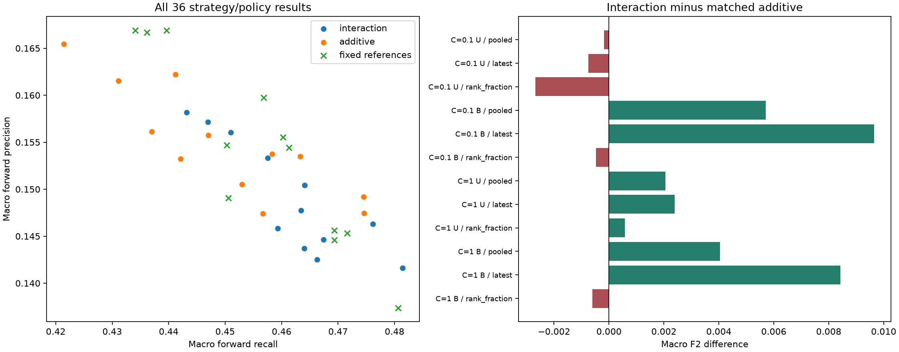
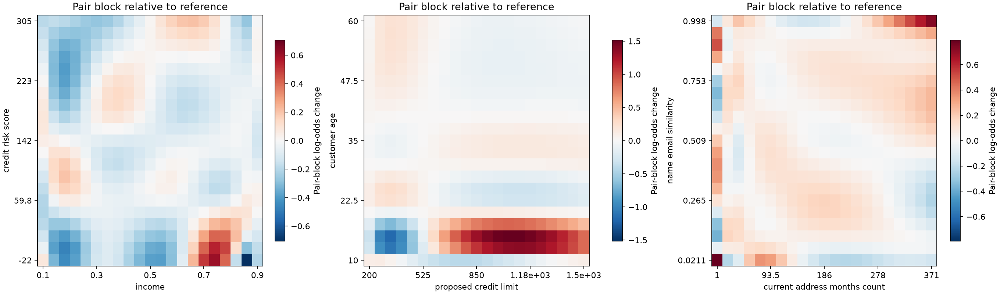

# Fixed spline-interaction study findings

Selected **margin_blend_spline_c0p1_unweighted_a25 / latest**, actual macro month-5/6 F2 **0.329010**. Best interaction: **interaction_c1p0_balanced / pooled**, F2 **0.322976**. Positive measured differences against all four original references on both development and consumed transfer: **False**. Finishing this finite search does not itself establish the performance goal.

## Design and actual execution

Three fixed training-only centered/scaled tensor pairs augment the unchanged additive spline representation. C=0.1/1 and unweighted/balanced recipes provide all matched controls. There were 12 new full interaction development fits, 21 base reuses, 0 exact missing-base reproduction fits, and 3 recent-fusion derived reuses. Eight miniature integration fits are separate. The new cache-reproduction tests made 10 separately counted tiny estimator fits across their recorded invocations. The latest full methodological run passed 379 tests. Development contains 33 bases, six derived references, 39 total score artifacts, 36 selectable scores, 72 forward operating rows and 204 contrasts. Feature-only/analytical fixtures fit no estimators; existing historical test-module fits are also separate from this development count.

Eligible training ends before the evaluation month; month-5 policies use month 4 and month-6 policies use months 4/5 or latest month 5. Selection uses actual macro F2 beta=2, then recall/precision and deterministic IDs. No review quota or precision floor is imposed. The recent selected fusion retains its original latest policy; tree fusion and balanced/unweighted retain pooled policies. Fixed margin composition never treats the existing tree-fusion margin as a probability. Settings and pair choices remain analyst-selected and adaptive to earlier development experiments.

All original and pair feature statistics are training-only and independent of class weighting. Exact constants remain zero at inference, dimensions are retained, and dense construction is limited to one bounded pair chunk. Independent SciPy/two-pass statistics, coefficient inference, normalized objective/full gradient, warnings/iterations and genuine Newton execution were audited. The independent moment accumulator has 64 bits on this host; no extra precision over float64 is implied when those widths agree. Solver and resource tables expose actual dimensions, sparsity, storage, Hessian estimates, timings and process RSS. Centering does not prove orthogonality, and equal nominal C does not imply equal effective complexity.

## Complete forward results

| candidate | policy | f2 | precision | recall | flagged_fraction | average_precision |
| --- | --- | --- | --- | --- | --- | --- |
| margin_blend_spline_c0p1_unweighted_a25 | latest | 0.329010 | 0.155537 | 0.460249 | 0.038074 | 0.190366 |
| logit_mean_xgb_d4_w1_baseline_balanced_a50 | pooled | 0.328907 | 0.166891 | 0.439609 | 0.034181 | 0.188626 |
| margin_blend_spline_c0p1_unweighted_a25 | pooled | 0.328205 | 0.154440 | 0.461284 | 0.038527 | 0.190366 |
| baseline_balanced | pooled | 0.327802 | 0.166693 | 0.436170 | 0.033753 | 0.183160 |
| logit_mean_xgb_d4_w1_baseline_balanced_a50 | latest | 0.327582 | 0.159761 | 0.456850 | 0.038092 | 0.188626 |
| baseline_balanced | latest | 0.327170 | 0.166913 | 0.434101 | 0.033512 | 0.183160 |
| logit_mean_xgb_d4_w1_baseline_balanced_a50 | rank_fraction | 0.323872 | 0.154697 | 0.450255 | 0.036859 | 0.188626 |
| margin_blend_spline_c0p1_unweighted_a25 | rank_fraction | 0.323057 | 0.145341 | 0.471623 | 0.041219 | 0.190366 |
| interaction_c1p0_balanced | pooled | 0.322976 | 0.156041 | 0.450988 | 0.038152 | 0.184803 |
| baseline_lgbm | pooled | 0.322654 | 0.145630 | 0.469348 | 0.041789 | 0.182014 |
| spline_c0p1_unweighted | rank_fraction | 0.322264 | 0.150523 | 0.452966 | 0.037916 | 0.186404 |
| interaction_c1p0_balanced | latest | 0.321936 | 0.153336 | 0.457540 | 0.039853 | 0.184803 |
| baseline_lgbm | latest | 0.321424 | 0.144608 | 0.469348 | 0.042196 | 0.182014 |
| spline_c1p0_balanced | rank_fraction | 0.321374 | 0.147390 | 0.456673 | 0.039011 | 0.186367 |
| interaction_c1p0_balanced | rank_fraction | 0.320775 | 0.144633 | 0.467399 | 0.041072 | 0.184803 |
| interaction_c1p0_unweighted | pooled | 0.320761 | 0.150445 | 0.464072 | 0.041525 | 0.185661 |
| interaction_c1p0_unweighted | rank_fraction | 0.320494 | 0.143699 | 0.464010 | 0.040681 | 0.185661 |
| interaction_c0p1_balanced | latest | 0.320245 | 0.157144 | 0.446976 | 0.038131 | 0.185343 |
| spline_c0p1_balanced | rank_fraction | 0.320217 | 0.153218 | 0.442143 | 0.036346 | 0.186464 |
| interaction_c0p1_balanced | pooled | 0.320155 | 0.158155 | 0.443183 | 0.037373 | 0.185343 |
| spline_c1p0_unweighted | rank_fraction | 0.319918 | 0.156127 | 0.436971 | 0.035329 | 0.186735 |
| spline_c0p1_unweighted | pooled | 0.319745 | 0.155748 | 0.447023 | 0.038270 | 0.186404 |
| interaction_c0p1_balanced | rank_fraction | 0.319739 | 0.145839 | 0.459297 | 0.039813 | 0.185343 |
| interaction_c0p1_unweighted | rank_fraction | 0.319587 | 0.142511 | 0.466260 | 0.041258 | 0.185641 |
| interaction_c0p1_unweighted | pooled | 0.319568 | 0.147765 | 0.463469 | 0.041663 | 0.185641 |
| spline_c1p0_balanced | pooled | 0.318929 | 0.162202 | 0.441220 | 0.037381 | 0.186367 |
| baseline_balanced | rank_fraction | 0.318771 | 0.149056 | 0.450543 | 0.038377 | 0.183160 |
| baseline_lgbm | rank_fraction | 0.318729 | 0.137376 | 0.480665 | 0.044290 | 0.182014 |
| spline_c1p0_unweighted | pooled | 0.318707 | 0.161552 | 0.431085 | 0.035359 | 0.186735 |
| interaction_c1p0_unweighted | latest | 0.318534 | 0.146316 | 0.476141 | 0.044853 | 0.185661 |
| spline_c0p1_unweighted | latest | 0.316889 | 0.147446 | 0.474610 | 0.045055 | 0.186404 |
| interaction_c0p1_unweighted | latest | 0.316143 | 0.141609 | 0.481400 | 0.046692 | 0.185641 |
| spline_c1p0_unweighted | latest | 0.316139 | 0.149205 | 0.474533 | 0.045440 | 0.186735 |
| spline_c0p1_balanced | pooled | 0.314454 | 0.165450 | 0.421403 | 0.034476 | 0.186464 |
| spline_c1p0_balanced | latest | 0.313509 | 0.153477 | 0.463289 | 0.043936 | 0.186367 |
| spline_c0p1_balanced | latest | 0.310590 | 0.153727 | 0.458300 | 0.043591 | 0.186464 |

## Matched effects

| contrast | candidate | policy | reference | f2_difference | recall_difference | flagged_fraction_difference |
| --- | --- | --- | --- | --- | --- | --- |
| interaction minus additive | interaction_c0p1_unweighted | pooled | spline_c0p1_unweighted | -0.000177 | 0.016445 | 0.003393 |
| interaction minus additive | interaction_c0p1_unweighted | latest | spline_c0p1_unweighted | -0.000746 | 0.006790 | 0.001637 |
| interaction minus additive | interaction_c0p1_unweighted | rank_fraction | spline_c0p1_unweighted | -0.002677 | 0.013294 | 0.003342 |
| interaction minus additive | interaction_c0p1_balanced | pooled | spline_c0p1_balanced | 0.005701 | 0.021780 | 0.002897 |
| interaction minus additive | interaction_c0p1_balanced | latest | spline_c0p1_balanced | 0.009655 | -0.011324 | -0.005460 |
| interaction minus additive | interaction_c0p1_balanced | rank_fraction | spline_c0p1_balanced | -0.000478 | 0.017154 | 0.003467 |
| interaction minus additive | interaction_c1p0_unweighted | pooled | spline_c1p0_unweighted | 0.002054 | 0.032987 | 0.006167 |
| interaction minus additive | interaction_c1p0_unweighted | latest | spline_c1p0_unweighted | 0.002395 | 0.001608 | -0.000587 |
| interaction minus additive | interaction_c1p0_unweighted | rank_fraction | spline_c1p0_unweighted | 0.000576 | 0.027040 | 0.005352 |
| interaction minus additive | interaction_c1p0_balanced | pooled | spline_c1p0_balanced | 0.004047 | 0.009768 | 0.000771 |
| interaction minus additive | interaction_c1p0_balanced | latest | spline_c1p0_balanced | 0.008427 | -0.005749 | -0.004082 |
| interaction minus additive | interaction_c1p0_balanced | rank_fraction | spline_c1p0_balanced | -0.000600 | 0.010726 | 0.002061 |
| balanced minus unweighted | spline_c0p1_balanced | pooled | spline_c0p1_unweighted | -0.005290 | -0.025620 | -0.003794 |
| balanced minus unweighted | spline_c0p1_balanced | latest | spline_c0p1_unweighted | -0.006299 | -0.016310 | -0.001464 |
| balanced minus unweighted | spline_c0p1_balanced | rank_fraction | spline_c0p1_unweighted | -0.002047 | -0.010823 | -0.001570 |
| balanced minus unweighted | spline_c1p0_balanced | pooled | spline_c1p0_unweighted | 0.000222 | 0.010135 | 0.002022 |
| balanced minus unweighted | spline_c1p0_balanced | latest | spline_c1p0_unweighted | -0.002629 | -0.011244 | -0.001504 |
| balanced minus unweighted | spline_c1p0_balanced | rank_fraction | spline_c1p0_unweighted | 0.001456 | 0.019703 | 0.003681 |
| balanced minus unweighted | interaction_c0p1_balanced | pooled | interaction_c0p1_unweighted | 0.000587 | -0.020286 | -0.004289 |
| balanced minus unweighted | interaction_c0p1_balanced | latest | interaction_c0p1_unweighted | 0.004103 | -0.034424 | -0.008561 |
| balanced minus unweighted | interaction_c0p1_balanced | rank_fraction | interaction_c0p1_unweighted | 0.000152 | -0.006963 | -0.001445 |
| balanced minus unweighted | interaction_c1p0_balanced | pooled | interaction_c1p0_unweighted | 0.002215 | -0.013084 | -0.003373 |
| balanced minus unweighted | interaction_c1p0_balanced | latest | interaction_c1p0_unweighted | 0.003402 | -0.018602 | -0.005000 |
| balanced minus unweighted | interaction_c1p0_balanced | rank_fraction | interaction_c1p0_unweighted | 0.000281 | 0.003389 | 0.000391 |
| larger C minus smaller C | spline_c1p0_unweighted | pooled | spline_c0p1_unweighted | -0.001038 | -0.015938 | -0.002911 |
| larger C minus smaller C | spline_c1p0_unweighted | latest | spline_c0p1_unweighted | -0.000750 | -0.000076 | 0.000385 |
| larger C minus smaller C | spline_c1p0_unweighted | rank_fraction | spline_c0p1_unweighted | -0.002346 | -0.015996 | -0.002587 |
| larger C minus smaller C | spline_c1p0_balanced | pooled | spline_c0p1_balanced | 0.004475 | 0.019817 | 0.002905 |
| larger C minus smaller C | spline_c1p0_balanced | latest | spline_c0p1_balanced | 0.002919 | 0.004990 | 0.000344 |
| larger C minus smaller C | spline_c1p0_balanced | rank_fraction | spline_c0p1_balanced | 0.001157 | 0.014530 | 0.002665 |
| larger C minus smaller C | interaction_c1p0_unweighted | pooled | interaction_c0p1_unweighted | 0.001193 | 0.000604 | -0.000137 |
| larger C minus smaller C | interaction_c1p0_unweighted | latest | interaction_c0p1_unweighted | 0.002391 | -0.005258 | -0.001838 |
| larger C minus smaller C | interaction_c1p0_unweighted | rank_fraction | interaction_c0p1_unweighted | 0.000907 | -0.002250 | -0.000577 |
| larger C minus smaller C | interaction_c1p0_balanced | pooled | interaction_c0p1_balanced | 0.002821 | 0.007805 | 0.000779 |
| larger C minus smaller C | interaction_c1p0_balanced | latest | interaction_c0p1_balanced | 0.001691 | 0.010564 | 0.001722 |
| larger C minus smaller C | interaction_c1p0_balanced | rank_fraction | interaction_c0p1_balanced | 0.001035 | 0.008103 | 0.001259 |

All 204 contrasts, including reference and policy-only differences, negative values and ties, remain in contrasts.csv. AP and pooled confusion metrics supplement the macro objective.

## Conditional development differences

| scope | reference | difference | ci_low | ci_high | replicates |
| --- | --- | --- | --- | --- | --- |
| 5 | recent_fusion | 0.000000 | 0.000000 | 0.000000 | 500 |
| 5 | fusion | -0.000576 | -0.007309 | 0.005420 | 500 |
| 5 | balanced | 0.000749 | -0.006548 | 0.008579 | 500 |
| 5 | unweighted | 0.000883 | -0.006898 | 0.008136 | 500 |
| 5 | same_model | 0.000000 | 0.000000 | 0.000000 | 500 |
| 6 | recent_fusion | 0.000000 | 0.000000 | 0.000000 | 500 |
| 6 | fusion | 0.000783 | -0.005143 | 0.006285 | 500 |
| 6 | balanced | 0.001668 | -0.006011 | 0.009270 | 500 |
| 6 | unweighted | 0.011829 | 0.005064 | 0.019031 | 500 |
| 6 | same_model | 0.001610 | 0.000072 | 0.003127 | 500 |
| macro | recent_fusion | 0.000000 | 0.000000 | 0.000000 | 500 |
| macro | fusion | 0.000103 | -0.004381 | 0.004735 | 500 |
| macro | balanced | 0.001208 | -0.003665 | 0.006420 | 500 |
| macro | unweighted | 0.006356 | 0.001273 | 0.011306 | 500 |
| macro | same_model | 0.000805 | 0.000036 | 0.001564 | 500 |

## Already-consumed month 7: frozen exploratory transfer

| role | candidate | policy | f2 | precision | recall | flagged_fraction | tp | fp | fn |
| --- | --- | --- | --- | --- | --- | --- | --- | --- | --- |
| selected | margin_blend_spline_c0p1_unweighted_a25 | latest | 0.370248 | 0.200839 | 0.469188 | 0.034448 | 670 | 2666 | 758 |
| recent_fusion | margin_blend_spline_c0p1_unweighted_a25 | latest | 0.370248 | 0.200839 | 0.469188 | 0.034448 | 670 | 2666 | 758 |
| fusion | logit_mean_xgb_d4_w1_baseline_balanced_a50 | pooled | 0.372694 | 0.192414 | 0.486695 | 0.037297 | 695 | 2917 | 733 |
| balanced | baseline_balanced | pooled | 0.364409 | 0.181747 | 0.486695 | 0.039487 | 695 | 3129 | 733 |
| unweighted | baseline_lgbm | pooled | 0.376884 | 0.168248 | 0.546218 | 0.047871 | 780 | 3856 | 648 |
| same_model | margin_blend_spline_c0p1_unweighted_a25 | pooled | 0.370833 | 0.195310 | 0.478291 | 0.036110 | 683 | 2814 | 745 |

| scope | reference | difference | ci_low | ci_high | replicates |
| --- | --- | --- | --- | --- | --- |
| 7_consumed | recent_fusion | 0.000000 | 0.000000 | 0.000000 | 500 |
| 7_consumed | fusion | -0.002447 | -0.007202 | 0.003564 | 500 |
| 7_consumed | balanced | 0.005839 | -0.002027 | 0.013381 | 500 |
| 7_consumed | unweighted | -0.006637 | -0.015719 | 0.003520 | 500 |
| 7_consumed | same_model | -0.000585 | -0.004208 | 0.002978 | 500 |

Only 6 predeclared frozen roles transferred. Unique dependencies required 0 interaction fits, 0 additive reproductions, 0 tree reproductions and 4 base reuses. Freeze/access timestamps and hashes agree; duplicate roles retain aliases and share work. No losing-grid sweep, hindsight cutoff or replacement of the development winner was used. Month 7 was already consumed and cannot provide fresh independent confirmation.

## Contribution surfaces and limitations

pair_surfaces.csv contains 1,323 independently reconstructed pair-block contributions for **interaction_c1p0_balanced**, using month-6 coefficients and training reference values over training 1–99% ranges. Each panel isolates one pair block relative to its reference pair; it is neither a total model effect nor a causal effect. A diagnostic losing interaction is not transferred merely because it is plotted.

Intervals use 500 paired fixed-decision row draws per month, seed 1027. All 1,500 draws and quantiles were independently checked. They condition on fixed models/policies and exclude adaptive pair/C/source choice, repeated search, selection, retraining, temporal/generative uncertainty and multiplicity correction. Clear-gain language needs a positive conditional lower bound on the named scope; measured goal acceptance requires positive differences against all four references on both scopes. Synthetic data and eight monthly periods limit generalization.

All twelve historical studies and the stopped attempt remain preserved, including separate original Newton fit/corrected analysis identities. Exact config, provenance, selection/access records, numerical/feature evidence and uncertainty are exported. README documents pinned data/environment, twelve selection restores and ordered execution. Codex assisted with design, implementation, execution and verification; scikit-learn/SciPy supply basis/solver APIs, and no public notebook was copied. The group must acknowledge assistance in the eventual course report and understand the submitted work.

