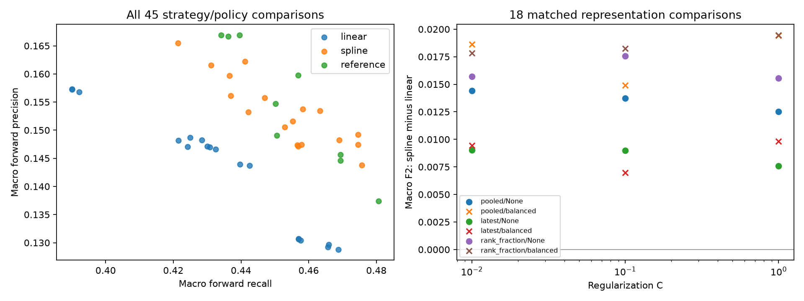
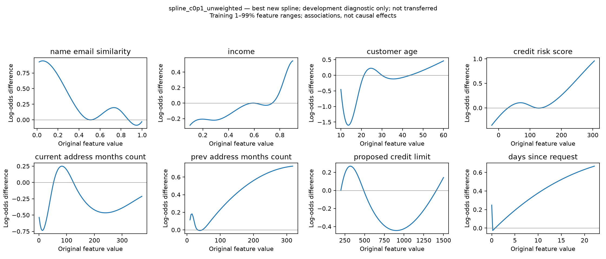

# Newton additive spline-logistic findings

Selected **logit_mean_xgb_d4_w1_baseline_balanced_a50 / pooled**, macro chronological F2 **0.328907**. Positive measured F2 differences against fusion, balanced and unweighted references on both development and consumed transfer: **False**. This is exploratory evidence after adaptive development reuse; month 7 was already consumed and supplies no independent confirmation. Search completion alone does not achieve the performance goal.

## Design and verified inference

Twelve paired logistic recipes cross linear/spline representation, C 0.01/0.1/1 and unweighted/balanced training. They use the same 29 original decoded predictors and earlier training populations. Seventeen numeric effects use observed-training quantile knots, exact duplicate removal, cubic bases and constant extrapolation; seven discrete numeric fields stay linear. Both representations retain training medians, all 24 numeric missing indicators, variance scaling without centering and the same five categorical one-hot vocabularies. Degenerate smooth columns have explicit constant/all-missing fallbacks. No target/month inputs, interactions or target encoding are used. Missing/new-category/range handling is saved with the model.

There were **36 new full development fits**, **9 verified base reuses** and **0 reference fits**, plus three fixed reference fusions. The separate miniature gate made 24 fits. Newton–Cholesky/L2 settings and independent objective/gradient/fallback checks, actual iterations, warnings, dimensions, sparse sizes, time and process memory are exported. Every saved model reproduces positive-class scores and coefficient/intercept margins. Weighted outputs are not asserted calibrated fraud probabilities. All ten older source/config/software/selection identities and the stopped L-BFGS attempt remain preserved. An analysis-only index-reset repair uses separate recorded analysis fingerprints; original fit records, scores and model sources remain unchanged. analysis_declaration.json exposes the repair timing and all preexisting artifacts. numerical.csv records the independently checked objectives, gradients and observed fallback counts; old_solver_comparisons.csv contains optional training-objective diagnostics outside selection.

## Forward actual performance

| candidate | policy | f2 | precision | recall | flagged_fraction | average_precision |
| --- | --- | --- | --- | --- | --- | --- |
| logit_mean_xgb_d4_w1_baseline_balanced_a50 | pooled | 0.328907 | 0.166891 | 0.439609 | 0.034181 | 0.188626 |
| baseline_balanced | pooled | 0.327802 | 0.166693 | 0.436170 | 0.033753 | 0.183160 |
| logit_mean_xgb_d4_w1_baseline_balanced_a50 | latest | 0.327582 | 0.159761 | 0.456850 | 0.038092 | 0.188626 |
| baseline_balanced | latest | 0.327170 | 0.166913 | 0.434101 | 0.033512 | 0.183160 |
| logit_mean_xgb_d4_w1_baseline_balanced_a50 | rank_fraction | 0.323872 | 0.154697 | 0.450255 | 0.036859 | 0.188626 |
| baseline_lgbm | pooled | 0.322654 | 0.145630 | 0.469348 | 0.041789 | 0.182014 |
| spline_c0p1_unweighted | rank_fraction | 0.322264 | 0.150523 | 0.452966 | 0.037916 | 0.186404 |
| spline_c0p01_unweighted | rank_fraction | 0.321480 | 0.147449 | 0.457822 | 0.039114 | 0.186254 |
| baseline_lgbm | latest | 0.321424 | 0.144608 | 0.469348 | 0.042196 | 0.182014 |
| spline_c1p0_balanced | rank_fraction | 0.321374 | 0.147390 | 0.456673 | 0.039011 | 0.186367 |
| spline_c0p1_balanced | rank_fraction | 0.320217 | 0.153218 | 0.442143 | 0.036346 | 0.186464 |
| spline_c1p0_unweighted | rank_fraction | 0.319918 | 0.156127 | 0.436971 | 0.035329 | 0.186735 |
| spline_c0p1_unweighted | pooled | 0.319745 | 0.155748 | 0.447023 | 0.038270 | 0.186404 |
| spline_c0p01_balanced | rank_fraction | 0.319644 | 0.147155 | 0.456912 | 0.039314 | 0.185955 |
| spline_c0p01_unweighted | pooled | 0.319303 | 0.151586 | 0.455328 | 0.039985 | 0.186254 |
| spline_c1p0_balanced | pooled | 0.318929 | 0.162202 | 0.441220 | 0.037381 | 0.186367 |
| spline_c0p01_balanced | pooled | 0.318883 | 0.159720 | 0.436555 | 0.036349 | 0.185955 |
| baseline_balanced | rank_fraction | 0.318771 | 0.149056 | 0.450543 | 0.038377 | 0.183160 |
| baseline_lgbm | rank_fraction | 0.318729 | 0.137376 | 0.480665 | 0.044290 | 0.182014 |
| spline_c1p0_unweighted | pooled | 0.318707 | 0.161552 | 0.431085 | 0.035359 | 0.186735 |
| spline_c0p1_unweighted | latest | 0.316889 | 0.147446 | 0.474610 | 0.045055 | 0.186404 |
| spline_c1p0_unweighted | latest | 0.316139 | 0.149205 | 0.474533 | 0.045440 | 0.186735 |
| spline_c0p01_unweighted | latest | 0.314530 | 0.143794 | 0.475673 | 0.045939 | 0.186254 |
| spline_c0p1_balanced | pooled | 0.314454 | 0.165450 | 0.421403 | 0.034476 | 0.186464 |
| spline_c0p01_balanced | latest | 0.313794 | 0.148259 | 0.468968 | 0.044947 | 0.185955 |
| spline_c1p0_balanced | latest | 0.313509 | 0.153477 | 0.463289 | 0.043936 | 0.186367 |
| spline_c0p1_balanced | latest | 0.310590 | 0.153727 | 0.458300 | 0.043591 | 0.186464 |
| linear_c1p0_unweighted | latest | 0.308544 | 0.143689 | 0.442493 | 0.040391 | 0.157634 |
| linear_c0p1_unweighted | latest | 0.307896 | 0.143952 | 0.439725 | 0.040010 | 0.157733 |
| linear_c1p0_unweighted | pooled | 0.306195 | 0.148158 | 0.421458 | 0.036637 | 0.157634 |
| linear_c0p1_unweighted | pooled | 0.305998 | 0.147037 | 0.424208 | 0.037292 | 0.157733 |
| linear_c0p01_unweighted | rank_fraction | 0.305780 | 0.129194 | 0.465687 | 0.045446 | 0.158089 |
| linear_c0p01_unweighted | latest | 0.305523 | 0.148282 | 0.428423 | 0.038366 | 0.158089 |
| linear_c0p01_unweighted | pooled | 0.304882 | 0.148719 | 0.424975 | 0.037839 | 0.158089 |
| linear_c0p1_unweighted | rank_fraction | 0.304713 | 0.128789 | 0.468722 | 0.046264 | 0.157733 |
| linear_c1p0_unweighted | rank_fraction | 0.304374 | 0.129688 | 0.465973 | 0.045770 | 0.157634 |
| linear_c0p01_balanced | latest | 0.304344 | 0.146581 | 0.432514 | 0.039592 | 0.155374 |
| linear_c1p0_balanced | latest | 0.303697 | 0.147014 | 0.430751 | 0.039417 | 0.155342 |
| linear_c0p1_balanced | latest | 0.303622 | 0.147157 | 0.430062 | 0.039297 | 0.155346 |
| linear_c0p1_balanced | rank_fraction | 0.301976 | 0.130678 | 0.456969 | 0.044555 | 0.155346 |
| linear_c1p0_balanced | rank_fraction | 0.301904 | 0.130607 | 0.456969 | 0.044577 | 0.155342 |
| linear_c0p01_balanced | rank_fraction | 0.301824 | 0.130426 | 0.457678 | 0.044746 | 0.155374 |
| linear_c0p01_balanced | pooled | 0.300266 | 0.156785 | 0.392169 | 0.032136 | 0.155374 |
| linear_c0p1_balanced | pooled | 0.299548 | 0.157323 | 0.390062 | 0.031897 | 0.155346 |
| linear_c1p0_balanced | pooled | 0.299499 | 0.157250 | 0.390062 | 0.031910 | 0.155342 |

All 90 forward rows, 45 macro summaries, 45 pooled-confusion rows, 237 matched contrasts and 45 selectable score summaries remain visible. There are 45 selectable prediction artifacts plus three nonselectable XGBoost dependencies. Month-5 policies use month 4; month-6 policies use months 4/5 or latest month 5. Rank fractions maximize earlier F2, with no 1% quota or precision floor. Actual macro F2 selects the winner; pooled F2 and AP are descriptive. Equal C does not imply equal effective model complexity across representations.

## Conditional development differences

| scope | reference | difference | ci_low | ci_high | replicates |
| --- | --- | --- | --- | --- | --- |
| 5 | fusion | 0.000000 | 0.000000 | 0.000000 | 500 |
| 5 | balanced | 0.001325 | -0.005799 | 0.008630 | 500 |
| 5 | unweighted | 0.001460 | -0.007150 | 0.009011 | 500 |
| 5 | same_model | 0.000000 | 0.000000 | 0.000000 | 500 |
| 6 | fusion | 0.000000 | 0.000000 | 0.000000 | 500 |
| 6 | balanced | 0.000885 | -0.004264 | 0.006977 | 500 |
| 6 | unweighted | 0.011046 | 0.003502 | 0.018768 | 500 |
| 6 | same_model | 0.000000 | 0.000000 | 0.000000 | 500 |
| macro | fusion | 0.000000 | 0.000000 | 0.000000 | 500 |
| macro | balanced | 0.001105 | -0.002882 | 0.005802 | 500 |
| macro | unweighted | 0.006253 | 0.000619 | 0.011613 | 500 |
| macro | same_model | 0.000000 | 0.000000 | 0.000000 | 500 |

## Already-consumed month 7

| role | candidate | policy | f2 | precision | recall | flagged_fraction | tp | fp | fn |
| --- | --- | --- | --- | --- | --- | --- | --- | --- | --- |
| selected | logit_mean_xgb_d4_w1_baseline_balanced_a50 | pooled | 0.372694 | 0.192414 | 0.486695 | 0.037297 | 695 | 2917 | 733 |
| fusion | logit_mean_xgb_d4_w1_baseline_balanced_a50 | pooled | 0.372694 | 0.192414 | 0.486695 | 0.037297 | 695 | 2917 | 733 |
| balanced | baseline_balanced | pooled | 0.364409 | 0.181747 | 0.486695 | 0.039487 | 695 | 3129 | 733 |
| unweighted | baseline_lgbm | pooled | 0.376884 | 0.168248 | 0.546218 | 0.047871 | 780 | 3856 | 648 |
| same_model | logit_mean_xgb_d4_w1_baseline_balanced_a50 | pooled | 0.372694 | 0.192414 | 0.486695 | 0.037297 | 695 | 2917 | 733 |

| scope | reference | difference | ci_low | ci_high | replicates |
| --- | --- | --- | --- | --- | --- |
| 7_consumed | fusion | 0.000000 | 0.000000 | 0.000000 | 500 |
| 7_consumed | balanced | 0.008286 | 0.001241 | 0.014945 | 500 |
| 7_consumed | unweighted | -0.004190 | -0.013532 | 0.003542 | 500 |
| 7_consumed | same_model | 0.000000 | 0.000000 | 0.000000 | 500 |

Only the frozen winner, same-strategy pooled rule, three existing references and winner-type-matched controls were transferred. Fit/reuse counts are in transfer_complete.json; aliases retain comparisons while models are deduplicated. Selection, dependencies and earlier-only final rules were frozen before recorded further access. No losing-setting sweep or hindsight threshold was computed. Failed comparisons remain visible. Clear/confirmed gain language requires a positive conditional interval on the named scope; neither such an interval nor a positive estimate restores an independent test.

## Features, uncertainty and reproducibility

feature_blocks.json records knots, fallbacks, medians, vocabularies, scaler statistics and transformed names. feature_diagnostics.csv records training/prediction missingness, unseen categories and boundary exceedances for every new development fit. coefficients.csv and additive_curves.csv support the checked effects figure; curves describe log-odds associations over training-derived ranges, not causal effects. The curve model and diagnostic scope are recorded in audit.json.

Intervals use 500 paired fixed-decision row draws per month with seed 1027; development macro differences average separately resampled months. All 1500 draws are independently reconstructed using direct sampled Boolean rows. Models, selection, policies and realized decisions remain fixed. Intervals exclude adaptive multiple-study search/selection, retraining, temporal/generative uncertainty and multiplicity adjustment. Results are from one small synthetic benchmark with eight months.

Reproduction uses configs/newton-spline-logistic.json, docs/newton-spline-logistic-protocol.md and the sequential miniature/validate/freeze/exploratory/report commands in README. No package or old protocol was changed. Codex assisted with planning, implementation, analysis and checks; official scikit-learn SplineTransformer and LogisticRegression documentation supplied API definitions. No public notebook was copied. Settings remain analyst-selected, not group-approved operating policy.

