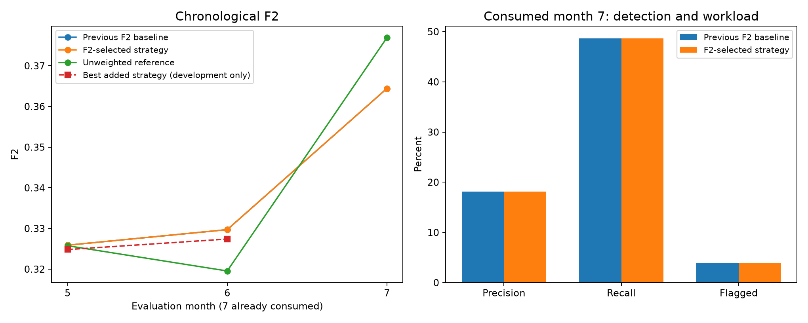

# Adaptive BAF recall-weighted F2 extension

This study continues the user's unachieved recall-weighted detection goal after the prior F2 search produced no gain. It optimizes positive-class **F2=5TP/(5TP+4FN+FP)**, not support-weighted F1, and imposes no review quota or precision floor. Beta=2 and the finite presets are analyst-selected, not approved group decisions.

## Measured result

The earlier-only chronological selection is **baseline_balanced / pooled**, with macro month-5/6 F2 **0.3278** versus **0.3278** for the previous balanced LightGBM F2 policy (difference **+0.0000**).

On already-consumed month 7, the frozen strategy's F2 is **0.3644**, versus balanced **0.3644** and unweighted **0.3769**. Its difference from the stronger observed old baseline is **-0.0125**. It does not beat the stronger observed prior baseline on this consumed period. Its paired conditional difference interval versus unweighted is **[-0.0222, -0.0040]**. The interval excludes zero conditional on fixed models and decisions; this is still exploratory evidence.

Month 7 has already been consumed; no new holdout was created. Repeated development tuning and adaptive extension can be optimistic. A finished search is not itself an improvement, and a positive conditional point estimate is not independent confirmation.

The extension did not establish the requested performance improvement; the goal remains unachieved.

## Selected operating results

| candidate | policy | f2 | f1 | f3 | precision | recall | flagged_fraction | tp | fp | fn |
| --- | --- | --- | --- | --- | --- | --- | --- | --- | --- | --- |
| baseline_balanced | pooled | 0.3644 | 0.2647 | 0.4168 | 0.1817 | 0.4867 | 0.0395 | 695 | 3129 | 733 |
| baseline_lgbm | pooled | 0.3769 | 0.2573 | 0.4460 | 0.1682 | 0.5462 | 0.0479 | 780 | 3856 | 648 |

The selected strategy catches **695** frauds, misses **733** and flags **3,129** legitimate applications, reviewing **3.95%**. All selected/baseline policies were fitted on development predictions and frozen before this further access. Other declared policies are diagnostics, not post-hoc replacements for the selected one.

## Search and controls

36 new development fits and 81 verified reuses cover 39 base models across months 4/5/6. Twelve native LightGBM presets cross weights 1/30/100, leaves 15/31 and rounds 200/600 with all other settings fixed. Fifteen prior F2 recipes remain references. Twelve original recent-K/historical-matched-K recipes retain exact original training rows, class counts and one-hot/imputation preprocessing. The [config](config.json), [protocol](../../docs/recall-weighted-extension-protocol.md) and [audit](audit.json) expose the recipes and identities.

Three historical-seed means and six earlier-selected batch rank ensembles give 48 strategies and 288 forward policy evaluations. Rank percentiles use unlabeled scores from the same application month, never its labels, to put differently weighted models on comparable scales. This requires batch scoring and does not produce calibrated fraud probabilities. Ensemble members can change across folds; [crossfit.csv](crossfit.csv) records their recipes and policy-source months.

| candidate | policy | f2 | precision | recall | flagged_fraction |
| --- | --- | --- | --- | --- | --- |
| baseline_balanced | pooled | 0.3278 | 0.1667 | 0.4362 | 0.0338 |
| baseline_balanced | latest | 0.3272 | 0.1669 | 0.4341 | 0.0335 |
| lgb15_w1 | rank_fraction | 0.3267 | 0.1504 | 0.4621 | 0.0388 |
| rank_window_50 | rank_fraction | 0.3261 | 0.1542 | 0.4528 | 0.0370 |
| rank_window_50 | pooled | 0.3261 | 0.1540 | 0.4531 | 0.0371 |
| rank_window_50 | latest | 0.3260 | 0.1551 | 0.4507 | 0.0366 |
| lgb15_w10 | pooled | 0.3253 | 0.1541 | 0.4584 | 0.0389 |
| ext_l31_w1_r200 | rank_fraction | 0.3251 | 0.1475 | 0.4651 | 0.0398 |
| lgb15_w10 | latest | 0.3244 | 0.1545 | 0.4546 | 0.0384 |
| lgb31_w10 | rank_fraction | 0.3242 | 0.1502 | 0.4577 | 0.0384 |
| window_recent_k500000_s17 | latest | 0.3234 | 0.1570 | 0.4432 | 0.0363 |
| ext_l15_w1_r600 | rank_fraction | 0.3233 | 0.1502 | 0.4549 | 0.0381 |

The original unweighted and balanced macro F2 baselines reproduce. Macro monthly F2 is the selection objective; [pooled_development.csv](pooled_development.csv) separately reports pooled confusion-count F2.

## Ablations and uncertainty

[Matched contrasts](matched_contrasts.csv) include weight-1 controls, boosting duration, leaf capacity, recent-versus-size/class-matched history and seed averaging versus constituents. [Rank-ensemble contrasts](ensemble_contrasts.csv) compare each fold's actual selected member and anchor. [Policy contrasts](policy_contrasts.csv) hold model predictions fixed. These retain unsuccessful effects rather than treating every added strategy as beneficial; window comparisons do not establish causal recency effects.

| eval_month | reference | difference | ci_low | ci_high |
| --- | --- | --- | --- | --- |
| 5 | balanced | 0.0000 | 0.0000 | 0.0000 |
| 5 | unweighted | 0.0001 | -0.0096 | 0.0089 |
| 6 | balanced | 0.0000 | 0.0000 | 0.0000 |
| 6 | unweighted | 0.0102 | 0.0019 | 0.0186 |
| macro | balanced | 0.0000 | 0.0000 | 0.0000 |
| macro | unweighted | 0.0051 | -0.0008 | 0.0102 |

Intervals use 500 paired row-bootstrap draws at fixed decisions, seed 1027. Development macro intervals resample within each month and average differences. They exclude tuning, retraining, temporal and generative uncertainty, have no multiplicity correction, and do not remove adaptive search optimism. Rank-policy uncertainty is conditional on realized decisions, not a bootstrap of reselected rankings. Month-7 policy comparisons are in [paired_intervals.csv](paired_intervals.csv) and the selected comparison to unweighted in [selected_vs_unweighted_interval.csv](selected_vs_unweighted_interval.csv).

## Verification, reproduction and limits

The audit checks base and derived predictions, direct metrics, original training-row hashes and matched class counts, identical future applications, earlier-only policies/members, preserved old artifacts, software/source/config identity and unchanged selection after access. Exploratory transfer needed 0 new dependency fits and 2 verified reuses. Raw data and bulk outputs remain ignored.

Use the [README](../../README.md) sequence: validate, freeze, exploratory, report. Missing caches are refitted into this study's directories using the same frozen recipes; older output directories are never rewritten. Fresh-clone instructions restore the small exported frozen records first. Further tuning requires another separate study.

One synthetic variant, only eight monthly periods, two operating-policy evaluation months, coarse time, unknown label delays and no applicant identifiers limit generalization. Higher F2 can still entail many false positives and missed fraud; workload and precision remain necessary operating judgments. New data is required for independent confirmation.

Codex assisted with design, implementation, verification, plots and interpretation. Acknowledge BAF, scikit-learn, LightGBM and CatBoost in the eventual course report. This is an experiment report, not the final 8-12 page submission.
