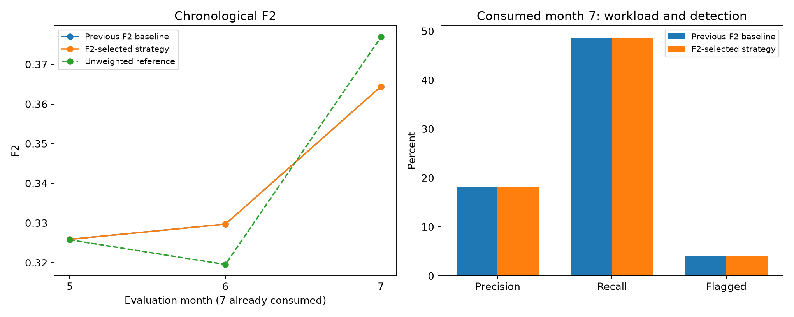

# BAF recall-weighted F2 study

The user requested improved detection with greater emphasis on recall. The objective here is **F2**, not class-support-weighted F1, and there is **no imposed 1% review quota**. F2=5TP/(5TP+4FN+FP), so missed fraud has a fourfold denominator penalty relative to false alarms. Beta=2 remains analyst-selected.

## Measured result

The chronological development selection is **baseline_balanced / pooled**, macro F2 **0.3278** versus **0.3278** for the previous balanced LightGBM F2 policy (difference **+0.0000**). Selection uses months 5/6 with policy parameters and blend members fitted only from earlier prediction months.

On already-consumed month 7, its F2 is **0.3644**, versus **0.3644** for balanced LightGBM (difference **+0.0000**) and **0.3769** for unweighted LightGBM. The development selection does not improve the previous balanced F2 policy on this consumed period. The selected strategy is the reference policy itself.

Month 7 is not fresh confirmation. Repeated development selection, prior dataset knowledge and the finite search make all new comparisons exploratory. A completed search does not by itself establish a performance gain.

## Selected operating points

| candidate | policy | f2 | f1 | f3 | precision | recall | flagged_fraction | tp | fp | fn |
| --- | --- | --- | --- | --- | --- | --- | --- | --- | --- | --- |
| baseline_balanced | pooled | 0.3644 | 0.2647 | 0.4168 | 0.1817 | 0.4867 | 0.0395 | 695 | 3129 | 733 |
| baseline_lgbm | pooled | 0.3769 | 0.2573 | 0.4460 | 0.1682 | 0.5462 | 0.0479 | 780 | 3856 | 648 |

Fraud not caught: **733**. Legitimate applications flagged: **3,129**. The selected policy reviews **3.95%** of applications. These costs remain visible even if F2 improves. Other policies below are diagnostics and are not substituted for the frozen selected policy after seeing month 7.

## Development search

30 new development fits and 15 verified read-only reuses cover 15 base candidates across months 4/5/6. Nine LightGBM presets cross leaves 15/31/63 with positive weights 1/3/10, with all other training parameters fixed. CatBoost compares weights 1/3/10 using the same engineered depth-6 preset. The original unweighted/balanced LightGBM and native31 are retained references. Three family blends and three policies yield 108 cross-fitted evaluations. See [exact config](config.json) and [protocol](../../docs/recall-weighted-protocol.md).

| candidate | policy | f2 | precision | recall | flagged_fraction |
| --- | --- | --- | --- | --- | --- |
| baseline_balanced | pooled | 0.3278 | 0.1667 | 0.4362 | 0.0338 |
| baseline_balanced | latest | 0.3272 | 0.1669 | 0.4341 | 0.0335 |
| lgb15_w1 | rank_fraction | 0.3267 | 0.1504 | 0.4621 | 0.0388 |
| lgb15_w10 | pooled | 0.3253 | 0.1541 | 0.4584 | 0.0389 |
| blend50 | rank_fraction | 0.3247 | 0.1538 | 0.4515 | 0.0370 |
| lgb15_w10 | latest | 0.3244 | 0.1545 | 0.4546 | 0.0384 |
| lgb31_w10 | rank_fraction | 0.3242 | 0.1502 | 0.4577 | 0.0384 |
| blend75 | rank_fraction | 0.3241 | 0.1570 | 0.4424 | 0.0355 |
| baseline_lgbm | pooled | 0.3227 | 0.1456 | 0.4693 | 0.0418 |
| catboost_weight10 | pooled | 0.3225 | 0.1462 | 0.4682 | 0.0415 |
| lgb31_w3 | rank_fraction | 0.3225 | 0.1480 | 0.4571 | 0.0390 |
| lgb15_w10 | rank_fraction | 0.3223 | 0.1477 | 0.4624 | 0.0397 |

The original balanced/unweighted pooled-policy macro F2 values reproduce exactly. Macro monthly F2 and pooled confusion-count F2 differ; [pooled_development.csv](pooled_development.csv) reports the latter without replacing the selection objective.

## Controlled contrasts and policy effects

The [matched ablations](ablations.csv) retain all weight and leaf-capacity contrasts, including negative effects. The [policy comparisons](policy_comparisons.csv) hold predictions fixed while varying earlier-only policy fitting. New models under the original pooled policy and old models under the new policies separate modelling changes from policy changes; a threshold-only gain is not claimed as improved score ranking.

Blends select each family's member using earlier prediction months only. Their members can differ across forward folds. Weighted member scores and raw-score averages are not calibrated fraud probabilities. Threshold optimization emphasizes F2 rather than enforcing 90% recall, a precision floor, or a review quota.

## Uncertainty, verification and limits

| eval_month | difference | ci_low | ci_high |
| --- | --- | --- | --- |
| 5 | 0.0000 | 0.0000 | 0.0000 |
| 6 | 0.0000 | 0.0000 | 0.0000 |
| macro | 0.0000 | 0.0000 | 0.0000 |

These are conditional paired row-bootstrap intervals at fixed decisions (500 draws, seed 1027; per-month seeds recorded by implementation). The macro interval resamples within each month and averages month-level differences. They exclude tuning/retraining/time/generative uncertainty and multiplicity correction; selection optimism remains. Rank-fraction uncertainty is conditional on realized decisions, not a bootstrap of reselected review rankings. Month-7 intervals for every declared diagnostic are in [paired_intervals.csv](paired_intervals.csv).

The [audit](audit.json) verifies all saved metrics against predictions, source/config/software identity, eligible training populations, identical evaluation cases, preserved prior runs and an unchanged selection hash frozen before further month-7 access. 0 new selected/dependency fits and 2 verified reuses support the consumed-period comparison. Six threads and fixed iterations were used; no outer-fold early stopping or evaluation-fitted preprocessing is allowed.

One synthetic variant, eight coarse monthly periods, unknown label delays, no applicant/transaction identifiers and only two cross-fitted operating-policy evaluation months limit generalization. A feature bundle's success does not identify causal predictors. The settings are analyst-selected and remain open to group review. Further tuning needs a separate frozen study; new data is needed for independent confirmation.

## Reproduction and acknowledgment

Follow the [README](../../README.md) commands: development validation, selection freeze, exploratory transfer, then report. Bulk data/models/predictions remain ignored. Config and selection are exported here for review; checkpoints reject source/config/software drift and changed reuse artifacts.

Codex assisted with protocol design, modelling implementation, verification, plotting and interpretation. Acknowledge BAF, scikit-learn, LightGBM and CatBoost in the course report. These experiments do not constitute the final 8-12 page course deliverable.
