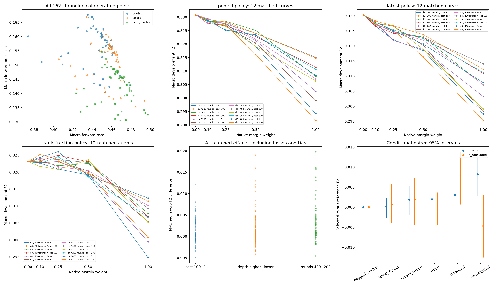

# Shallow CatBoost study findings

Selected **bagged_anchor_balanced_logit_a25 / pooled**, macro chronological F2 **0.330880962**. Measured improvement against all six fixed references in development and consumed transfer: **False**. Completing this finite search does not itself achieve the broader performance goal.

Twelve native recipes cross depth 3/4/6, 200/400 rounds and fixed positive cost 1/100. Thirty-six fixed raw-margin blends and six references yield 54 strategies and 162 policy cases. Positive-class F2 uses beta=2 without a review quota or precision floor. All settings are adaptive analyst selections, open to group review.

All 29 raw predictors use training-only numerical medians and native categorical inputs. RawFormulaVal scores and fixed blends are finite margins, not calibrated fraud probabilities. Original references retain their frozen representations. Depth/round comparisons do not equalize runtime, storage or categorical-statistic work.

Models for months 4/5/6 use strictly earlier training rows. Month-5 rules use month 4; month-6 rules use months 4/5 or latest 5. Selection is actual macro F2 across months 5/6. Transfer roles and exact dependencies were frozen before further month-7 access. Month 7 is an already-consumed exploratory evaluation, not independent confirmation.

| Fixed reference | Macro F2 difference | Consumed F2 difference |
| --- | ---: | ---: |
| bagged_anchor | +0.000000000 | +0.000000000 |
| latest_fusion | +0.000087708 | +0.000705952 |
| recent_fusion | +0.001871017 | +0.001992179 |
| fusion | +0.001974392 | -0.000454375 |
| balanced | +0.003079384 | +0.007831191 |
| unweighted | +0.008227277 | -0.004644674 |

All operating results, matched effects including negative values and ties, score/diversity/overlap diagnostics, requested/effective parameters, preprocessing and actual model work are exported beside this report. Current/historical methodological test calls, fourteen production miniature fits, full native fits, exact reference reproductions and verified reuses are separately recorded in their ledgers.

The 1500 paired row-bootstrap draws keep policies and decisions fixed. Intervals are conditional on the observed synthetic cases and exclude retraining, adaptive recipe/source/policy/selection search, temporal/generative variation and multiple-comparison uncertainty. Clear-gain claims require positive lower bounds in the named scope. Repeated consumed-month access further limits generalization claims.

Codex assisted with design, implementation, tests and interpretation. Primary documentation: [CatBoost raw predictions](https://catboost.ai/docs/en/concepts/python-reference_catboostclassifier_predict), [training parameters](https://catboost.ai/docs/en/references/training-parameters/common), [margin/probability output](https://catboost.ai/docs/en/concepts/output-data_model-value-output), and [native serialization](https://catboost.ai/docs/en/concepts/python-reference_catboostranker_save_model). No public notebook was copied.

## Measured new strategies and matched controls

| Strategy | Policy | Macro F2 | Macro recall | Macro precision |
| --- | --- | ---: | ---: | ---: |
| Best new native: cb_d4_r400_w100 | pooled | 0.315118369 | 0.457797 | 0.142326 |
| Best new blend: cb_anchor_d4_r200_w1_a10 | pooled | 0.329399758 | 0.460527 | 0.156576 |

The best new native trails the incumbent by 0.015762592 F2; the best new blend trails by 0.001481204. No new strategy displaced the existing anchor. More native weight generally worsens the pooled/latest curves; this observation does not authorize a new blend search.

| Matched intervention | Positive / negative / tied effects | Mean F2 change | Range |
| --- | ---: | ---: | ---: |
| Positive cost 100 minus 1 | 42 / 30 / 0 | +0.000972054 | -0.004955247 to +0.012149760 |
| Higher depth minus lower, all three pairs | 95 / 49 / 0 | +0.001369532 | -0.004134410 to +0.018993167 |
| 400 rounds minus 200 | 60 / 12 / 0 | +0.003112492 | -0.004550067 to +0.019742403 |

Depth/round/cost effects include pure models and all interior blend weights at each operating policy. The results provide no overall evidence that the shallower/shorter intervention improved the incumbent. Effects are repeated, dependent comparisons; counts are descriptive, not independent hypothesis tests.

## Bounded consumed-month transfer and uncertainty

| Role | F2 | Recall | Precision | Fraud detected | Legitimate flagged | Fraud missed |
| --- | ---: | ---: | ---: | ---: | ---: | ---: |
| selected | 0.372239748 | 0.495798 | 0.186414 | 708 | 3090 | 720 |
| latest_fusion | 0.371533795 | 0.480392 | 0.194886 | 686 | 2834 | 742 |
| recent_fusion | 0.370247569 | 0.469188 | 0.200839 | 670 | 2666 | 758 |
| fusion | 0.372694123 | 0.486695 | 0.192414 | 695 | 2917 | 733 |
| balanced | 0.364408557 | 0.486695 | 0.181747 | 695 | 3129 | 733 |
| unweighted | 0.376884422 | 0.546218 | 0.168248 | 780 | 3856 | 648 |

The selected policy flags 3798 of 96843 applications (3.9218%), detecting 708 of 1428 frauds. This is learned earlier-only F2 thresholding without the original 1% review cap. It remains below the unweighted reference in consumed F2. Selected, bagged-anchor and same-strategy roles are exact aliases; all corresponding differences and intervals are exactly zero.

| Fixed reference | Macro difference [conditional 95% interval] | Consumed difference [conditional 95% interval] |
| --- | ---: | ---: |
| bagged_anchor | +0.000000 [+0.000000, +0.000000] | +0.000000 [+0.000000, +0.000000] |
| latest_fusion | +0.000088 [-0.002631, +0.002345] | +0.000706 [-0.003961, +0.005732] |
| recent_fusion | +0.001871 [-0.001891, +0.005283] | +0.001992 [-0.004487, +0.007265] |
| fusion | +0.001974 [-0.001161, +0.005014] | -0.000454 [-0.004482, +0.003701] |
| balanced | +0.003079 [-0.000952, +0.007659] | +0.007831 [+0.000679, +0.013801] |
| unweighted | +0.008227 [+0.002848, +0.013327] | -0.004645 [-0.012565, +0.003035] |

The incumbent has a positive conditional macro interval against unweighted and a positive consumed interval against balanced. Its macro intervals against latest/recent/tree fusion and balanced include zero; its consumed intervals against latest/recent/tree fusion and unweighted include zero. Neither these intervals nor point estimates establish a gain from the new CatBoost intervention. They exclude adaptive selection and other uncertainties stated above.

## Actual execution and verification

Scientific production used 36 full native development fits and fourteen separate new production miniature fits. It reused 24 development base results and fifteen derived references, calculating 108 new blends: sixty saved models, 99 model files and 183 development score sets. The transfer reused eight bases and five derived scores, with nine model files/thirteen scores and zero new native or exact-reference fits. Original 9/8-fit source gates were audited without new source miniature fitting.

Seven methodological invocations, including failures and focused checks, performed 126 current-study and 255 historical tiny fits. The final primary and disposable-copy suites each passed all 2136 tests (221 current), with eighteen current/85 historical fits each. Original failures, source snapshots and ledgers remain preserved; default copied ledgers are not additional fits. The exact documented restore/setup block also passed in the cache-free copy. The pinned runtime and checksum-verified Base symlink were shared; fresh installation/full-size clean-copy training were not executed.

Independent reporting checked all sixty development and eight transfer models, all 1728 contrast identities, 1500 bootstrap draws/28 intervals, and all six figure panels with 162 operating points, 36 curves/180 endpoint rows, 288 matched effects and twelve reference intervals. See the accompanying audit, reproduction, fit ledgers and figure-value exports.

