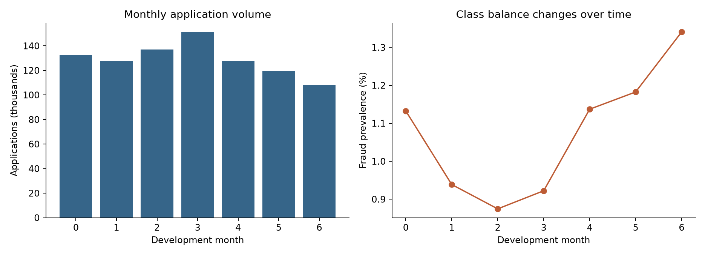
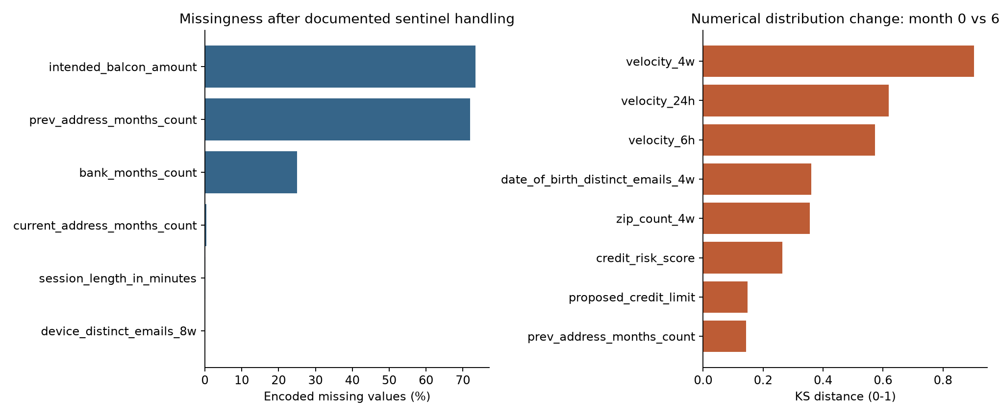
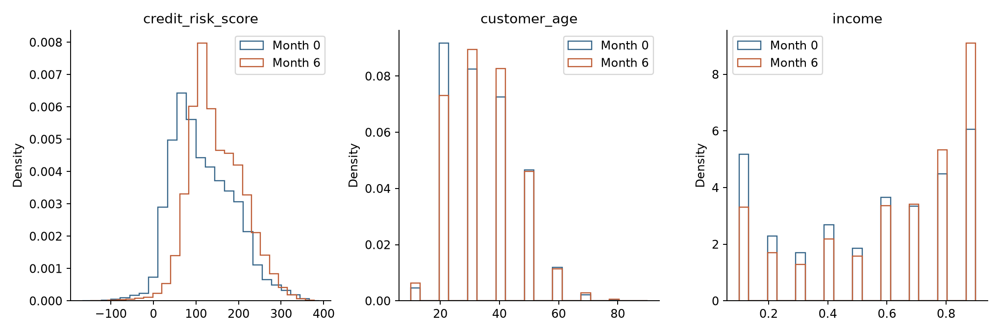
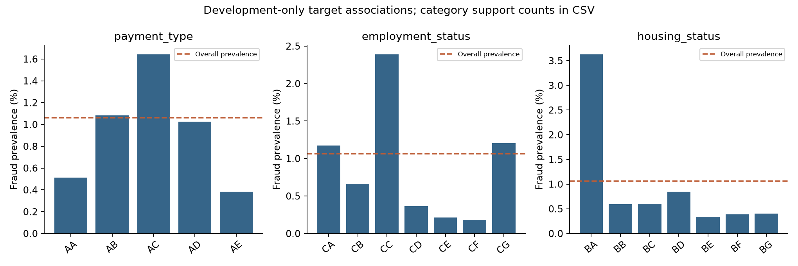
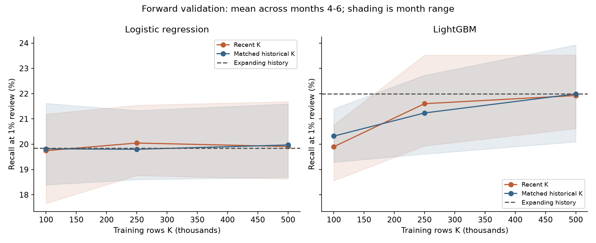
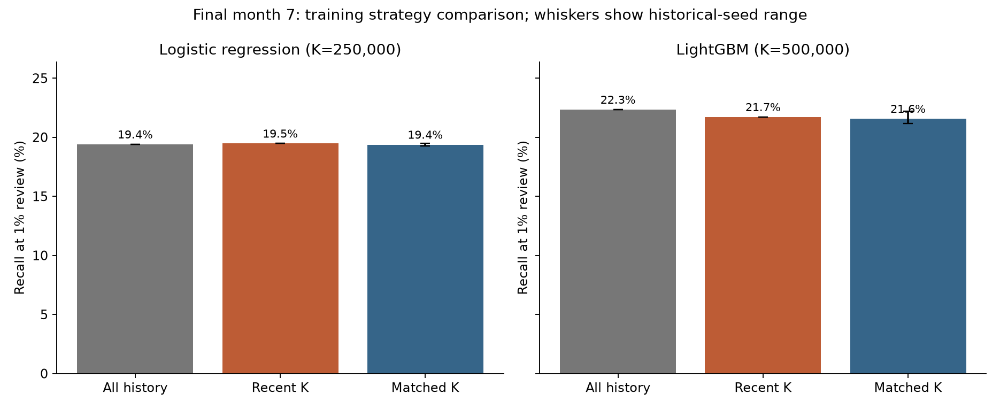
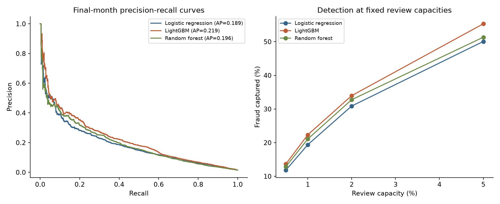
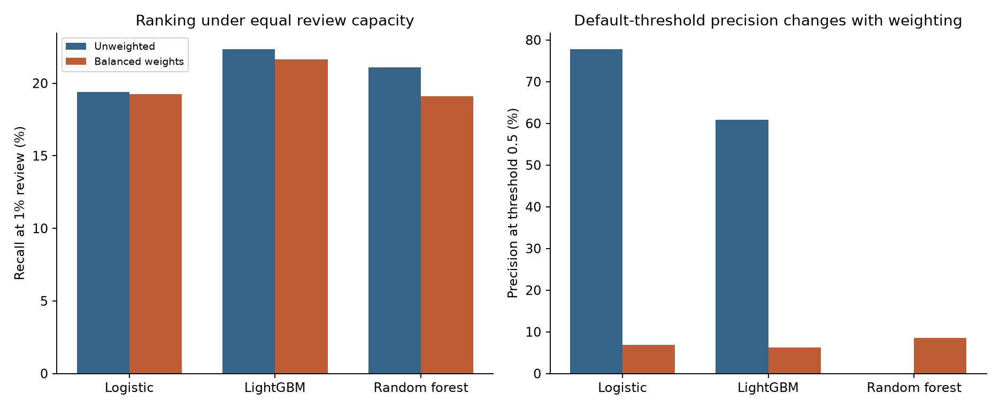

# BAF Base v2: EDA and first hypothesis tests

Measured study, 10 October 2026. Codex assisted with design, code, execution and interpretation; group review is required before submission.

## Main result

The validation-selected candidate was **LightGBM, expanding history (903,157 training rows), balanced**. On month 7 it captured **21.64%** of fraud at 1% review, with **31.89% precision** and **AP 0.2122**. The holdout contains 96,843 applications and 1,428 fraud cases; the review quota is 969. It flags 309 frauds and 660 legitimate applications while missing 1,119 frauds. Historical-control results are seed means where applicable, so counts may be fractional averages. This is a small synthetic benchmark, not a production performance claim.

## What the evidence supports

Both final recent-minus-matched intervals include zero; the study does not establish a reliable recency advantage. The intervals still allow modest effects in either direction.

At the same 1% review capacity, the predeclared **unweighted expanding-history** baselines captured: **LightGBM 22.34%; Random forest 21.08%; Logistic regression 19.40%**. These are descriptive comparisons of fixed presets. The validation-selected candidate remains the weighted LightGBM configuration above; a higher observed holdout score does not retroactively change that selection.

Balanced class weighting reduced final recall at 1% review for all three tested model presets. It improved F1 at the arbitrary 0.5 threshold, but validation-selected thresholds gave stronger F1 for the unweighted versions. This points to threshold policy and score scale as central to interpreting the weighting comparison.

## Design and what each comparison tests

The [protocol](../../docs/experiment-protocol.md) and [configuration](../../configs/study.json) specify settings fixed before final scoring. Three forward validation folds evaluate months 4, 5 and 6. Recent and historical samples have identical K and exact class counts; historical samples use three seeds and can include recent rows. K is selected from validation recent-strategy recall. Final month 7 is accessed only after a hash-stamped selection freeze. Class weighting and model comparisons use expanding history, keeping that ablation separate from the recency experiment.

Tables express recall, precision, prevalence, missing fractions and AP as fractions (0.20 means 20%), unless a column explicitly says percentage points (`pp`). For expanding-history rows, `k=0` is an internal marker for using all eligible training rows; it does not mean an empty training set.

## EDA: development months 0-6 only

The development set contains 903,157 applications, 0 literal null cells and 0 duplicate rows. `device_fraud_count` is constant zero and excluded; `month` is split-only. There are 29 candidate predictors. Encoded missing values require explicit treatment despite the absence of literal nulls.

| month | rows | fraud | prevalence |
|---|---|---|---|
| 0 | 132440 | 1500 | 0.0113 |
| 1 | 127620 | 1198 | 0.0094 |
| 2 | 136979 | 1198 | 0.0087 |
| 3 | 150936 | 1392 | 0.0092 |
| 4 | 127691 | 1452 | 0.0114 |
| 5 | 119323 | 1411 | 0.0118 |
| 6 | 108168 | 1450 | 0.0134 |

Fraud prevalence changes across development months; detection at a fixed quota must be interpreted alongside precision and prevalence rather than accuracy alone.

| feature | missing_fraction |
|---|---|
| intended_balcon_amount | 0.7347 |
| prev_address_months_count | 0.7194 |
| bank_months_count | 0.2502 |
| current_address_months_count | 0.0038 |
| session_length_in_minutes | 0.0020 |
| device_distinct_emails_8w | 0.0004 |

The largest numerical distribution changes are in the application-velocity features. The table reports KS distance for numerical variables and total-variation distance for categorical variables, comparing months 0 and 6. These are effect sizes, not proof of changing fraud mechanisms; measures across variable types are not a single common drift scale.

| feature | measure | effect | missing_change |
|---|---|---|---|
| velocity_4w | ks_statistic | 0.9033 | 0.0000 |
| velocity_24h | ks_statistic | 0.6191 | 0.0000 |
| velocity_6h | ks_statistic | 0.5727 | 0.0000 |
| date_of_birth_distinct_emails_4w | ks_statistic | 0.3607 | 0.0000 |
| zip_count_4w | ks_statistic | 0.3560 | 0.0000 |
| credit_risk_score | ks_statistic | 0.2634 | 0.0000 |
| housing_status | total_variation | 0.1538 | 0.0000 |
| payment_type | total_variation | 0.1511 | 0.0000 |
| proposed_credit_limit | ks_statistic | 0.1480 | 0.0000 |
| prev_address_months_count | ks_statistic | 0.1427 | 0.0513 |
| employment_status | total_variation | 0.1327 | 0.0000 |
| income | ks_statistic | 0.1263 | 0.0000 |

Development-only associations with fraud are descriptive: numerical values below are Pearson correlations using available values, and categorical plots show group prevalence. These do not establish causation, and associations can change over time. Support counts, numerical-quantile fraud rates and class-conditional monthly means are provided in the accompanying CSVs. They were not used to select predictors or tune models.

| feature | pearson_correlation_with_fraud |
|---|---|
| credit_risk_score | 0.0682 |
| proposed_credit_limit | 0.0665 |
| customer_age | 0.0631 |
| keep_alive_session | -0.0492 |
| income | 0.0439 |
| date_of_birth_distinct_emails_4w | -0.0429 |
| device_distinct_emails_8w | 0.0374 |
| name_email_similarity | -0.0357 |

## Theory 1: recent data versus matched historical data

Validation differences below average the historical seeds within each month, then give each forward month equal weight. Positive differences favor recent training. The month-range columns show whether any apparent advantage is stable over time.

| model | k | recent_mean_recall | matched_mean_recall | difference_pp | min_month_difference_pp | max_month_difference_pp | months_recent_better |
|---|---|---|---|---|---|---|---|
| logistic | 100000 | 0.1974 | 0.1982 | -0.0732 | -0.7356 | 0.9412 | 1 |
| logistic | 250000 | 0.2005 | 0.1980 | 0.2469 | 0.1609 | 0.3673 | 3 |
| logistic | 500000 | 0.1991 | 0.1997 | -0.0604 | -0.2066 | 0.0945 | 1 |
| lightgbm | 100000 | 0.1990 | 0.2032 | -0.4196 | -0.7356 | 0.1148 | 1 |
| lightgbm | 250000 | 0.2160 | 0.2124 | 0.3674 | -0.0230 | 0.8032 | 2 |
| lightgbm | 500000 | 0.2193 | 0.2199 | -0.0648 | -0.4016 | 0.5287 | 1 |

Final comparisons use K chosen from validation, not the holdout. Matched-control uncertainty is conditional on these fitted models and the chosen settings. It does not include all retraining or temporal variation.

- **Logistic regression, recent minus mean matched:** +0.09 percentage points; conditional 95% interval [-0.61, +0.89] pp (includes zero).

- **Logistic regression, recent minus expanding:** +0.07 percentage points; conditional 95% interval [-0.91, +0.88] pp (includes zero).

- **LightGBM, recent minus mean matched:** +0.14 percentage points; conditional 95% interval [-0.81, +0.89] pp (includes zero).

- **LightGBM, recent minus expanding:** -0.63 percentage points; conditional 95% interval [-1.58, +0.29] pp (includes zero).

| model | strategy | k | weighted | recall | precision | ap | tp | fp | missed | min_seed_recall | max_seed_recall |
|---|---|---|---|---|---|---|---|---|---|---|---|
| lightgbm | expanding | 0 | False | 0.2234 | 0.3292 | 0.2186 | 319.0000 | 650.0000 | 1109.0000 | 0.2234 | 0.2234 |
| lightgbm | expanding | 0 | True | 0.2164 | 0.3189 | 0.2122 | 309.0000 | 660.0000 | 1119.0000 | 0.2164 | 0.2164 |
| lightgbm | historical_matched | 500000 | False | 0.2157 | 0.3179 | 0.2115 | 308.0000 | 661.0000 | 1120.0000 | 0.2115 | 0.2220 |
| lightgbm | recent | 500000 | False | 0.2171 | 0.3199 | 0.2112 | 310.0000 | 659.0000 | 1118.0000 | 0.2171 | 0.2171 |
| logistic | expanding | 0 | False | 0.1940 | 0.2859 | 0.1888 | 277.0000 | 692.0000 | 1151.0000 | 0.1940 | 0.1940 |
| logistic | expanding | 0 | True | 0.1926 | 0.2838 | 0.1865 | 275.0000 | 694.0000 | 1153.0000 | 0.1926 | 0.1926 |
| logistic | historical_matched | 250000 | False | 0.1937 | 0.2855 | 0.1884 | 276.6667 | 692.3333 | 1151.3333 | 0.1926 | 0.1947 |
| logistic | recent | 250000 | False | 0.1947 | 0.2869 | 0.1873 | 278.0000 | 691.0000 | 1150.0000 | 0.1947 | 0.1947 |
| random_forest | expanding | 0 | False | 0.2108 | 0.3106 | 0.1956 | 301.0000 | 668.0000 | 1127.0000 | 0.2108 | 0.2108 |
| random_forest | expanding | 0 | True | 0.1912 | 0.2817 | 0.1797 | 273.0000 | 696.0000 | 1155.0000 | 0.1912 | 0.1912 |

## Theory 2: more data and model family

The validation training-size curves show whether detection improves as K rises under recent and matched-historical retention. Across K, class proportions can differ because controls match each recent-K sample; this is not a pure size-only ablation. The expanding reference answers the practical all-history question but has a different size and composition; it does not isolate recency. Final unweighted expanding baselines compare the three fixed model presets on the same applications. No hyperparameter search was performed, so these results do not establish a universally best model family.

The unweighted expanding-history LightGBM model's most-used transformed features are shown below. Importance is split count, not gain, a causal effect or a complete explanation; correlated and high-cardinality predictors complicate interpretation. Logistic coefficients and random-forest importances are also saved as descriptive diagnostics.

| feature | importance |
|---|---|
| numeric__velocity_4w | 195 |
| numeric__current_address_months_count | 175 |
| numeric__name_email_similarity | 164 |
| numeric__days_since_request | 162 |
| numeric__credit_risk_score | 156 |
| numeric__bank_branch_count_8w | 136 |
| numeric__session_length_in_minutes | 111 |
| numeric__customer_age | 104 |
| numeric__phone_home_valid | 95 |
| numeric__date_of_birth_distinct_emails_4w | 95 |

## Theory 3: class weighting and threshold policy

Balanced weighting changes the training objective and may change both rankings and probability scale. Compare recall at equal review capacity to assess ranking. Default-threshold results use 0.5; selected-threshold results use thresholds chosen from validation only. Differences at 0.5 alone are not evidence that a model has improved operationally.

| model | weighted | recall_at_1pct | precision_at_1pct | average_precision | default_precision | default_recall | default_f1 | selected_precision | selected_recall | selected_f1 | selected_threshold |
|---|---|---|---|---|---|---|---|---|---|---|---|
| lightgbm | False | 0.2234 | 0.3292 | 0.2186 | 0.6087 | 0.0392 | 0.0737 | 0.2522 | 0.3368 | 0.2885 | 0.0997 |
| lightgbm | True | 0.2164 | 0.3189 | 0.2122 | 0.0622 | 0.8235 | 0.1157 | 0.2475 | 0.3228 | 0.2802 | 0.8973 |
| logistic | False | 0.1940 | 0.2859 | 0.1888 | 0.7778 | 0.0049 | 0.0097 | 0.2331 | 0.2955 | 0.2607 | 0.0825 |
| logistic | True | 0.1926 | 0.2838 | 0.1865 | 0.0685 | 0.7682 | 0.1257 | 0.2453 | 0.2668 | 0.2556 | 0.8985 |
| random_forest | False | 0.2108 | 0.3106 | 0.1956 | 0.0000 | 0.0000 | 0.0000 | 0.2445 | 0.3242 | 0.2787 | 0.0798 |
| random_forest | True | 0.1912 | 0.2817 | 0.1797 | 0.0851 | 0.6996 | 0.1518 | 0.2180 | 0.2948 | 0.2507 | 0.7937 |

## Random-split diagnostic

An 80/20 stratified random split of development months only gives the following unweighted results. It uses different training size and evaluation populations from the chronological folds; average precision also depends on population prevalence. A gap cannot be attributed solely to temporal drift, and the holdout month is excluded from this diagnostic.

| model | train_rows | n_eval | recall_at_1pct | precision_at_1pct | average_precision | default_f1 |
|---|---|---|---|---|---|---|
| lightgbm | 722525 | 180632 | 0.2240 | 0.2380 | 0.1641 | 0.0704 |
| logistic | 722525 | 180632 | 0.1979 | 0.2103 | 0.1357 | 0.0164 |
| random_forest | 722525 | 180632 | 0.2151 | 0.2286 | 0.1435 | 0.0000 |

## Verification, uncertainty and next use

Completed 90 validation, 14 final and 3 diagnostic fits. Eight methodological tests verify temporal sampling, exact class/size controls, missing-code handling, training-only preprocessing, rounding/ties, bootstrap equivalence and freeze guards. Full-data audits passed training boundaries, equal evaluation cases, matched class counts, quota/confusion accounting, source/config identity and freeze-before-test ordering. No convergence warnings were found.

The 500-replicate paired percentile intervals resample final test rows under fixed fitted models. They exclude model-selection/retraining and between-month uncertainty and are unadjusted for multiple comparisons. Historical-seed ranges and forward-month variation are reported separately. One variant, three forward folds, one final month, coarse timestamps, synthetic generation and unobserved reporting delays limit the claims. Age and other sensitive attributes remain predictors; no fairness audit or deployment recommendation is implied.

Month 7 has now been consumed. Future tuning on these findings is exploratory and requires new holdout evidence for confirmatory claims. Review model-specific coefficients/importances as descriptive diagnostics; they are not causal explanations or a replacement for a future interpretability/fairness study.

Reproduce using the [README](../../README.md). Run-level metrics, selection, feature diagnostics, audits and all small EDA tables accompany this report; bulk predictions/checkpoints remain in ignored `outputs/`.

Sources: [BAF](https://github.com/feedzai/bank-account-fraud), [datasheet](https://github.com/feedzai/bank-account-fraud/blob/main/documents/datasheet.pdf), [LightGBM parameters](https://lightgbm.readthedocs.io/en/stable/Parameters.html), [scikit-learn average precision](https://scikit-learn.org/stable/modules/generated/sklearn.metrics.average_precision_score.html). See pinned software versions in `requirements.txt` and acknowledge AI/external software in the final course report.
