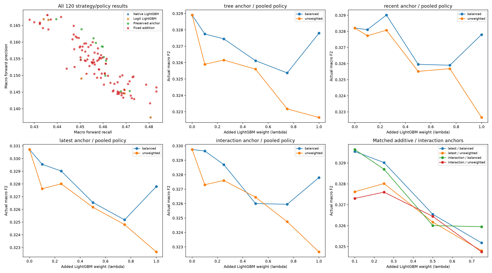

# Unweighted-reference fusion findings

Selected **interaction_blend_spline_c1p0_balanced_a10 / latest**, macro development F2 **0.330793**. Positive measured differences against all five fixed references on both development and consumed transfer: **False**. Finite-search completion does not itself establish the performance goal.

## Design and actual work

Four preserved margins receive balanced or unweighted LightGBM at fixed lambdas 0.10/0.25/0.50/0.75. Four anchors, two native and two logit controls plus 32 additions form 40 canonical strategies. The half-balanced addition to the tree margin retains its historical quarter-XGBoost/three-quarter-balanced identity and direct floating-point association; it is not a renamed gain. Only probability-like scores receive logit clipping (epsilon 1e-6); anchors are finite margins. Neither scores nor analyst-selected weights are asserted calibrated probabilities or bank costs.

Development used 18 independently checked base reuses and 0 new full fits. Its 114 derived results include 15 checked historical reuses and 99 new arithmetic calculations. There are 132 physical scores, 120 selectable scores, 240 forward rows, 120 macro/pooled/monthly-score summaries and 1199 contrasts. Four new tiny cache-test fits per full invocation are separate from historical test-module fits; the recorded suite passed 922 tests. The preserved eight-fit miniature gate required no new production miniature fits. Predictor-only preflight covers 903157 eligible rows, bounded 8192-row construction and the unchanged 70%-of-host-RAM gate.

Models/preprocessing use earlier training months. Month-5 policies learn month 4; month-6 policies learn months 4/5 or latest month 5. Actual macro F2 beta=2 determines selection, then recall/precision/deterministic IDs, without a quota or precision floor. AP, pooled F2, correlations and joint errors are descriptive.

## Complete chronological results

| candidate | policy | f2 | precision | recall | flagged_fraction | average_precision |
| --- | --- | --- | --- | --- | --- | --- |
| interaction_blend_spline_c1p0_balanced_a10 | latest | 0.330793 | 0.158659 | 0.459837 | 0.037598 | 0.189693 |
| interaction_blend_spline_c1p0_balanced_a10 | pooled | 0.330716 | 0.158702 | 0.459493 | 0.037552 | 0.189693 |
| interaction_blend_interaction_c1p0_balanced_a10 | pooled | 0.329747 | 0.163896 | 0.450624 | 0.036165 | 0.189630 |
| lgbm_blend_recent_balanced_l25 | latest | 0.329726 | 0.167583 | 0.441640 | 0.034390 | 0.189483 |
| lgbm_blend_interaction_balanced_l10 | pooled | 0.329645 | 0.161687 | 0.448085 | 0.035514 | 0.189465 |
| lgbm_blend_latest_balanced_l10 | pooled | 0.329552 | 0.158127 | 0.457730 | 0.037494 | 0.189471 |
| lgbm_blend_latest_balanced_l10 | latest | 0.329451 | 0.159107 | 0.454627 | 0.036898 | 0.189471 |
| lgbm_blend_latest_balanced_l25 | pooled | 0.329019 | 0.161278 | 0.449397 | 0.036013 | 0.188879 |
| lgbm_blend_recent_balanced_l25 | pooled | 0.329014 | 0.164880 | 0.447157 | 0.035716 | 0.189483 |
| margin_blend_spline_c0p1_unweighted_a25 | latest | 0.329010 | 0.155537 | 0.460249 | 0.038074 | 0.190366 |
| logit_mean_xgb_d4_w1_baseline_balanced_a50 | pooled | 0.328907 | 0.166891 | 0.439609 | 0.034181 | 0.188626 |
| lgbm_blend_interaction_balanced_l25 | pooled | 0.328701 | 0.159638 | 0.452510 | 0.036718 | 0.188843 |
| interaction_blend_interaction_c1p0_balanced_a10 | latest | 0.328543 | 0.161176 | 0.455797 | 0.037580 | 0.189630 |
| margin_blend_spline_c0p1_unweighted_a25 | pooled | 0.328205 | 0.154440 | 0.461284 | 0.038527 | 0.190366 |
| lgbm_blend_recent_balanced_l10 | pooled | 0.328109 | 0.155296 | 0.458515 | 0.037988 | 0.190163 |
| lgbm_blend_recent_unweighted_l25 | pooled | 0.328070 | 0.159583 | 0.451811 | 0.036798 | 0.189208 |
| lgbm_blend_latest_unweighted_l25 | pooled | 0.328016 | 0.158549 | 0.453554 | 0.037135 | 0.188736 |
| lgbm_blend_recent_balanced_l10 | latest | 0.328001 | 0.155195 | 0.458515 | 0.038020 | 0.190163 |
| baseline_balanced | pooled | 0.327802 | 0.166693 | 0.436170 | 0.033753 | 0.183160 |
| logit_baseline_balanced | pooled | 0.327802 | 0.166693 | 0.436170 | 0.033753 | 0.183160 |
| lgbm_blend_tree_balanced_l10 | pooled | 0.327748 | 0.166773 | 0.437176 | 0.034015 | 0.188462 |
| lgbm_blend_recent_unweighted_l10 | pooled | 0.327729 | 0.162291 | 0.447204 | 0.036011 | 0.189956 |
| lgbm_blend_latest_unweighted_l10 | pooled | 0.327623 | 0.156538 | 0.457692 | 0.038055 | 0.189459 |
| lgbm_blend_interaction_unweighted_l25 | pooled | 0.327604 | 0.160828 | 0.446629 | 0.035846 | 0.188657 |
| lgbm_blend_interaction_balanced_l10 | latest | 0.327600 | 0.155018 | 0.461533 | 0.038856 | 0.189465 |
| logit_mean_xgb_d4_w1_baseline_balanced_a50 | latest | 0.327582 | 0.159761 | 0.456850 | 0.038092 | 0.188626 |
| lgbm_blend_tree_balanced_l25 | latest | 0.327469 | 0.168114 | 0.435730 | 0.033851 | 0.188064 |
| lgbm_blend_tree_balanced_l25 | pooled | 0.327453 | 0.168098 | 0.435730 | 0.033856 | 0.188064 |
| lgbm_blend_interaction_unweighted_l10 | pooled | 0.327306 | 0.156865 | 0.456275 | 0.037842 | 0.189400 |
| lgbm_blend_recent_unweighted_l10 | latest | 0.327265 | 0.161380 | 0.448584 | 0.036431 | 0.189956 |
| lgbm_blend_tree_balanced_l10 | latest | 0.327224 | 0.159970 | 0.455452 | 0.037903 | 0.188462 |
| baseline_balanced | latest | 0.327170 | 0.166913 | 0.434101 | 0.033512 | 0.183160 |
| logit_baseline_balanced | latest | 0.327170 | 0.166913 | 0.434101 | 0.033512 | 0.183160 |
| lgbm_blend_interaction_balanced_l25 | latest | 0.327149 | 0.156074 | 0.459062 | 0.038526 | 0.188843 |
| lgbm_blend_latest_unweighted_l50 | latest | 0.326702 | 0.158423 | 0.449790 | 0.036763 | 0.187054 |
| lgbm_blend_latest_balanced_l50 | pooled | 0.326546 | 0.158636 | 0.451055 | 0.037061 | 0.187583 |
| logit_mean_xgb_d4_w1_baseline_balanced_a25 | latest | 0.326513 | 0.165887 | 0.432463 | 0.033274 | 0.187035 |
| lgbm_blend_interaction_unweighted_l50 | pooled | 0.326446 | 0.157174 | 0.452223 | 0.037337 | 0.187026 |
| lgbm_blend_interaction_unweighted_l10 | latest | 0.326279 | 0.155090 | 0.459033 | 0.038720 | 0.189400 |
| lgbm_blend_latest_balanced_l25 | latest | 0.326267 | 0.155349 | 0.459742 | 0.038966 | 0.188879 |
| lgbm_blend_latest_unweighted_l50 | pooled | 0.326171 | 0.157555 | 0.450824 | 0.037138 | 0.187054 |
| lgbm_blend_tree_unweighted_l25 | pooled | 0.326160 | 0.154373 | 0.457424 | 0.038392 | 0.187900 |
| lgbm_blend_latest_balanced_l50 | latest | 0.326126 | 0.165598 | 0.432434 | 0.033382 | 0.187583 |
| logit_mean_xgb_d4_w1_baseline_balanced_a25 | pooled | 0.326120 | 0.165440 | 0.432463 | 0.033385 | 0.187035 |
| lgbm_blend_interaction_balanced_l50 | pooled | 0.326005 | 0.158696 | 0.449982 | 0.036989 | 0.187605 |
| lgbm_blend_recent_balanced_l50 | latest | 0.325955 | 0.153524 | 0.461198 | 0.039292 | 0.188081 |
| lgbm_blend_recent_balanced_l50 | pooled | 0.325955 | 0.153524 | 0.461198 | 0.039292 | 0.188081 |
| lgbm_blend_interaction_balanced_l75 | pooled | 0.325951 | 0.163806 | 0.436180 | 0.034175 | 0.185732 |
| lgbm_blend_tree_unweighted_l10 | pooled | 0.325901 | 0.154688 | 0.458028 | 0.038614 | 0.188541 |
| lgbm_blend_recent_balanced_l75 | pooled | 0.325896 | 0.155931 | 0.453545 | 0.037671 | 0.186049 |
| lgbm_blend_recent_unweighted_l75 | pooled | 0.325682 | 0.154685 | 0.455738 | 0.038267 | 0.185032 |
| lgbm_blend_tree_unweighted_l50 | pooled | 0.325601 | 0.157880 | 0.447367 | 0.036531 | 0.186511 |
| lgbm_blend_recent_balanced_l25 | rank_fraction | 0.325550 | 0.151859 | 0.458158 | 0.038060 | 0.189483 |
| lgbm_blend_recent_unweighted_l50 | pooled | 0.325516 | 0.150667 | 0.460746 | 0.039076 | 0.187519 |
| lgbm_blend_tree_balanced_l75 | pooled | 0.325372 | 0.164213 | 0.433766 | 0.033845 | 0.185440 |
| lgbm_blend_recent_unweighted_l50 | latest | 0.325334 | 0.150495 | 0.460746 | 0.039131 | 0.187519 |
| lgbm_blend_interaction_balanced_l50 | latest | 0.325300 | 0.165968 | 0.429982 | 0.033110 | 0.187605 |
| lgbm_blend_latest_balanced_l75 | pooled | 0.325178 | 0.166756 | 0.427923 | 0.032716 | 0.185746 |
| lgbm_blend_tree_balanced_l25 | rank_fraction | 0.325050 | 0.155405 | 0.450150 | 0.036614 | 0.188064 |
| lgbm_blend_recent_unweighted_l75 | latest | 0.324998 | 0.153952 | 0.456083 | 0.038554 | 0.185032 |
| lgbm_blend_recent_unweighted_l10 | rank_fraction | 0.324957 | 0.151763 | 0.458262 | 0.038152 | 0.189956 |
| interaction_blend_interaction_c1p0_balanced_a10 | rank_fraction | 0.324850 | 0.149962 | 0.460964 | 0.038786 | 0.189630 |
| lgbm_blend_latest_unweighted_l75 | latest | 0.324802 | 0.153913 | 0.455393 | 0.038457 | 0.184881 |
| lgbm_blend_latest_unweighted_l75 | pooled | 0.324802 | 0.153913 | 0.455393 | 0.038457 | 0.184881 |
| lgbm_blend_interaction_unweighted_l75 | pooled | 0.324745 | 0.153991 | 0.455038 | 0.038394 | 0.184859 |
| lgbm_blend_interaction_unweighted_l75 | latest | 0.324474 | 0.153635 | 0.455383 | 0.038551 | 0.184859 |
| lgbm_blend_recent_unweighted_l25 | rank_fraction | 0.324418 | 0.149884 | 0.462141 | 0.039022 | 0.189208 |
| lgbm_blend_latest_unweighted_l25 | rank_fraction | 0.324048 | 0.147928 | 0.466289 | 0.039979 | 0.188736 |
| lgbm_blend_latest_unweighted_l25 | latest | 0.323990 | 0.149710 | 0.473210 | 0.042483 | 0.188736 |
| lgbm_blend_recent_balanced_l75 | latest | 0.323921 | 0.153263 | 0.456303 | 0.038849 | 0.186049 |
| lgbm_blend_recent_balanced_l50 | rank_fraction | 0.323888 | 0.141638 | 0.480455 | 0.042904 | 0.188081 |
| logit_mean_xgb_d4_w1_baseline_balanced_a50 | rank_fraction | 0.323872 | 0.154697 | 0.450255 | 0.036859 | 0.188626 |
| lgbm_blend_tree_balanced_l10 | rank_fraction | 0.323867 | 0.154669 | 0.450236 | 0.036874 | 0.188462 |
| lgbm_blend_tree_unweighted_l10 | latest | 0.323722 | 0.150019 | 0.468372 | 0.041448 | 0.188541 |
| lgbm_blend_tree_unweighted_l25 | latest | 0.323604 | 0.148267 | 0.471562 | 0.042141 | 0.187900 |
| lgbm_blend_interaction_unweighted_l25 | latest | 0.323237 | 0.149477 | 0.472836 | 0.042651 | 0.188657 |
| lgbm_blend_interaction_unweighted_l25 | rank_fraction | 0.323224 | 0.150550 | 0.459373 | 0.038795 | 0.188657 |
| lgbm_blend_interaction_unweighted_l50 | rank_fraction | 0.323175 | 0.147502 | 0.464900 | 0.039941 | 0.187026 |
| lgbm_blend_tree_unweighted_l75 | pooled | 0.323174 | 0.152804 | 0.453994 | 0.038643 | 0.184638 |
| lgbm_blend_tree_unweighted_l50 | latest | 0.323107 | 0.149639 | 0.467367 | 0.041468 | 0.186511 |
| margin_blend_spline_c0p1_unweighted_a25 | rank_fraction | 0.323057 | 0.145341 | 0.471623 | 0.041219 | 0.190366 |
| lgbm_blend_latest_balanced_l75 | latest | 0.322898 | 0.154792 | 0.453095 | 0.038591 | 0.185746 |
| lgbm_blend_interaction_unweighted_l50 | latest | 0.322847 | 0.147205 | 0.478774 | 0.044062 | 0.187026 |
| lgbm_blend_latest_unweighted_l50 | rank_fraction | 0.322781 | 0.147785 | 0.463157 | 0.039706 | 0.187054 |
| baseline_lgbm | pooled | 0.322654 | 0.145630 | 0.469348 | 0.041789 | 0.182014 |
| logit_baseline_lgbm | pooled | 0.322654 | 0.145630 | 0.469348 | 0.041789 | 0.182014 |
| lgbm_blend_tree_unweighted_l10 | rank_fraction | 0.322398 | 0.143167 | 0.472486 | 0.041724 | 0.188541 |
| lgbm_blend_recent_balanced_l10 | rank_fraction | 0.322318 | 0.145767 | 0.469181 | 0.040954 | 0.190163 |
| lgbm_blend_tree_unweighted_l75 | latest | 0.322268 | 0.147451 | 0.470891 | 0.042498 | 0.184638 |
| lgbm_blend_recent_balanced_l75 | rank_fraction | 0.322176 | 0.142950 | 0.473559 | 0.041988 | 0.186049 |
| lgbm_blend_tree_balanced_l75 | latest | 0.322169 | 0.154475 | 0.452042 | 0.038578 | 0.185440 |
| lgbm_blend_interaction_balanced_l75 | latest | 0.322061 | 0.154325 | 0.452386 | 0.038691 | 0.185732 |
| interaction_blend_spline_c1p0_balanced_a10 | rank_fraction | 0.321916 | 0.145238 | 0.467697 | 0.040846 | 0.189693 |
| lgbm_blend_tree_unweighted_l50 | rank_fraction | 0.321880 | 0.149275 | 0.459019 | 0.039104 | 0.186511 |
| lgbm_blend_interaction_unweighted_l10 | rank_fraction | 0.321859 | 0.144703 | 0.468022 | 0.040941 | 0.189400 |
| lgbm_blend_interaction_balanced_l50 | rank_fraction | 0.321823 | 0.144812 | 0.466500 | 0.040750 | 0.187605 |
| lgbm_blend_latest_balanced_l10 | rank_fraction | 0.321750 | 0.144670 | 0.468750 | 0.041096 | 0.189471 |
| lgbm_blend_interaction_balanced_l75 | rank_fraction | 0.321587 | 0.150442 | 0.456213 | 0.038655 | 0.185732 |
| lgbm_blend_latest_unweighted_l75 | rank_fraction | 0.321530 | 0.144913 | 0.466978 | 0.040828 | 0.184881 |
| lgbm_blend_latest_balanced_l50 | rank_fraction | 0.321496 | 0.144449 | 0.466855 | 0.040911 | 0.187583 |
| lgbm_blend_interaction_unweighted_l75 | rank_fraction | 0.321475 | 0.145160 | 0.466279 | 0.040707 | 0.184859 |
| lgbm_blend_recent_unweighted_l25 | latest | 0.321434 | 0.146404 | 0.483190 | 0.045548 | 0.189208 |
| baseline_lgbm | latest | 0.321424 | 0.144608 | 0.469348 | 0.042196 | 0.182014 |
| logit_baseline_lgbm | latest | 0.321424 | 0.144608 | 0.469348 | 0.042196 | 0.182014 |
| lgbm_blend_latest_unweighted_l10 | rank_fraction | 0.321232 | 0.144061 | 0.468032 | 0.041113 | 0.189459 |
| lgbm_blend_latest_unweighted_l10 | latest | 0.321076 | 0.145170 | 0.483210 | 0.045547 | 0.189459 |
| lgbm_blend_interaction_balanced_l25 | rank_fraction | 0.320934 | 0.145488 | 0.464546 | 0.040512 | 0.188843 |
| lgbm_blend_tree_unweighted_l75 | rank_fraction | 0.320857 | 0.144444 | 0.466260 | 0.040895 | 0.184638 |
| lgbm_blend_recent_unweighted_l75 | rank_fraction | 0.320718 | 0.145236 | 0.464191 | 0.040503 | 0.185032 |
| lgbm_blend_latest_balanced_l25 | rank_fraction | 0.320679 | 0.147218 | 0.460389 | 0.039735 | 0.188879 |
| lgbm_blend_tree_unweighted_l25 | rank_fraction | 0.320507 | 0.143352 | 0.468741 | 0.041457 | 0.187900 |
| lgbm_blend_recent_unweighted_l50 | rank_fraction | 0.320428 | 0.143968 | 0.472054 | 0.042024 | 0.187519 |
| lgbm_blend_interaction_balanced_l10 | rank_fraction | 0.320150 | 0.149349 | 0.457371 | 0.039183 | 0.189465 |
| lgbm_blend_tree_balanced_l75 | rank_fraction | 0.320038 | 0.150504 | 0.452755 | 0.038366 | 0.185440 |
| logit_mean_xgb_d4_w1_baseline_balanced_a25 | rank_fraction | 0.318882 | 0.152568 | 0.447563 | 0.037626 | 0.187035 |
| baseline_balanced | rank_fraction | 0.318771 | 0.149056 | 0.450543 | 0.038377 | 0.183160 |
| logit_baseline_balanced | rank_fraction | 0.318771 | 0.149056 | 0.450543 | 0.038377 | 0.183160 |
| baseline_lgbm | rank_fraction | 0.318729 | 0.137376 | 0.480665 | 0.044290 | 0.182014 |
| logit_baseline_lgbm | rank_fraction | 0.318729 | 0.137376 | 0.480665 | 0.044290 | 0.182014 |
| lgbm_blend_latest_balanced_l75 | rank_fraction | 0.316784 | 0.152049 | 0.444153 | 0.037417 | 0.185746 |

## Matched effects and all five references

All fixed-reference, own-policy, anchor/native/logit member, added-weighting, matched latest/interaction-anchor and addition-weight contrasts retain negative effects and ties. Recent versus latest anchors change C, weighting and spline fraction together, so their contrast does not isolate one factor. Equal C across representations does not mean equal complexity. Clipping retains 18 rows and diversity 48, including explicit null reasons for undefined correlations. Nine logistic numerical/resource/main-feature blocks, three interaction blocks, 522 original-feature rows, 18 pair rows and all actual saved coefficient/intercept names were verified. Historical fit resources are distinguished from current verification/composition resources.

| contrast | policy | reference | reference_policy | f2_difference |
| --- | --- | --- | --- | --- |
| fixed operating reference | pooled | interaction_blend_spline_c1p0_balanced_a10 | latest | -0.000078 |
| fixed operating reference | pooled | margin_blend_spline_c0p1_unweighted_a25 | latest | 0.001706 |
| fixed operating reference | pooled | logit_mean_xgb_d4_w1_baseline_balanced_a50 | pooled | 0.001809 |
| fixed operating reference | pooled | baseline_balanced | pooled | 0.002914 |
| fixed operating reference | pooled | baseline_lgbm | pooled | 0.008062 |
| fixed operating reference | latest | interaction_blend_spline_c1p0_balanced_a10 | latest | 0.000000 |
| fixed operating reference | latest | margin_blend_spline_c0p1_unweighted_a25 | latest | 0.001783 |
| fixed operating reference | latest | logit_mean_xgb_d4_w1_baseline_balanced_a50 | pooled | 0.001887 |
| fixed operating reference | latest | baseline_balanced | pooled | 0.002992 |
| fixed operating reference | latest | baseline_lgbm | pooled | 0.008140 |
| policy minus own pooled | latest | interaction_blend_spline_c1p0_balanced_a10 | pooled | 0.000078 |
| fixed operating reference | rank_fraction | interaction_blend_spline_c1p0_balanced_a10 | latest | -0.008877 |
| fixed operating reference | rank_fraction | margin_blend_spline_c0p1_unweighted_a25 | latest | -0.007094 |
| fixed operating reference | rank_fraction | logit_mean_xgb_d4_w1_baseline_balanced_a50 | pooled | -0.006990 |
| fixed operating reference | rank_fraction | baseline_balanced | pooled | -0.005885 |
| fixed operating reference | rank_fraction | baseline_lgbm | pooled | -0.000737 |
| policy minus own pooled | rank_fraction | interaction_blend_spline_c1p0_balanced_a10 | pooled | -0.008799 |

## Conditional development differences

| scope | reference | difference | ci_low | ci_high | replicates |
| --- | --- | --- | --- | --- | --- |
| 5 | latest_fusion | 0.000000 | 0.000000 | 0.000000 | 500 |
| 5 | recent_fusion | 0.002693 | -0.002074 | 0.007141 | 500 |
| 5 | fusion | 0.002117 | -0.003197 | 0.006887 | 500 |
| 5 | balanced | 0.003442 | -0.003273 | 0.010204 | 500 |
| 5 | unweighted | 0.003576 | -0.003940 | 0.010777 | 500 |
| 5 | same_strategy | 0.000000 | 0.000000 | 0.000000 | 500 |
| 6 | latest_fusion | 0.000000 | 0.000000 | 0.000000 | 500 |
| 6 | recent_fusion | 0.000874 | -0.002837 | 0.004524 | 500 |
| 6 | fusion | 0.001657 | -0.003068 | 0.007168 | 500 |
| 6 | balanced | 0.002542 | -0.004038 | 0.009650 | 500 |
| 6 | unweighted | 0.012703 | 0.006049 | 0.020528 | 500 |
| 6 | same_strategy | 0.000155 | -0.000429 | 0.001129 | 500 |
| macro | latest_fusion | 0.000000 | 0.000000 | 0.000000 | 500 |
| macro | recent_fusion | 0.001783 | -0.001322 | 0.005006 | 500 |
| macro | fusion | 0.001887 | -0.001847 | 0.006004 | 500 |
| macro | balanced | 0.002992 | -0.001442 | 0.008094 | 500 |
| macro | unweighted | 0.008140 | 0.003097 | 0.013272 | 500 |
| macro | same_strategy | 0.000078 | -0.000215 | 0.000564 | 500 |

## Already-consumed month 7

| role | candidate | policy | f2 | precision | recall | flagged_fraction | tp | fp | fn |
| --- | --- | --- | --- | --- | --- | --- | --- | --- | --- |
| selected | interaction_blend_spline_c1p0_balanced_a10 | latest | 0.371534 | 0.194886 | 0.480392 | 0.036347 | 686 | 2834 | 742 |
| latest_fusion | interaction_blend_spline_c1p0_balanced_a10 | latest | 0.371534 | 0.194886 | 0.480392 | 0.036347 | 686 | 2834 | 742 |
| recent_fusion | margin_blend_spline_c0p1_unweighted_a25 | latest | 0.370248 | 0.200839 | 0.469188 | 0.034448 | 670 | 2666 | 758 |
| fusion | logit_mean_xgb_d4_w1_baseline_balanced_a50 | pooled | 0.372694 | 0.192414 | 0.486695 | 0.037297 | 695 | 2917 | 733 |
| balanced | baseline_balanced | pooled | 0.364409 | 0.181747 | 0.486695 | 0.039487 | 695 | 3129 | 733 |
| unweighted | baseline_lgbm | pooled | 0.376884 | 0.168248 | 0.546218 | 0.047871 | 780 | 3856 | 648 |
| same_strategy | interaction_blend_spline_c1p0_balanced_a10 | pooled | 0.374974 | 0.184777 | 0.504902 | 0.040292 | 721 | 3181 | 707 |

Only 7 frozen roles transferred with 5 base reuses and 0 new fits. Exact DAG, original cache hashes and tighter per-type fit bounds were frozen before further access. No losing-grid evaluation, hindsight cutoff or replacement of the development winner occurred.

| scope | reference | difference | ci_low | ci_high | replicates |
| --- | --- | --- | --- | --- | --- |
| 7_consumed | latest_fusion | 0.000000 | 0.000000 | 0.000000 | 500 |
| 7_consumed | recent_fusion | 0.001286 | -0.003943 | 0.005301 | 500 |
| 7_consumed | fusion | -0.001160 | -0.004637 | 0.001898 | 500 |
| 7_consumed | balanced | 0.007125 | -0.000200 | 0.013949 | 500 |
| 7_consumed | unweighted | -0.005351 | -0.014823 | 0.003437 | 500 |
| 7_consumed | same_strategy | -0.003440 | -0.009837 | 0.002028 | 500 |

## Limitations and reproduction

Every one of 1500 paired fixed-decision draws and its quantiles was independently reconstructed, with seed 1027 and 500 draws per month. Intervals condition on fixed models/policies and exclude adaptive source/anchor/lambda choices, repeated search, selection, retraining, temporal/generative uncertainty and multiplicity adjustment. Clear-gain language additionally requires a positive conditional lower bound on the named scope. Month 7 was already consumed and provides no independent confirmation. The synthetic data and eight monthly periods limit generalization.

Fourteen completed studies, separate Newton fit/analysis identities and the stopped attempt remain preserved. README provides pinned environment/data identity, fourteen exact selection restores and ordered reproduction. Existing frozen audit/selection/report evidence must not be overwritten. Settings remain analyst-selected and open to group review. Codex assisted with implementation, execution, independent audits, diagnostics and reporting, using preserved repository interfaces and pinned scikit-learn/SciPy/XGBoost/LightGBM APIs. No public notebook was copied; the group must acknowledge assistance and understand submitted work.

