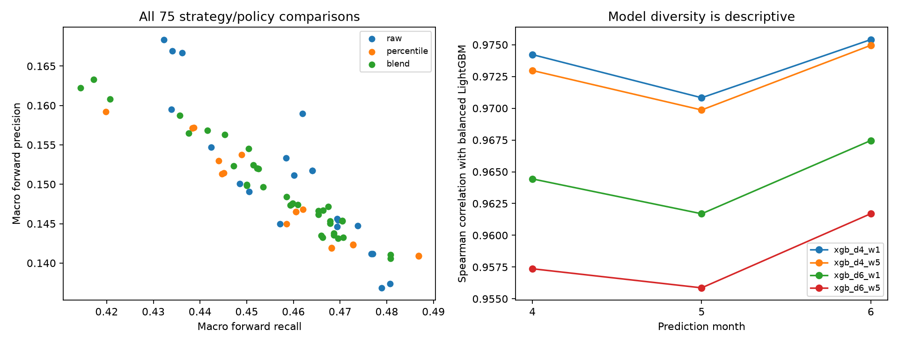

# XGBoost and rank-ensemble study findings

Selected **baseline_balanced / pooled** scores actual macro chronological F2 **0.327802**. Best new raw XGBoost: **xgb_d4_w5 / latest**, F2 **0.326484**. Best blend: **blend_xgb_d6_w1_a25 / pooled**, F2 **0.325311**. Positive measured gain against both old references on development and consumed transfer: **False**. Search completion alone does not establish the performance objective.

## Design and verified inference

Four fixed native categorical presets cross depth4/6 with positive weight1/5. Twelve full new development fits and nine verified reference results produce21 base predictions; six percentile representations and12 fixed blends produce75 total score results. Eight separate miniature fits verify deterministic repeats, missing/unseen categorical handling, class orientation and native saved-model reconstruction. Native category vocabularies are training-fitted, numeric NaNs remain missing, and all29 original eligible predictors exclude target/month/device_fraud_count. No evaluation-set early stopping or new feature engineering occurs. Old references retain their exact frozen recipes; cross-family preset differences do not isolate a universal algorithm effect.

Percentiles are average ascending rank/n within each current unlabeled application batch. Ties receive their average rank. Blends use predeclared members/weights0.25/0.5/0.75. Saved dependency hashes and composed predictions reconstruct exactly. These batch-dependent scores are not calibrated fraud probabilities. Raw/percentile/member controls distinguish representation from blending. Beta remains2 with no fixed review quota or precision floor; all settings are analyst-selected.

## Forward actual performance

| candidate | policy | f2 | precision | recall | flagged_fraction | average_precision |
| --- | --- | --- | --- | --- | --- | --- |
| baseline_balanced | pooled | 0.3278 | 0.1667 | 0.4362 | 0.0338 | 0.1832 |
| baseline_balanced | latest | 0.3272 | 0.1669 | 0.4341 | 0.0335 | 0.1832 |
| xgb_d4_w5 | latest | 0.3265 | 0.1517 | 0.4641 | 0.0396 | 0.1881 |
| xgb_d4_w5 | pooled | 0.3265 | 0.1517 | 0.4641 | 0.0396 | 0.1881 |
| xgb_d4_w1 | latest | 0.3265 | 0.1590 | 0.4619 | 0.0395 | 0.1880 |
| xgb_d4_w1 | pooled | 0.3263 | 0.1684 | 0.4323 | 0.0335 | 0.1880 |
| pct_xgb_d4_w5 | pooled | 0.3255 | 0.1409 | 0.4868 | 0.0436 | 0.1881 |
| pct_xgb_d4_w5 | rank_fraction | 0.3255 | 0.1409 | 0.4868 | 0.0436 | 0.1881 |
| blend_xgb_d6_w1_a25 | pooled | 0.3253 | 0.1472 | 0.4674 | 0.0400 | 0.1863 |
| blend_xgb_d6_w1_a25 | rank_fraction | 0.3245 | 0.1467 | 0.4664 | 0.0401 | 0.1863 |
| blend_xgb_d4_w5_a50 | pooled | 0.3240 | 0.1410 | 0.4808 | 0.0430 | 0.1882 |
| blend_xgb_d4_w1_a75 | latest | 0.3240 | 0.1563 | 0.4453 | 0.0359 | 0.1889 |
| blend_xgb_d4_w1_a75 | pooled | 0.3238 | 0.1520 | 0.4525 | 0.0375 | 0.1889 |
| blend_xgb_d4_w1_a75 | rank_fraction | 0.3237 | 0.1520 | 0.4522 | 0.0375 | 0.1889 |
| xgb_d6_w1 | pooled | 0.3236 | 0.1533 | 0.4584 | 0.0396 | 0.1848 |
| blend_xgb_d6_w5_a25 | rank_fraction | 0.3236 | 0.1466 | 0.4654 | 0.0401 | 0.1860 |
| blend_xgb_d4_w5_a50 | rank_fraction | 0.3236 | 0.1406 | 0.4808 | 0.0431 | 0.1882 |
| xgb_d4_w5 | rank_fraction | 0.3234 | 0.1447 | 0.4737 | 0.0415 | 0.1881 |
| blend_xgb_d4_w5_a75 | rank_fraction | 0.3234 | 0.1454 | 0.4705 | 0.0410 | 0.1889 |
| blend_xgb_d4_w5_a75 | pooled | 0.3232 | 0.1453 | 0.4705 | 0.0410 | 0.1889 |
| blend_xgb_d6_w5_a25 | pooled | 0.3231 | 0.1462 | 0.4654 | 0.0402 | 0.1860 |
| blend_xgb_d4_w1_a25 | pooled | 0.3228 | 0.1453 | 0.4679 | 0.0407 | 0.1862 |
| baseline_lgbm | pooled | 0.3227 | 0.1456 | 0.4693 | 0.0418 | 0.1820 |
| blend_xgb_d4_w1_a25 | rank_fraction | 0.3226 | 0.1450 | 0.4679 | 0.0408 | 0.1862 |
| blend_xgb_d6_w5_a75 | pooled | 0.3222 | 0.1432 | 0.4707 | 0.0415 | 0.1865 |
| pct_xgb_d4_w1 | rank_fraction | 0.3219 | 0.1572 | 0.4387 | 0.0352 | 0.1880 |
| blend_xgb_d6_w5_a75 | rank_fraction | 0.3218 | 0.1431 | 0.4696 | 0.0414 | 0.1865 |
| blend_xgb_d4_w5_a50 | latest | 0.3217 | 0.1545 | 0.4504 | 0.0374 | 0.1882 |
| pct_xgb_d4_w1 | latest | 0.3216 | 0.1571 | 0.4383 | 0.0352 | 0.1880 |
| pct_xgb_d4_w1 | pooled | 0.3216 | 0.1571 | 0.4383 | 0.0352 | 0.1880 |
| xgb_d6_w1 | latest | 0.3216 | 0.1511 | 0.4601 | 0.0407 | 0.1848 |
| baseline_lgbm | latest | 0.3214 | 0.1446 | 0.4693 | 0.0422 | 0.1820 |
| blend_xgb_d4_w1_a50 | pooled | 0.3212 | 0.1438 | 0.4687 | 0.0413 | 0.1881 |
| pct_baseline_balanced | pooled | 0.3212 | 0.1465 | 0.4605 | 0.0398 | 0.1832 |
| pct_baseline_balanced | rank_fraction | 0.3212 | 0.1465 | 0.4605 | 0.0398 | 0.1832 |
| blend_xgb_d4_w1_a50 | rank_fraction | 0.3211 | 0.1435 | 0.4687 | 0.0413 | 0.1881 |
| xgb_d4_w1 | rank_fraction | 0.3211 | 0.1595 | 0.4338 | 0.0344 | 0.1880 |
| xgb_d6_w5 | pooled | 0.3207 | 0.1412 | 0.4770 | 0.0439 | 0.1837 |
| blend_xgb_d4_w5_a25 | pooled | 0.3206 | 0.1475 | 0.4597 | 0.0396 | 0.1863 |
| xgb_d6_w5 | latest | 0.3206 | 0.1412 | 0.4767 | 0.0439 | 0.1837 |
| blend_xgb_d4_w5_a25 | rank_fraction | 0.3204 | 0.1474 | 0.4593 | 0.0396 | 0.1863 |
| blend_xgb_d4_w1_a50 | latest | 0.3200 | 0.1525 | 0.4515 | 0.0380 | 0.1881 |
| pct_baseline_lgbm | pooled | 0.3197 | 0.1423 | 0.4727 | 0.0424 | 0.1820 |
| blend_xgb_d6_w5_a50 | rank_fraction | 0.3197 | 0.1435 | 0.4659 | 0.0412 | 0.1870 |
| pct_baseline_lgbm | rank_fraction | 0.3197 | 0.1423 | 0.4727 | 0.0424 | 0.1820 |
| blend_xgb_d6_w5_a50 | pooled | 0.3196 | 0.1433 | 0.4663 | 0.0413 | 0.1870 |
| native31 | rank_fraction | 0.3195 | 0.1500 | 0.4485 | 0.0377 | 0.1842 |
| blend_xgb_d6_w1_a25 | latest | 0.3195 | 0.1587 | 0.4357 | 0.0351 | 0.1863 |
| pct_xgb_d6_w1 | latest | 0.3193 | 0.1530 | 0.4440 | 0.0368 | 0.1848 |
| blend_xgb_d6_w1_a75 | latest | 0.3192 | 0.1523 | 0.4472 | 0.0374 | 0.1875 |
| blend_xgb_d6_w1_a50 | rank_fraction | 0.3192 | 0.1474 | 0.4609 | 0.0401 | 0.1876 |
| native31 | pooled | 0.3191 | 0.1547 | 0.4424 | 0.0375 | 0.1842 |
| xgb_d6_w1 | rank_fraction | 0.3188 | 0.1450 | 0.4571 | 0.0397 | 0.1848 |
| blend_xgb_d6_w1_a75 | rank_fraction | 0.3188 | 0.1499 | 0.4500 | 0.0381 | 0.1875 |
| blend_xgb_d6_w1_a75 | pooled | 0.3188 | 0.1499 | 0.4500 | 0.0381 | 0.1875 |
| blend_xgb_d6_w5_a50 | latest | 0.3188 | 0.1497 | 0.4535 | 0.0388 | 0.1870 |
| blend_xgb_d6_w1_a50 | pooled | 0.3188 | 0.1476 | 0.4599 | 0.0400 | 0.1876 |
| baseline_balanced | rank_fraction | 0.3188 | 0.1491 | 0.4505 | 0.0384 | 0.1832 |
| baseline_lgbm | rank_fraction | 0.3187 | 0.1374 | 0.4807 | 0.0443 | 0.1820 |
| blend_xgb_d6_w1_a50 | latest | 0.3187 | 0.1484 | 0.4585 | 0.0397 | 0.1876 |
| pct_xgb_d6_w1 | rank_fraction | 0.3186 | 0.1514 | 0.4451 | 0.0372 | 0.1848 |
| pct_xgb_d6_w1 | pooled | 0.3184 | 0.1513 | 0.4447 | 0.0372 | 0.1848 |
| pct_baseline_lgbm | latest | 0.3183 | 0.1468 | 0.4620 | 0.0405 | 0.1820 |
| pct_xgb_d4_w5 | latest | 0.3182 | 0.1537 | 0.4489 | 0.0377 | 0.1881 |
| xgb_d6_w5 | rank_fraction | 0.3177 | 0.1369 | 0.4789 | 0.0443 | 0.1837 |
| pct_xgb_d6_w5 | pooled | 0.3177 | 0.1419 | 0.4682 | 0.0421 | 0.1837 |
| pct_xgb_d6_w5 | rank_fraction | 0.3176 | 0.1419 | 0.4682 | 0.0421 | 0.1837 |
| blend_xgb_d4_w5_a75 | latest | 0.3174 | 0.1568 | 0.4415 | 0.0365 | 0.1889 |
| blend_xgb_d6_w5_a75 | latest | 0.3169 | 0.1565 | 0.4376 | 0.0360 | 0.1865 |
| native31 | latest | 0.3161 | 0.1454 | 0.4696 | 0.0443 | 0.1842 |
| pct_xgb_d6_w5 | latest | 0.3156 | 0.1450 | 0.4585 | 0.0406 | 0.1837 |
| pct_baseline_balanced | latest | 0.3097 | 0.1592 | 0.4199 | 0.0342 | 0.1832 |
| blend_xgb_d4_w5_a25 | latest | 0.3090 | 0.1608 | 0.4207 | 0.0344 | 0.1863 |
| blend_xgb_d4_w1_a25 | latest | 0.3089 | 0.1633 | 0.4172 | 0.0337 | 0.1862 |
| blend_xgb_d6_w5_a25 | latest | 0.3085 | 0.1622 | 0.4144 | 0.0333 | 0.1860 |

All150 monthly rows,75 macro rows,75 pooled-confusion summaries and302 contrasts remain exported, including failures and zero/self comparisons. Models and preprocessing fit strictly earlier months. Month5 policies use month4; month6 policies use earlier4/5 or5. Actual macro F2 selects the winner, not AP, diversity or training loss. Eight prior studies have adaptively reused development data.

The complete matched comparisons are in contrasts.csv; they include percentile-minus-raw, blend-minus-each-percentile-member, policy-minus-own-pooled, and raw depth/weight changes. All arithmetic was independently reconstructed. diversity.csv contains12 label-free rank correlations; score_diagnostics.csv contains75 range/tie summaries. Diversity alone proves no useful fraud gain.

## Paired conditional development differences

| scope | reference | difference | ci_low | ci_high | replicates |
| --- | --- | --- | --- | --- | --- |
| 5 | balanced | 0.0000 | 0.0000 | 0.0000 | 500 |
| 5 | unweighted | 0.0001 | -0.0096 | 0.0089 | 500 |
| 5 | same_model | 0.0000 | 0.0000 | 0.0000 | 500 |
| 5 | rank_member | 0.0109 | 0.0009 | 0.0208 | 500 |
| 6 | balanced | 0.0000 | 0.0000 | 0.0000 | 500 |
| 6 | unweighted | 0.0102 | 0.0019 | 0.0186 | 500 |
| 6 | same_model | 0.0000 | 0.0000 | 0.0000 | 500 |
| 6 | rank_member | 0.0023 | -0.0023 | 0.0074 | 500 |
| macro | balanced | 0.0000 | 0.0000 | 0.0000 | 500 |
| macro | unweighted | 0.0051 | -0.0008 | 0.0102 | 500 |
| macro | same_model | 0.0000 | 0.0000 | 0.0000 | 500 |
| macro | rank_member | 0.0066 | 0.0009 | 0.0118 | 500 |

## Already-consumed month7: exploratory transfer

| role | candidate | policy | f2 | precision | recall | flagged_fraction | tp | fp | fn |
| --- | --- | --- | --- | --- | --- | --- | --- | --- | --- |
| selected | baseline_balanced | pooled | 0.3644 | 0.1817 | 0.4867 | 0.0395 | 695 | 3129 | 733 |
| balanced | baseline_balanced | pooled | 0.3644 | 0.1817 | 0.4867 | 0.0395 | 695 | 3129 | 733 |
| unweighted | baseline_lgbm | pooled | 0.3769 | 0.1682 | 0.5462 | 0.0479 | 780 | 3856 | 648 |
| same_model | baseline_balanced | pooled | 0.3644 | 0.1817 | 0.4867 | 0.0395 | 695 | 3129 | 733 |
| rank_member | pct_baseline_balanced | pooled | 0.3653 | 0.1794 | 0.4930 | 0.0405 | 704 | 3221 | 724 |

| scope | reference | difference | ci_low | ci_high | replicates |
| --- | --- | --- | --- | --- | --- |
| 7_consumed | balanced | 0.0000 | 0.0000 | 0.0000 | 500 |
| 7_consumed | unweighted | -0.0125 | -0.0222 | -0.0040 | 500 |
| 7_consumed | same_model | 0.0000 | 0.0000 | 0.0000 | 500 |
| 7_consumed | rank_member | -0.0009 | -0.0034 | 0.0021 | 500 |

Only the actual winner, same-strategy pooled rule, both old pooled references and the controls determined by its declared strategy type were evaluated. Base fits are deduplicated while all roles remain visible. Freeze/control/dependency hashes and access chronology agree. No losing-setting sweep, hindsight month7 threshold or retuning occurred. A development gain that fails transfer is not out-of-time improvement. This period cannot provide fresh independent confirmation.

## Uncertainty, preservation and reproduction

Intervals use500 paired fixed-decision row draws with seed1027. Development resamples each month separately and averages monthly F2 differences. Models, selection, percentile batches and decisions remain fixed; intervals exclude adaptive search/selection, retraining, batch-composition, temporal/generative uncertainty and multiplicity correction. Intervals overlapping zero preclude clear/confirmed gain claims; statistical significance is not substituted for a positive measured difference. All eight earlier source/config/software/selection identities remain preserved. Exact model/score provenance, config, freeze/access records, draws and audit are exported. README provides pinned install, verified Base access, eight-record restoration and new-destination reference reproduction.

Codex assisted with design, implementation, execution, methodological checks, figures and interpretation. The official XGBoost categorical/parameter documentation and pinned package informed the model interface; stable online docs were newer than the pinned installed version, whose contract was checked locally. No public notebook was copied. These synthetic-data experiments are supporting material, not a bank deployment claim.

