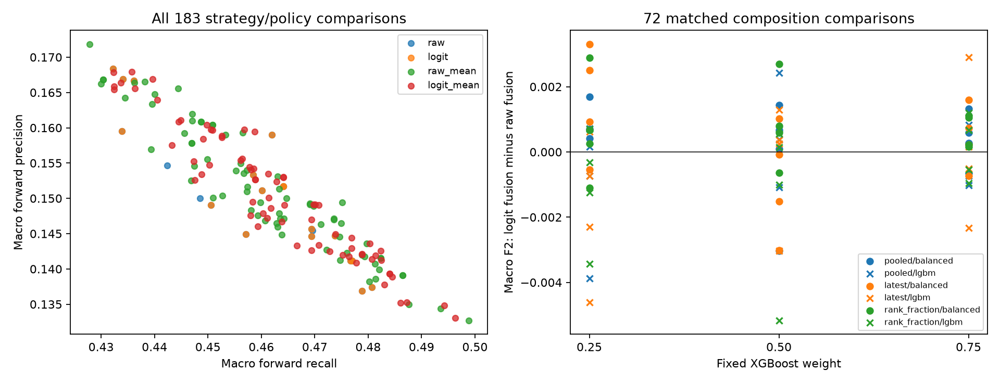

# Fixed score-fusion study findings

Selected **logit_mean_xgb_d4_w1_baseline_balanced_a50 / pooled** scores actual macro chronological F2 **0.328907**. Best raw fusion: **raw_mean_xgb_d4_w1_baseline_balanced_a75 / pooled**, F2 **0.327946**. Best logit fusion: **logit_mean_xgb_d4_w1_baseline_balanced_a50 / pooled**, F2 **0.328907**. Best raw XGBoost control F2: **0.326484**. Positive measured gain against both original references on development and consumed transfer: **False**. Completing a search alone does not establish the performance objective.

## Design and verified inference

Seven raw controls, six single-logit controls and 48 fixed fusions produce 183 strategy/month scores and 366 forward operating rows. Members, weights 0.25/0.5/0.75 and epsilon 1e-6 were fixed before evaluation. Raw fusion averages the two original scores; logit fusion averages their clipped log-odds, retained as finite real-valued scores without a sigmoid. Single-logit controls isolate clipping/transformation from fusion. Inputs align by stable ID and labels; arithmetic uses no labels or batch ranks. Neither class-weighted base scores nor their fusions are asserted to be calibrated fraud probabilities.

Development used **12 verified XGBoost model reuses**, **0 new XGBoost fits**, **9 reference prediction reuses** and **0 reference prediction refits**. Older references had no saved development models; **9 separately counted exact-recipe verification fits** reconstructed their frozen predictions and supplied saved models. No new learning recipe or package was introduced. All required models reload and reproduce scores. Test fixtures are separate from these counts.

All models and preprocessing use strictly earlier training months. The 29 original predictors exclude fraud_bool, month and constant device_fraud_count. XGBoost and native31 retain training-only category vocabularies and numeric missing values; baseline LightGBM retains its own frozen pipeline. All source/config/software/selection identities from nine prior studies remain preserved. Cross-family preset differences are not a universal algorithm effect. F2 retains beta=2 without a fixed review quota or precision floor; settings are analyst-selected.

## Forward actual performance

| candidate | policy | f2 | precision | recall | flagged_fraction | average_precision |
| --- | --- | --- | --- | --- | --- | --- |
| logit_mean_xgb_d4_w1_baseline_balanced_a50 | pooled | 0.3289 | 0.1669 | 0.4396 | 0.0342 | 0.1886 |
| raw_mean_xgb_d4_w1_baseline_balanced_a75 | pooled | 0.3279 | 0.1665 | 0.4382 | 0.0342 | 0.1884 |
| logit_mean_xgb_d4_w5_baseline_balanced_a25 | latest | 0.3279 | 0.1656 | 0.4363 | 0.0337 | 0.1871 |
| baseline_balanced | pooled | 0.3278 | 0.1667 | 0.4362 | 0.0338 | 0.1832 |
| logit_baseline_balanced | pooled | 0.3278 | 0.1667 | 0.4362 | 0.0338 | 0.1832 |
| raw_mean_xgb_d6_w1_baseline_balanced_a50 | pooled | 0.3277 | 0.1648 | 0.4400 | 0.0346 | 0.1872 |
| raw_mean_xgb_d6_w1_baseline_balanced_a50 | latest | 0.3277 | 0.1663 | 0.4362 | 0.0338 | 0.1872 |
| logit_mean_xgb_d4_w5_baseline_balanced_a50 | pooled | 0.3277 | 0.1530 | 0.4641 | 0.0393 | 0.1886 |
| raw_mean_xgb_d4_w5_baseline_lgbm_a50 | rank_fraction | 0.3277 | 0.1513 | 0.4633 | 0.0386 | 0.1870 |
| raw_mean_xgb_d4_w1_baseline_balanced_a50 | latest | 0.3277 | 0.1656 | 0.4444 | 0.0356 | 0.1884 |
| logit_mean_xgb_d4_w5_baseline_balanced_a50 | latest | 0.3276 | 0.1530 | 0.4641 | 0.0393 | 0.1886 |
| logit_mean_xgb_d4_w1_baseline_balanced_a50 | latest | 0.3276 | 0.1598 | 0.4569 | 0.0381 | 0.1886 |
| raw_mean_xgb_d4_w1_baseline_balanced_a50 | pooled | 0.3275 | 0.1719 | 0.4278 | 0.0323 | 0.1884 |
| logit_mean_xgb_d4_w5_baseline_balanced_a75 | pooled | 0.3274 | 0.1491 | 0.4708 | 0.0405 | 0.1888 |
| logit_mean_xgb_d4_w1_baseline_balanced_a75 | pooled | 0.3273 | 0.1679 | 0.4357 | 0.0339 | 0.1889 |
| logit_mean_xgb_d4_w5_baseline_balanced_a75 | latest | 0.3272 | 0.1492 | 0.4697 | 0.0404 | 0.1888 |
| baseline_balanced | latest | 0.3272 | 0.1669 | 0.4341 | 0.0335 | 0.1832 |
| logit_baseline_balanced | latest | 0.3272 | 0.1669 | 0.4341 | 0.0335 | 0.1832 |
| raw_mean_xgb_d4_w5_baseline_balanced_a50 | pooled | 0.3270 | 0.1531 | 0.4630 | 0.0393 | 0.1885 |
| logit_mean_xgb_d6_w5_baseline_balanced_a25 | latest | 0.3270 | 0.1678 | 0.4324 | 0.0332 | 0.1866 |
| raw_mean_xgb_d4_w5_baseline_balanced_a75 | latest | 0.3270 | 0.1492 | 0.4691 | 0.0403 | 0.1884 |
| logit_mean_xgb_d6_w1_baseline_balanced_a25 | pooled | 0.3269 | 0.1610 | 0.4449 | 0.0358 | 0.1872 |
| raw_mean_xgb_d4_w1_baseline_balanced_a75 | latest | 0.3269 | 0.1593 | 0.4565 | 0.0382 | 0.1884 |
| raw_mean_xgb_d4_w5_baseline_balanced_a75 | pooled | 0.3269 | 0.1491 | 0.4691 | 0.0404 | 0.1884 |
| logit_mean_xgb_d4_w5_baseline_balanced_a25 | pooled | 0.3267 | 0.1609 | 0.4446 | 0.0357 | 0.1871 |
| raw_mean_xgb_d4_w5_baseline_balanced_a50 | latest | 0.3266 | 0.1494 | 0.4751 | 0.0419 | 0.1885 |
| logit_mean_xgb_d4_w1_baseline_balanced_a25 | latest | 0.3265 | 0.1659 | 0.4325 | 0.0333 | 0.1870 |
| logit_mean_xgb_d6_w1_baseline_lgbm_a75 | pooled | 0.3265 | 0.1556 | 0.4564 | 0.0383 | 0.1862 |
| logit_xgb_d4_w5 | latest | 0.3265 | 0.1517 | 0.4641 | 0.0396 | 0.1881 |
| logit_xgb_d4_w5 | pooled | 0.3265 | 0.1517 | 0.4641 | 0.0396 | 0.1881 |
| xgb_d4_w5 | latest | 0.3265 | 0.1517 | 0.4641 | 0.0396 | 0.1881 |
| xgb_d4_w5 | pooled | 0.3265 | 0.1517 | 0.4641 | 0.0396 | 0.1881 |
| logit_xgb_d4_w1 | latest | 0.3265 | 0.1590 | 0.4619 | 0.0395 | 0.1880 |
| xgb_d4_w1 | latest | 0.3265 | 0.1590 | 0.4619 | 0.0395 | 0.1880 |
| logit_mean_xgb_d6_w1_baseline_balanced_a75 | pooled | 0.3263 | 0.1554 | 0.4561 | 0.0382 | 0.1868 |
| logit_xgb_d4_w1 | pooled | 0.3263 | 0.1684 | 0.4323 | 0.0335 | 0.1880 |
| xgb_d4_w1 | pooled | 0.3263 | 0.1684 | 0.4323 | 0.0335 | 0.1880 |
| raw_mean_xgb_d6_w1_baseline_balanced_a25 | latest | 0.3263 | 0.1668 | 0.4304 | 0.0329 | 0.1873 |
| raw_mean_xgb_d6_w1_baseline_balanced_a25 | pooled | 0.3262 | 0.1668 | 0.4304 | 0.0330 | 0.1873 |
| logit_mean_xgb_d6_w5_baseline_balanced_a25 | pooled | 0.3262 | 0.1664 | 0.4337 | 0.0338 | 0.1866 |
| logit_mean_xgb_d4_w5_baseline_lgbm_a75 | rank_fraction | 0.3261 | 0.1490 | 0.4643 | 0.0392 | 0.1881 |
| logit_mean_xgb_d4_w1_baseline_balanced_a25 | pooled | 0.3261 | 0.1654 | 0.4325 | 0.0334 | 0.1870 |
| logit_mean_xgb_d4_w1_baseline_balanced_a75 | latest | 0.3261 | 0.1594 | 0.4588 | 0.0389 | 0.1889 |
| raw_mean_xgb_d6_w1_baseline_balanced_a75 | pooled | 0.3261 | 0.1489 | 0.4698 | 0.0409 | 0.1866 |
| raw_mean_xgb_d4_w5_baseline_balanced_a25 | pooled | 0.3260 | 0.1593 | 0.4456 | 0.0361 | 0.1882 |
| logit_mean_xgb_d6_w1_baseline_balanced_a75 | latest | 0.3260 | 0.1535 | 0.4613 | 0.0394 | 0.1868 |
| logit_mean_xgb_d6_w5_baseline_balanced_a75 | latest | 0.3259 | 0.1545 | 0.4577 | 0.0386 | 0.1859 |
| logit_mean_xgb_d6_w1_baseline_balanced_a25 | latest | 0.3257 | 0.1584 | 0.4491 | 0.0370 | 0.1872 |
| raw_mean_xgb_d4_w1_baseline_balanced_a25 | pooled | 0.3257 | 0.1642 | 0.4345 | 0.0339 | 0.1877 |
| raw_mean_xgb_d6_w1_baseline_lgbm_a75 | pooled | 0.3257 | 0.1550 | 0.4561 | 0.0384 | 0.1860 |
| raw_mean_xgb_d4_w5_baseline_lgbm_a25 | latest | 0.3256 | 0.1470 | 0.4735 | 0.0418 | 0.1858 |
| logit_mean_xgb_d6_w1_baseline_lgbm_a75 | latest | 0.3256 | 0.1542 | 0.4585 | 0.0390 | 0.1862 |
| raw_mean_xgb_d4_w1_baseline_balanced_a25 | latest | 0.3256 | 0.1662 | 0.4300 | 0.0330 | 0.1877 |
| logit_mean_xgb_d6_w5_baseline_balanced_a75 | pooled | 0.3255 | 0.1540 | 0.4581 | 0.0388 | 0.1859 |
| raw_mean_xgb_d4_w5_baseline_lgbm_a25 | pooled | 0.3255 | 0.1465 | 0.4749 | 0.0421 | 0.1858 |
| raw_mean_xgb_d4_w5_baseline_lgbm_a75 | rank_fraction | 0.3255 | 0.1516 | 0.4574 | 0.0380 | 0.1876 |
| raw_mean_xgb_d4_w5_baseline_lgbm_a75 | latest | 0.3253 | 0.1619 | 0.4471 | 0.0368 | 0.1876 |
| raw_mean_xgb_d4_w1_baseline_lgbm_a75 | rank_fraction | 0.3253 | 0.1556 | 0.4498 | 0.0365 | 0.1880 |
| raw_mean_xgb_d6_w1_baseline_balanced_a75 | latest | 0.3252 | 0.1471 | 0.4736 | 0.0420 | 0.1866 |
| raw_mean_xgb_d4_w1_baseline_lgbm_a50 | rank_fraction | 0.3252 | 0.1510 | 0.4573 | 0.0382 | 0.1871 |
| raw_mean_xgb_d4_w5_baseline_lgbm_a50 | latest | 0.3250 | 0.1604 | 0.4509 | 0.0377 | 0.1870 |
| raw_mean_xgb_d4_w5_baseline_lgbm_a50 | pooled | 0.3250 | 0.1604 | 0.4509 | 0.0377 | 0.1870 |
| logit_mean_xgb_d6_w1_baseline_lgbm_a50 | latest | 0.3250 | 0.1436 | 0.4803 | 0.0433 | 0.1865 |
| logit_mean_xgb_d4_w1_baseline_lgbm_a75 | pooled | 0.3249 | 0.1640 | 0.4405 | 0.0355 | 0.1881 |
| raw_mean_xgb_d6_w5_baseline_balanced_a50 | latest | 0.3249 | 0.1445 | 0.4747 | 0.0420 | 0.1862 |
| logit_mean_xgb_d6_w1_baseline_balanced_a50 | latest | 0.3247 | 0.1527 | 0.4588 | 0.0392 | 0.1879 |
| logit_mean_xgb_d6_w1_baseline_balanced_a50 | pooled | 0.3247 | 0.1527 | 0.4588 | 0.0392 | 0.1879 |
| raw_mean_xgb_d4_w1_baseline_lgbm_a75 | pooled | 0.3247 | 0.1633 | 0.4395 | 0.0354 | 0.1880 |
| raw_mean_xgb_d4_w1_baseline_lgbm_a75 | latest | 0.3246 | 0.1590 | 0.4533 | 0.0382 | 0.1880 |
| raw_mean_xgb_d4_w5_baseline_balanced_a25 | latest | 0.3246 | 0.1540 | 0.4573 | 0.0389 | 0.1882 |
| raw_mean_xgb_d6_w5_baseline_balanced_a25 | latest | 0.3245 | 0.1578 | 0.4469 | 0.0368 | 0.1871 |
| raw_mean_xgb_d6_w5_baseline_balanced_a25 | pooled | 0.3245 | 0.1578 | 0.4469 | 0.0368 | 0.1871 |
| logit_mean_xgb_d6_w5_baseline_lgbm_a25 | pooled | 0.3244 | 0.1501 | 0.4614 | 0.0396 | 0.1847 |
| logit_mean_xgb_d6_w1_baseline_lgbm_a50 | pooled | 0.3244 | 0.1426 | 0.4823 | 0.0439 | 0.1865 |
| logit_mean_xgb_d4_w1_baseline_lgbm_a75 | rank_fraction | 0.3243 | 0.1553 | 0.4473 | 0.0363 | 0.1881 |
| raw_mean_xgb_d4_w5_baseline_lgbm_a75 | pooled | 0.3243 | 0.1610 | 0.4471 | 0.0371 | 0.1876 |
| raw_mean_xgb_d6_w5_baseline_balanced_a75 | latest | 0.3243 | 0.1536 | 0.4567 | 0.0388 | 0.1851 |
| logit_mean_xgb_d4_w1_baseline_lgbm_a50 | rank_fraction | 0.3242 | 0.1495 | 0.4584 | 0.0386 | 0.1872 |
| raw_mean_xgb_d6_w5_baseline_balanced_a75 | pooled | 0.3242 | 0.1539 | 0.4553 | 0.0386 | 0.1851 |
| logit_mean_xgb_d4_w1_baseline_lgbm_a75 | latest | 0.3241 | 0.1604 | 0.4498 | 0.0377 | 0.1881 |
| logit_mean_xgb_d4_w5_baseline_lgbm_a50 | pooled | 0.3239 | 0.1524 | 0.4629 | 0.0404 | 0.1870 |
| logit_mean_xgb_d4_w1_baseline_lgbm_a50 | pooled | 0.3239 | 0.1598 | 0.4505 | 0.0379 | 0.1872 |
| logit_mean_xgb_d4_w1_baseline_balanced_a50 | rank_fraction | 0.3239 | 0.1547 | 0.4503 | 0.0369 | 0.1886 |
| logit_mean_xgb_d4_w1_baseline_lgbm_a50 | latest | 0.3239 | 0.1596 | 0.4509 | 0.0380 | 0.1872 |
| logit_mean_xgb_d4_w1_baseline_balanced_a75 | rank_fraction | 0.3237 | 0.1575 | 0.4433 | 0.0355 | 0.1889 |
| logit_mean_xgb_d6_w5_baseline_lgbm_a50 | pooled | 0.3237 | 0.1470 | 0.4693 | 0.0415 | 0.1858 |
| raw_mean_xgb_d6_w5_baseline_lgbm_a25 | pooled | 0.3237 | 0.1463 | 0.4711 | 0.0419 | 0.1848 |
| raw_mean_xgb_d6_w1_baseline_lgbm_a50 | latest | 0.3237 | 0.1416 | 0.4824 | 0.0441 | 0.1864 |
| raw_mean_xgb_d6_w1_baseline_lgbm_a50 | pooled | 0.3237 | 0.1416 | 0.4824 | 0.0441 | 0.1864 |
| logit_xgb_d6_w1 | pooled | 0.3236 | 0.1533 | 0.4584 | 0.0396 | 0.1848 |
| xgb_d6_w1 | pooled | 0.3236 | 0.1533 | 0.4584 | 0.0396 | 0.1848 |
| raw_mean_xgb_d4_w1_baseline_lgbm_a50 | latest | 0.3235 | 0.1609 | 0.4487 | 0.0377 | 0.1871 |
| raw_mean_xgb_d4_w1_baseline_lgbm_a50 | pooled | 0.3235 | 0.1609 | 0.4487 | 0.0377 | 0.1871 |
| logit_xgb_d4_w5 | rank_fraction | 0.3234 | 0.1447 | 0.4737 | 0.0415 | 0.1881 |
| xgb_d4_w5 | rank_fraction | 0.3234 | 0.1447 | 0.4737 | 0.0415 | 0.1881 |
| logit_mean_xgb_d6_w5_baseline_balanced_a50 | latest | 0.3233 | 0.1421 | 0.4788 | 0.0433 | 0.1872 |
| logit_mean_xgb_d6_w1_baseline_lgbm_a25 | latest | 0.3233 | 0.1486 | 0.4618 | 0.0400 | 0.1850 |
| logit_mean_xgb_d6_w5_baseline_balanced_a50 | pooled | 0.3233 | 0.1421 | 0.4788 | 0.0434 | 0.1872 |
| logit_mean_xgb_d4_w5_baseline_lgbm_a75 | pooled | 0.3233 | 0.1589 | 0.4526 | 0.0386 | 0.1881 |
| raw_mean_xgb_d6_w5_baseline_balanced_a50 | pooled | 0.3232 | 0.1420 | 0.4788 | 0.0434 | 0.1862 |
| logit_mean_xgb_d6_w1_baseline_lgbm_a25 | pooled | 0.3230 | 0.1449 | 0.4738 | 0.0427 | 0.1850 |
| logit_mean_xgb_d4_w5_baseline_lgbm_a75 | latest | 0.3230 | 0.1587 | 0.4526 | 0.0386 | 0.1881 |
| raw_mean_xgb_d6_w5_baseline_lgbm_a25 | latest | 0.3229 | 0.1436 | 0.4797 | 0.0440 | 0.1848 |
| logit_mean_xgb_d6_w5_baseline_lgbm_a50 | latest | 0.3229 | 0.1444 | 0.4769 | 0.0434 | 0.1858 |
| raw_mean_xgb_d6_w1_baseline_lgbm_a25 | pooled | 0.3229 | 0.1471 | 0.4642 | 0.0406 | 0.1850 |
| raw_mean_xgb_d6_w1_baseline_lgbm_a25 | latest | 0.3227 | 0.1472 | 0.4635 | 0.0405 | 0.1850 |
| raw_mean_xgb_d6_w1_baseline_lgbm_a75 | latest | 0.3227 | 0.1500 | 0.4647 | 0.0412 | 0.1860 |
| raw_mean_xgb_d6_w5_baseline_lgbm_a50 | latest | 0.3227 | 0.1484 | 0.4580 | 0.0393 | 0.1848 |
| baseline_lgbm | pooled | 0.3227 | 0.1456 | 0.4693 | 0.0418 | 0.1820 |
| logit_baseline_lgbm | pooled | 0.3227 | 0.1456 | 0.4693 | 0.0418 | 0.1820 |
| raw_mean_xgb_d4_w1_baseline_balanced_a75 | rank_fraction | 0.3226 | 0.1546 | 0.4474 | 0.0367 | 0.1884 |
| raw_mean_xgb_d6_w5_baseline_lgbm_a25 | rank_fraction | 0.3226 | 0.1407 | 0.4813 | 0.0433 | 0.1848 |
| logit_mean_xgb_d4_w5_baseline_lgbm_a50 | rank_fraction | 0.3225 | 0.1425 | 0.4728 | 0.0418 | 0.1870 |
| raw_mean_xgb_d4_w5_baseline_balanced_a50 | rank_fraction | 0.3224 | 0.1423 | 0.4760 | 0.0424 | 0.1885 |
| logit_mean_xgb_d6_w5_baseline_balanced_a75 | rank_fraction | 0.3224 | 0.1467 | 0.4638 | 0.0400 | 0.1859 |
| logit_mean_xgb_d6_w5_baseline_balanced_a25 | rank_fraction | 0.3221 | 0.1534 | 0.4488 | 0.0371 | 0.1866 |
| raw_mean_xgb_d6_w5_baseline_lgbm_a75 | pooled | 0.3221 | 0.1494 | 0.4598 | 0.0401 | 0.1842 |
| raw_mean_xgb_d4_w1_baseline_lgbm_a25 | latest | 0.3220 | 0.1391 | 0.4864 | 0.0454 | 0.1849 |
| raw_mean_xgb_d4_w1_baseline_lgbm_a25 | pooled | 0.3220 | 0.1391 | 0.4864 | 0.0454 | 0.1849 |
| logit_mean_xgb_d4_w5_baseline_lgbm_a50 | latest | 0.3220 | 0.1491 | 0.4701 | 0.0426 | 0.1870 |
| logit_mean_xgb_d4_w5_baseline_balanced_a75 | rank_fraction | 0.3218 | 0.1414 | 0.4807 | 0.0434 | 0.1888 |
| logit_mean_xgb_d4_w5_baseline_balanced_a50 | rank_fraction | 0.3217 | 0.1417 | 0.4764 | 0.0426 | 0.1886 |
| raw_mean_xgb_d4_w5_baseline_balanced_a75 | rank_fraction | 0.3216 | 0.1418 | 0.4794 | 0.0431 | 0.1884 |
| logit_mean_xgb_d4_w5_baseline_lgbm_a25 | pooled | 0.3216 | 0.1430 | 0.4769 | 0.0438 | 0.1850 |
| logit_mean_xgb_d6_w5_baseline_lgbm_a75 | latest | 0.3216 | 0.1434 | 0.4708 | 0.0423 | 0.1854 |
| logit_mean_xgb_d6_w1_baseline_balanced_a25 | rank_fraction | 0.3216 | 0.1478 | 0.4603 | 0.0395 | 0.1872 |
| logit_mean_xgb_d6_w5_baseline_lgbm_a75 | rank_fraction | 0.3216 | 0.1389 | 0.4845 | 0.0442 | 0.1854 |
| logit_xgb_d6_w1 | latest | 0.3216 | 0.1511 | 0.4601 | 0.0407 | 0.1848 |
| xgb_d6_w1 | latest | 0.3216 | 0.1511 | 0.4601 | 0.0407 | 0.1848 |
| logit_mean_xgb_d6_w5_baseline_lgbm_a50 | rank_fraction | 0.3215 | 0.1408 | 0.4778 | 0.0430 | 0.1858 |
| raw_mean_xgb_d6_w5_baseline_balanced_a25 | rank_fraction | 0.3215 | 0.1460 | 0.4630 | 0.0402 | 0.1871 |
| raw_mean_xgb_d6_w5_baseline_lgbm_a75 | latest | 0.3214 | 0.1479 | 0.4633 | 0.0410 | 0.1842 |
| baseline_lgbm | latest | 0.3214 | 0.1446 | 0.4693 | 0.0422 | 0.1820 |
| logit_baseline_lgbm | latest | 0.3214 | 0.1446 | 0.4693 | 0.0422 | 0.1820 |
| logit_mean_xgb_d6_w5_baseline_lgbm_a75 | pooled | 0.3214 | 0.1420 | 0.4753 | 0.0433 | 0.1854 |
| raw_mean_xgb_d6_w5_baseline_lgbm_a50 | rank_fraction | 0.3213 | 0.1399 | 0.4821 | 0.0438 | 0.1848 |
| raw_mean_xgb_d6_w5_baseline_balanced_a75 | rank_fraction | 0.3213 | 0.1469 | 0.4607 | 0.0397 | 0.1851 |
| raw_mean_xgb_d6_w5_baseline_lgbm_a50 | pooled | 0.3213 | 0.1427 | 0.4722 | 0.0426 | 0.1848 |
| raw_mean_xgb_d6_w1_baseline_lgbm_a75 | rank_fraction | 0.3213 | 0.1476 | 0.4593 | 0.0394 | 0.1860 |
| logit_mean_xgb_d4_w1_baseline_lgbm_a25 | latest | 0.3212 | 0.1393 | 0.4840 | 0.0452 | 0.1850 |
| logit_mean_xgb_d4_w1_baseline_lgbm_a25 | pooled | 0.3212 | 0.1393 | 0.4840 | 0.0452 | 0.1850 |
| raw_mean_xgb_d4_w1_baseline_balanced_a50 | rank_fraction | 0.3212 | 0.1569 | 0.4394 | 0.0355 | 0.1884 |
| logit_xgb_d4_w1 | rank_fraction | 0.3211 | 0.1595 | 0.4338 | 0.0344 | 0.1880 |
| xgb_d4_w1 | rank_fraction | 0.3211 | 0.1595 | 0.4338 | 0.0344 | 0.1880 |
| logit_mean_xgb_d4_w5_baseline_balanced_a25 | rank_fraction | 0.3211 | 0.1472 | 0.4611 | 0.0398 | 0.1871 |
| logit_mean_xgb_d4_w5_baseline_lgbm_a25 | latest | 0.3210 | 0.1413 | 0.4825 | 0.0451 | 0.1850 |
| raw_mean_xgb_d4_w5_baseline_balanced_a25 | rank_fraction | 0.3208 | 0.1465 | 0.4628 | 0.0402 | 0.1882 |
| logit_xgb_d6_w5 | pooled | 0.3207 | 0.1412 | 0.4770 | 0.0439 | 0.1837 |
| xgb_d6_w5 | pooled | 0.3207 | 0.1412 | 0.4770 | 0.0439 | 0.1837 |
| logit_mean_xgb_d6_w1_baseline_lgbm_a75 | rank_fraction | 0.3207 | 0.1476 | 0.4580 | 0.0392 | 0.1862 |
| logit_mean_xgb_d6_w5_baseline_lgbm_a25 | latest | 0.3207 | 0.1419 | 0.4814 | 0.0451 | 0.1847 |
| logit_xgb_d6_w5 | latest | 0.3206 | 0.1412 | 0.4767 | 0.0439 | 0.1837 |
| xgb_d6_w5 | latest | 0.3206 | 0.1412 | 0.4767 | 0.0439 | 0.1837 |
| logit_mean_xgb_d6_w1_baseline_balanced_a50 | rank_fraction | 0.3206 | 0.1426 | 0.4694 | 0.0416 | 0.1879 |
| logit_mean_xgb_d6_w1_baseline_lgbm_a25 | rank_fraction | 0.3205 | 0.1378 | 0.4830 | 0.0443 | 0.1850 |
| raw_mean_xgb_d6_w5_baseline_lgbm_a75 | rank_fraction | 0.3204 | 0.1448 | 0.4638 | 0.0405 | 0.1842 |
| raw_mean_xgb_d4_w5_baseline_lgbm_a25 | rank_fraction | 0.3203 | 0.1386 | 0.4813 | 0.0440 | 0.1858 |
| logit_mean_xgb_d6_w5_baseline_balanced_a50 | rank_fraction | 0.3200 | 0.1348 | 0.4943 | 0.0466 | 0.1872 |
| raw_mean_xgb_d4_w1_baseline_balanced_a25 | rank_fraction | 0.3200 | 0.1504 | 0.4528 | 0.0384 | 0.1877 |
| raw_mean_xgb_d6_w1_baseline_balanced_a50 | rank_fraction | 0.3200 | 0.1501 | 0.4509 | 0.0381 | 0.1872 |
| raw_mean_xgb_d4_w1_baseline_lgbm_a25 | rank_fraction | 0.3199 | 0.1327 | 0.4988 | 0.0475 | 0.1849 |
| raw_mean_xgb_d6_w1_baseline_lgbm_a25 | rank_fraction | 0.3198 | 0.1412 | 0.4747 | 0.0428 | 0.1850 |
| logit_mean_xgb_d6_w1_baseline_balanced_a75 | rank_fraction | 0.3196 | 0.1460 | 0.4593 | 0.0398 | 0.1868 |
| logit_mean_xgb_d4_w1_baseline_lgbm_a25 | rank_fraction | 0.3196 | 0.1330 | 0.4963 | 0.0472 | 0.1850 |
| native31 | rank_fraction | 0.3195 | 0.1500 | 0.4485 | 0.0377 | 0.1842 |
| raw_mean_xgb_d6_w1_baseline_balanced_a75 | rank_fraction | 0.3194 | 0.1382 | 0.4803 | 0.0441 | 0.1866 |
| raw_mean_xgb_d6_w5_baseline_balanced_a50 | rank_fraction | 0.3192 | 0.1344 | 0.4936 | 0.0467 | 0.1862 |
| logit_mean_xgb_d6_w5_baseline_lgbm_a25 | rank_fraction | 0.3191 | 0.1433 | 0.4667 | 0.0414 | 0.1847 |
| native31 | pooled | 0.3191 | 0.1547 | 0.4424 | 0.0375 | 0.1842 |
| logit_mean_xgb_d4_w5_baseline_lgbm_a25 | rank_fraction | 0.3191 | 0.1352 | 0.4861 | 0.0454 | 0.1850 |
| logit_mean_xgb_d4_w1_baseline_balanced_a25 | rank_fraction | 0.3189 | 0.1526 | 0.4476 | 0.0376 | 0.1870 |
| logit_xgb_d6_w1 | rank_fraction | 0.3188 | 0.1450 | 0.4571 | 0.0397 | 0.1848 |
| xgb_d6_w1 | rank_fraction | 0.3188 | 0.1450 | 0.4571 | 0.0397 | 0.1848 |
| baseline_balanced | rank_fraction | 0.3188 | 0.1491 | 0.4505 | 0.0384 | 0.1832 |
| logit_baseline_balanced | rank_fraction | 0.3188 | 0.1491 | 0.4505 | 0.0384 | 0.1832 |
| baseline_lgbm | rank_fraction | 0.3187 | 0.1374 | 0.4807 | 0.0443 | 0.1820 |
| logit_baseline_lgbm | rank_fraction | 0.3187 | 0.1374 | 0.4807 | 0.0443 | 0.1820 |
| raw_mean_xgb_d6_w1_baseline_balanced_a25 | rank_fraction | 0.3187 | 0.1525 | 0.4469 | 0.0375 | 0.1873 |
| logit_mean_xgb_d6_w1_baseline_lgbm_a50 | rank_fraction | 0.3187 | 0.1353 | 0.4873 | 0.0457 | 0.1865 |
| raw_mean_xgb_d6_w1_baseline_lgbm_a50 | rank_fraction | 0.3181 | 0.1350 | 0.4877 | 0.0459 | 0.1864 |
| logit_xgb_d6_w5 | rank_fraction | 0.3177 | 0.1369 | 0.4789 | 0.0443 | 0.1837 |
| xgb_d6_w5 | rank_fraction | 0.3177 | 0.1369 | 0.4789 | 0.0443 | 0.1837 |
| native31 | latest | 0.3161 | 0.1454 | 0.4696 | 0.0443 | 0.1842 |

All 366 monthly rows, 183 macro summaries, 183 pooled-confusion summaries and 866 contrasts remain exported, including failures and self comparisons. Month-5 policies learn from month 4; month-6 policies learn from months 4/5 or latest month 5. Actual macro F2 selects the winner, not AP or pooled F2. Nine earlier studies have adaptively reused development data.

Matched contrasts separate fusion versus each corresponding member, logit versus raw fusion, logit versus raw single, and each policy versus its own pooled rule; both old pooled references remain visible. Independent reconstruction checks every score, decision, confusion/F2 row and contrast. clipping.csv has 18 source/month rows, with epsilon, ranges and exact changed-score counts; score_diagnostics.csv has 183 range/tie summaries. Clipping can introduce ties and affect threshold transfer.

## Paired conditional development differences

| scope | reference | difference | ci_low | ci_high | replicates |
| --- | --- | --- | --- | --- | --- |
| 5 | balanced | 0.0013 | -0.0058 | 0.0086 | 500 |
| 5 | unweighted | 0.0015 | -0.0071 | 0.0090 | 500 |
| 5 | same_model | 0.0000 | 0.0000 | 0.0000 | 500 |
| 5 | xgb_member | 0.0014 | -0.0048 | 0.0082 | 500 |
| 5 | anchor_member | 0.0013 | -0.0058 | 0.0086 | 500 |
| 5 | raw_xgb | 0.0014 | -0.0048 | 0.0082 | 500 |
| 5 | raw_anchor | 0.0013 | -0.0058 | 0.0086 | 500 |
| 6 | balanced | 0.0009 | -0.0043 | 0.0070 | 500 |
| 6 | unweighted | 0.0110 | 0.0035 | 0.0188 | 500 |
| 6 | same_model | 0.0000 | 0.0000 | 0.0000 | 500 |
| 6 | xgb_member | 0.0038 | -0.0036 | 0.0103 | 500 |
| 6 | anchor_member | 0.0009 | -0.0043 | 0.0070 | 500 |
| 6 | raw_xgb | 0.0038 | -0.0036 | 0.0103 | 500 |
| 6 | raw_anchor | 0.0009 | -0.0043 | 0.0070 | 500 |
| macro | balanced | 0.0011 | -0.0029 | 0.0058 | 500 |
| macro | unweighted | 0.0063 | 0.0006 | 0.0116 | 500 |
| macro | same_model | 0.0000 | 0.0000 | 0.0000 | 500 |
| macro | xgb_member | 0.0026 | -0.0019 | 0.0072 | 500 |
| macro | anchor_member | 0.0011 | -0.0029 | 0.0058 | 500 |
| macro | raw_xgb | 0.0026 | -0.0019 | 0.0072 | 500 |
| macro | raw_anchor | 0.0011 | -0.0029 | 0.0058 | 500 |

## Already-consumed month 7: exploratory transfer

| role | candidate | policy | f2 | precision | recall | flagged_fraction | tp | fp | fn |
| --- | --- | --- | --- | --- | --- | --- | --- | --- | --- |
| selected | logit_mean_xgb_d4_w1_baseline_balanced_a50 | pooled | 0.3727 | 0.1924 | 0.4867 | 0.0373 | 695 | 2917 | 733 |
| balanced | baseline_balanced | pooled | 0.3644 | 0.1817 | 0.4867 | 0.0395 | 695 | 3129 | 733 |
| unweighted | baseline_lgbm | pooled | 0.3769 | 0.1682 | 0.5462 | 0.0479 | 780 | 3856 | 648 |
| same_model | logit_mean_xgb_d4_w1_baseline_balanced_a50 | pooled | 0.3727 | 0.1924 | 0.4867 | 0.0373 | 695 | 2917 | 733 |
| xgb_member | logit_xgb_d4_w1 | pooled | 0.3693 | 0.2020 | 0.4657 | 0.0340 | 665 | 2627 | 763 |
| anchor_member | logit_baseline_balanced | pooled | 0.3644 | 0.1817 | 0.4867 | 0.0395 | 695 | 3129 | 733 |
| raw_xgb | xgb_d4_w1 | pooled | 0.3693 | 0.2020 | 0.4657 | 0.0340 | 665 | 2627 | 763 |
| raw_anchor | baseline_balanced | pooled | 0.3644 | 0.1817 | 0.4867 | 0.0395 | 695 | 3129 | 733 |

| scope | reference | difference | ci_low | ci_high | replicates |
| --- | --- | --- | --- | --- | --- |
| 7_consumed | balanced | 0.0083 | 0.0012 | 0.0149 | 500 |
| 7_consumed | unweighted | -0.0042 | -0.0135 | 0.0035 | 500 |
| 7_consumed | same_model | 0.0000 | 0.0000 | 0.0000 | 500 |
| 7_consumed | xgb_member | 0.0034 | -0.0034 | 0.0107 | 500 |
| 7_consumed | anchor_member | 0.0083 | 0.0012 | 0.0149 | 500 |
| 7_consumed | raw_xgb | 0.0034 | -0.0034 | 0.0107 | 500 |
| 7_consumed | raw_anchor | 0.0083 | 0.0012 | 0.0149 | 500 |

Only the actual development winner, same-strategy pooled rule, both original pooled references and type-determined member/representation controls were evaluated. Base fits are deduplicated while every role remains visible. Transfer counts and saved-model provenance are exported in transfer_complete.json and transfer_provenance.json. Freeze/control/dependency hashes and access chronology agree. No losing-setting sweep, hindsight threshold or retuning occurred. A development gain that fails transfer is not out-of-time improvement; this consumed period cannot provide fresh independent confirmation.

## Uncertainty, preservation and reproduction

Intervals use 500 paired fixed-decision row draws with seed 1027. Development resamples months separately and averages monthly F2 differences. Models, selection and realized decisions stay fixed, including rank-policy decisions; intervals exclude adaptive search/selection, retraining, temporal/generative uncertainty and multiplicity correction. Overlapping-zero intervals preclude clear/confirmed gain claims; significance does not replace positive measured differences. Exact model/score origin provenance, config/freeze/access identities and every draw/interval are exported. README gives pinned installation, verified Base access, nine selection-restoration commands and new-destination reproduction.

Codex assisted with planning, implementation, execution, methodological checks, figures and interpretation. The [official SciPy logit documentation](https://docs.scipy.org/doc/scipy/reference/generated/scipy.special.logit.html) supplies the mathematical definition and endpoint behavior; epsilon, weights and study settings are our choices. Models reuse the frozen package interfaces and recipes. No public notebook was copied. These synthetic-data results are supporting coursework evidence, not a bank deployment claim.

