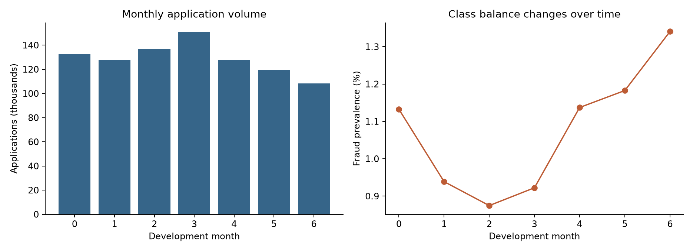
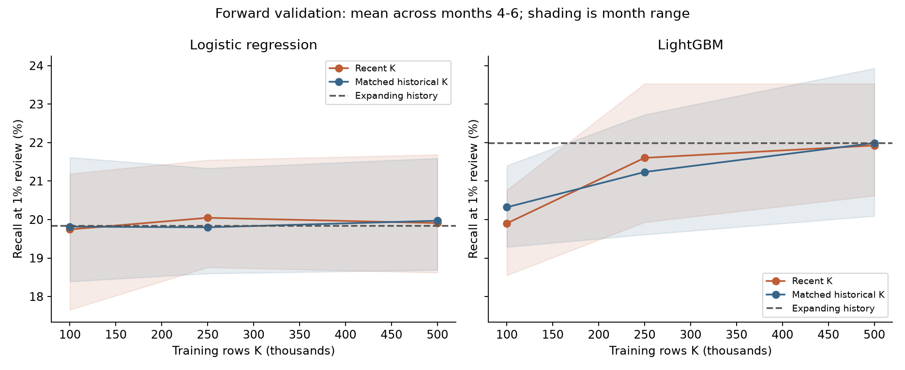
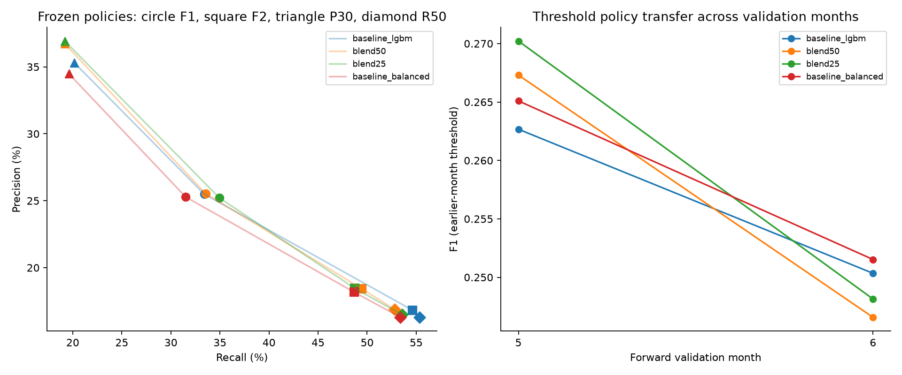

# Robust Bank Account Fraud Detection under Temporal Drift and Class Imbalance

**BT4012 Fraud Analytics — NUS AY2026/2027 Semester 1**  
**Group:** [GROUP NUMBER REQUIRED]  
**Members:** [GROUP MEMBER NAMES REQUIRED]  
**Code and reproduction:** https://github.com/snatzehua/bt-4012-project-2026  
**Submission status:** Draft for group review; replace the identity fields and confirm the teaching team can access the submitted repository revision.

## 1. Problem Description

Fraudulent bank-account applications create an investigation problem: a bank must identify suspicious applications while limiting unnecessary reviews of legitimate customers. One application is one observation in this study; the data do not describe payment transactions or the financial outcome of an intervention. We therefore measure detection of labelled fraud and legitimate applications flagged, rather than money saved or fraud prevented.

Two characteristics make this task difficult. First, fraud represents approximately one per cent of the available applications. A classifier that labels everyone legitimate can achieve high accuracy while detecting no fraud. Second, the distribution of applications changes over time. Older training cases may become less representative, but discarding them reduces the sample available to learn rare patterns. A comparison between a small recent sample and a larger historical sample cannot separate these effects.

We investigate three questions. **RQ1:** Does recent training improve future detection when training size and fraud counts are controlled? **RQ2:** How do model family, preprocessing and imbalance treatment affect ranking and the operating trade-off? **RQ3:** Can feature engineering and ensembles improve detection under a specified review capacity or recall-oriented policy? These questions connect experimental choices to a practical application-review process.

Our principal contribution is a controlled chronological comparison, followed by explicitly exploratory improvement studies. Results support retaining useful historical observations rather than assuming recent data are always better. They also show that the operating policy is part of the model decision: an improvement in F2 need not improve a fixed-capacity queue. Subsequent experiments use an already-consumed month-7 evaluation and cannot establish fresh confirmation.

## 2. Data Overview

### 2.1 Source, scale and temporal coverage

We use the **Base variant of the Bank Account Fraud (BAF) Dataset Suite, Kaggle version 2**, associated with Jesus et al. [1–2]. The synthetic dataset contains 1,000,000 account applications, 32 source columns and month indices 0–7. We verify the local CSV against its declared SHA-256 before modelling. Base provides a common first-study population; using it does not establish that the data are unbiased or representative of a particular bank.

Development months 0–6 contain 903,157 applications. Month 7 contains 96,843 applications, including 1,428 frauds (1.47%). Development-only checks found no literal null cells and no duplicate rows. However, six fields encode missingness using negative values, making a literal-null check insufficient.

| Month index | Applications | Frauds | Fraud prevalence |
|---|---:|---:|---:|
| 0 | 132,440 | 1,500 | 1.13% |
| 1 | 127,620 | 1,198 | 0.94% |
| 2 | 136,979 | 1,198 | 0.87% |
| 3 | 150,936 | 1,392 | 0.92% |
| 4 | 127,691 | 1,452 | 1.14% |
| 5 | 119,323 | 1,411 | 1.18% |
| 6 | 108,168 | 1,450 | 1.34% |
| 7 — consumed evaluation | 96,843 | 1,428 | 1.47% |

### 2.2 Variables and data quality

The target is `fraud_bool`. `month` is reserved for splitting and eligible training weights; it is never a predictor. `device_fraud_count` is constant zero in development and is excluded. A positional row identifier supports alignment and deterministic ties, not intramonth chronology. The remaining **29 original predictors** are listed below; groupings are descriptive rather than feature selection.

| Group | Exact source variables | Modelling role |
|---|---|---|
| Customer profile | `income`, `customer_age` | Coarse numerical profile measures; not exact income or age |
| Identity and contact | `name_email_similarity`, `email_is_free`, `phone_home_valid`, `phone_mobile_valid` | Similarity and binary contact signals |
| Residence history | `prev_address_months_count`, `current_address_months_count` | Numerical residence duration with encoded missingness |
| Request and intended funding | `days_since_request`, `intended_balcon_amount` | Numerical request timing and intended transfer |
| Local/application activity | `zip_count_4w`, `velocity_6h`, `velocity_24h`, `velocity_4w`, `bank_branch_count_8w`, `date_of_birth_distinct_emails_4w` | Supplied numerical aggregate activity features |
| Banking and credit | `credit_risk_score`, `bank_months_count`, `has_other_cards`, `proposed_credit_limit` | Numerical/binary banking and credit information |
| Session and device | `foreign_request`, `session_length_in_minutes`, `keep_alive_session`, `device_distinct_emails_8w` | Numerical/binary application and device signals |
| Categories | `payment_type`, `employment_status`, `housing_status`, `source`, `device_os` | Five categorical fields |

Missing fractions in development are especially high for `intended_balcon_amount` (73.47%), `prev_address_months_count` (71.94%) and `bank_months_count` (25.02%). The remaining sentinel fields are current residence duration, session length and distinct device emails. Documented negative sentinel values are decoded before preprocessing; valid negative risk scores and short-window velocities are retained.

Distribution changes are substantial in some supplied activity features. Comparing months 0 and 6, numerical Kolmogorov–Smirnov distances are 0.903 for `velocity_4w`, 0.619 for `velocity_24h` and 0.573 for `velocity_6h`. These are distributional effect sizes, not proof that the conditional fraud mechanism changed. Categorical total-variation distances use a different scale and are not combined into a universal drift ranking. Increasing prevalence also affects precision and AP, so month-specific performance is retained.

## 3. Methodology

### 3.1 Chronological design and information boundaries

The first study evaluates three forward folds, then a separate final month. Every compared strategy predicts the same future applications within each fold.

| Stage | Eligible training months | Prediction month | Training applications using all history |
|---|---|---|---:|
| Development fold 1 | 0–3 | 4 | 547,975 |
| Development fold 2 | 0–4 | 5 | 675,666 |
| Development fold 3 | 0–5 | 6 | 794,989 |
| Original final evaluation | 0–6 | 7 | 903,157 |

We assume previous-month labels are available by each cutoff. The dataset does not supply reporting delays, exact application timestamps or linked entities, so this is a retrospective benchmark rather than an end-to-end deployment simulation. Supplied aggregate features cannot be reconstructed independently from transaction histories. We do not infer recency within a month from CSV ordering.

Original selections were frozen before the first month-7 evaluation. That evaluation consumed the holdout. Later choices were frozen before additional scoring but remain adaptive, exploratory analyses on a known population. Neither preserving hashes nor using bootstrap intervals restores an independent holdout.

### 3.2 Separating recency from sample size

For logistic regression and LightGBM, we compare **K = 100,000, 250,000 and 500,000**. Recent-K takes whole eligible months from newest to oldest, with target-independent random priority within the boundary month. Historical-K samples from all eligible history, matching both K and the exact fraud/nonfraud counts of the corresponding recent sample. Historical samples use seeds 17, 29 and 43 and may overlap recent samples.

This design controls size and class composition within each recent-versus-historical contrast. It evaluates recent retention against representative historical retention, not against an exclusively old population, and does not establish causal identification. Controls are averaged across seeds within a month before averaging months. K is selected separately for each family using recent-strategy development recall at 1% review, giving 250,000 for logistic regression and 500,000 for LightGBM. Expanding history is a practical reference, but its different size/composition means it is not a pure recency contrast.

### 3.3 Model-specific preprocessing and justification

Logistic regression is a compact linear reference whose coefficients can be inspected after accounting for scale and encoding. Random forest supplies a bagged-tree comparator; LightGBM models nonlinear effects and interactions through boosted trees. These are fixed presets in the first study, not equally tuned estimates of each family's maximum performance.

| Model/preset | Numerical handling | Categorical handling | Selected configuration |
|---|---|---|---|
| Original logistic | Training-median imputation, missing indicators, standardisation | Training-fitted one-hot encoding; unknown categories ignored | C=1, L-BFGS, maximum 1,000 iterations |
| Original LightGBM | Training-median imputation and missing indicators; no scaling | Training-fitted one-hot encoding | 200 rounds, learning rate 0.05, 15 leaves, minimum child size 100 |
| Original random forest | Training-median imputation and missing indicators; no scaling | Training-fitted one-hot encoding | 150 trees, depth 14, minimum leaf size 20, sample fraction 0.5 |
| Native LightGBM improvements | Numerical NaNs retained | Training-only categorical levels; unseen categories missing | Separate declared capacity presets |
| CatBoost improvements | Training-only numerical medians | Category strings; training-only internal categorical statistics | Declared depth-6/8 CPU presets |

All learned preprocessing is refitted on each eligible training subset. The first study compares unweighted and balanced training on expanding history separately from its unweighted recency experiment. The improvement study adds moderate positive weights, training-only 20:1 negative undersampling with prior-odds correction, and recency weights with a two-month half-life. Correction assumes class-conditional sampling invariance and does not guarantee calibration. Recency weights also change effective class composition, so their comparison tests a practical strategy rather than a pure age effect.

### 3.4 Feature engineering and ensembles

The improvement study adds **36 row-local features** to the 29 originals. They include signed logarithms of skewed numerical inputs; velocity ratios/differences; missingness indicators; residence/bank-tenure contrasts; contact-validity and identity-mismatch signals; numerical credit/profile interactions; and three categorical crosses. These are computed independently per application without future population aggregates or target-derived rates. Income/age interactions are exploratory coarse-feature combinations, not financial affordability estimates.

Linear models cannot represent these nonlinearities without an expanded representation, whereas trees can learn many interactions directly. We therefore test the bundle separately by model family. The initial engineered-logistic comparison also changes C from 1 to 0.1. A subsequent development-only raw C=0.1 diagnostic separates regularisation from the feature bundle; it is excluded from selection and month 7.

The first improvement search contains 17 base presets and three blends, producing 51 forward base fits and nine blend comparisons. Blend members are chosen by mean development AP, then combined at LightGBM weights 0.25, 0.50 and 0.75. Reusing development folds for members and blend selection introduces search optimism. Later F2 studies explore score fusion and bagging under their own frozen protocols; raw/logit blend scores are not asserted to be calibrated probabilities.

### 3.5 Metrics, selection and uncertainty

The first study's primary operating point is **1% review capacity**, with 0.5%, 2% and 5% sensitivities. Exactly `ceil(qN)` applications enter the queue; ties use stable row ID. Precision is the fraud share of reviews, recall the fraud share detected, and confusion counts show the operational burden. AP summarises ranking across thresholds; ROC AUC is complementary. On month 7, always predicting legitimate achieves 98.53% accuracy but zero recall, illustrating why accuracy cannot select the detector.

Threshold-based F1 and F2 are distinct policies. F2 is `5TP / (5TP + 4FN + FP)`, placing greater emphasis on missed fraud. It has no fixed review quota or precision floor. Improvement thresholds are learned from earlier predictions: month 5 uses month 4, and month 6 uses months 4–5. Models and policies are selected by their declared development objective, not by the best-looking month-7 score.

Paired bootstrap intervals use identical resampled applications for each comparator. The core studies use 500 replicates and condition on fitted models and chosen policies. They exclude retraining, adaptive selection, between-month variation and multiplicity corrections. We report them as conditional descriptive uncertainty; a narrow interval cannot correct repeated holdout access.

## 4. Experiments and Results

### 4.1 Recency provides no reliable general advantage

| Model | K | Recent development recall at 1% | Matched-history recall | Recent minus historical, percentage points |
|---|---:|---:|---:|---:|
| Logistic | 100,000 | 19.74% | 19.82% | −0.07 |
| Logistic | 250,000 | 20.05% | 19.80% | +0.25 |
| Logistic | 500,000 | 19.91% | 19.97% | −0.06 |
| LightGBM | 100,000 | 19.90% | 20.32% | −0.42 |
| LightGBM | 250,000 | 21.60% | 21.24% | +0.37 |
| LightGBM | 500,000 | 21.93% | 21.99% | −0.06 |

Effects change sign across K. At the validation-selected K, original month-7 recent-minus-matched effects are +0.09 percentage points for logistic regression, with conditional 95% interval [−0.61, +0.89], and +0.14 for LightGBM, interval [−0.81, +0.89]. Both include zero and allow modest effects in either direction. LightGBM recent-K also trails expanding history by 0.63 percentage points, interval [−1.58, +0.29]. Thus the results do not justify throwing away history solely because visible covariate distributions drift.

### 4.2 Family and weighting comparisons depend on the policy

All rows below predict the same 96,843 original final-month applications and review exactly 969 cases.

| Fixed model | Training weights | Recall | Precision | AP | TP | Legitimate flagged | Missed fraud |
|---|---|---:|---:|---:|---:|---:|---:|
| Logistic | None | 19.40% | 28.59% | 0.1888 | 277 | 692 | 1,151 |
| Logistic | Balanced | 19.26% | 28.38% | 0.1865 | 275 | 694 | 1,153 |
| Random forest | None | 21.08% | 31.06% | 0.1956 | 301 | 668 | 1,127 |
| Random forest | Balanced | 19.12% | 28.17% | 0.1797 | 273 | 696 | 1,155 |
| LightGBM | None | 22.34% | 32.92% | 0.2186 | 319 | 650 | 1,109 |
| LightGBM | Balanced | 21.64% | 31.89% | 0.2122 | 309 | 660 | 1,119 |

The original development-selected candidate is balanced expanding-history LightGBM. Its identity does not change because the unweighted preset subsequently scores better on month 7. Weighting reduces final capacity recall for all three presets. For LightGBM, weighting improves F1 at threshold 0.5 from 0.0737 to 0.1157, but development-selected thresholds yield 0.2885 unweighted versus 0.2802 balanced. Comparing only the default threshold would confuse a score-scale change with useful detection improvement.

### 4.3 Engineering helps the linear model more consistently

Engineered logistic improves mean forward AP from 0.1542 to 0.1674 and recall at 1% from 19.84% to 21.00%. AP improves in all three development months. At fixed C=0.1, raw AP is 0.1544 versus engineered AP 0.1674, supporting a feature-bundle effect beyond regularisation. This adaptive diagnostic does not identify which individual features are responsible.

The same bundle does not universally help trees. Compared with matching native LightGBM presets, mean AP changes by −0.0012 at 31 leaves and −0.0030 at 63 leaves; engineered CatBoost improves AP by 0.0020 but reduces capacity recall by 0.43 percentage points. More complex representations therefore require model-specific evidence rather than a common assumption that added features improve every objective.

### 4.4 Ensemble gains are modest and objective-specific

The validation-selected capacity blend uses 25% LightGBM and 75% CatBoost. On consumed month 7 it finds **334 frauds and flags 635 legitimate applications**, versus 319 and 650 for the unweighted LightGBM reference, at the same 969-review budget. Recall rises from 22.34% to 23.39% and precision from 32.92% to 34.47%. The recall difference is +1.05 percentage points, conditional interval [+0.14, +2.26]. This is exploratory evidence, not a new confirmatory trial. The AP-selected 50/50 blend scores 0.2225 AP versus 0.2186 for the reference; its difference interval spans zero.

Later recall-oriented searches improve development F2 incrementally without establishing a general consumed-month gain:

| Strategy/policy | Chronological development F2 | Consumed month-7 F2 |
|---|---:|---:|
| Unweighted LightGBM reference | 0.322654 | 0.376884 |
| Balanced LightGBM | 0.327802 | 0.364409 |
| XGBoost–LightGBM score fusion | 0.328907 | 0.372694 |
| Selected bagged-anchor fusion | 0.330881 | 0.372240 |

The last strategy remains selected by its development rule, but trails unweighted LightGBM on consumed month 7. This divergence is a limitation of adaptive development selection and temporal transfer, not permission to choose a replacement using final outcomes. Unfinished context-feature-ablation work and the stopped L-BFGS spline attempt are excluded from complete-result claims.

### 4.5 Integration into an application-review process

A defensible use is batch triage: validate incoming schema, apply the frozen model, rank eligible applications, send the capacity-limited queue to analysts, record decisions and later reconcile matured outcomes. Flags should trigger investigation, not automatic rejection. The equal-capacity comparison means 15 additional labelled frauds and 15 fewer legitimate reviews in the evaluated batch; it does not quantify recovered losses or customer harm.

A bank choosing recall-oriented F2 must resource a larger queue. The unweighted reference's development-selected F2 threshold flags 4,636 applications on month 7: 780 frauds and 3,856 legitimate applications, versus 969 total reviews under the capacity policy. It captures 54.62% of fraud but precision falls to 16.82%. Neither policy is universally preferable without review capacity, error costs and service-level requirements. A simple cost sensitivity can express assumed burden as `c_FN × FN + c_FP × FP`; actual cost ratios are not supplied, so no financial optimum is claimed.

Operational monitoring should separate score/input drift from outcome-based precision, recall and queue burden. Thresholds transferred from development may not preserve their original alert rate. Any proposed recalibration needs eligible matured labels and a prospective evaluation boundary. These are deployment requirements and recommendations, not a claim that this repository implements a production banking system.

### 4.6 Auxiliary branch evidence: updating changes the operating point

A separate notebook workflow on `feat--zs-exploration-00` (commit `d466ff34`) trains static models on months 0–4, calibrates on 5, and evaluates 6–7. Its three-seed undersampled CatBoost average reports pooled AP 0.202266 versus 0.193286 for its full-data LightGBM reference. At **2,049 summed monthly exact 1% reviews**, it catches 633 versus 607 frauds. These counts use floor-rounded monthly budgets, unlike our ceiling-rounded core policy; the recipes, training periods and aggregation also differ. The results are auxiliary evidence, not a merged ranking against our local models.

For month 7, the notebook's frozen CatBoost policy reports recall 59.38% at FPR 5.38%. Recalibrating only the threshold changes these to 54.13% and 4.13%, with unchanged AP; retraining plus recalibration reports 55.53% and 4.37%. At the exact monthly-capacity policy, refreshing catches only two additional frauds across months 6–7 (635 versus 633). This illustrates workload adaptation, not a demonstrated general retraining gain. Values come from embedded executed notebook outputs; underlying Drive exports were not independently rerun here. Prior later-period exposure and assumed previous-month label availability remain limitations. The pinned audit in `docs/submission-branch-audit.md` records these qualifications and explains why the lecture branch's future-fitted vocabularies and mixed policy summaries are not adopted into canonical evaluation.

## 5. Conclusion

Matched-size, class-controlled comparisons do not establish a reliable recency advantage on BAF Base. Among the tested fixed presets, boosted trees provide stronger capacity detection than logistic regression, while engineered features substantially improve the linear baseline. Weighting, ranking and threshold policy interact: higher default-threshold recall or F2 cannot be presented as an equal-capacity improvement. A development-selected LightGBM–CatBoost blend shows a modest exploratory capacity gain, while extensive later F2 tuning does not beat the unweighted reference on the consumed final month.

The evidence is restricted to one synthetic variant, eight coarse months and assumed immediate availability of previous-month labels. Retraining uncertainty, delayed labels, realistic costs, application links and intervention outcomes are absent. Sensitive fields, including age, remain predictors; this report does not establish fairness or readiness for deployment. Repeated adaptive search and consumed-holdout access prevent confirmatory claims. Future work should use genuinely new time periods or another appropriately separated population, evaluate delayed feedback, quantify fairness and analyst outcomes, and assess whether complexity pays for its maintenance cost.

Reproducibility is supported by declared configurations, pinned software, training/evaluation row identities, frozen source and selection hashes, preserved models/predictions and independently checked small result tables. A fresh execution must follow the documented replay procedure in a separate location; exporting existing evidence is not equivalent to retraining. The final submitted repository must remain accessible to the teaching team, with the precise submitted revision identified.

## Acknowledgements and assistance declaration

ChatGPT/Codex assisted with research design, implementation, execution, methodological checks, result interpretation and drafting. Dataset and software sources are acknowledged below. The group must review all submitted material, verify its own contributions, and be able to explain and justify every included method and result. This declaration records assistance; it does not assert that group review has already occurred. Additional external code or material adopted during final consolidation must be acknowledged in the final revision.

## References

[1] Jesus, S., et al. (2022). *Turning the Tables: Biased, Imbalanced, Dynamic Tabular Datasets for ML Evaluation*. NeurIPS Datasets and Benchmarks. Official project: https://github.com/feedzai/bank-account-fraud.

[2] Feedzai. *BAF Datasheet* and Base dataset, Kaggle version 2. https://github.com/feedzai/bank-account-fraud/blob/main/documents/datasheet.pdf; https://www.kaggle.com/datasets/sgpjesus/bank-account-fraud-dataset-neurips-2022/versions/2.

[3] Project code and frozen evidence. https://github.com/snatzehua/bt-4012-project-2026. `docs/experiment-protocol.md`, `configs/study.json`, `reports/baf-study-v1/findings.md`.

[4] Exploratory improvements. `docs/improvement-protocol.md`, `configs/improvements.json`, `reports/baf-improvements-v1/findings.md`, `logistic_fixed_c_summary.csv`, `paired_intervals.csv`.

[5] Recall-oriented synthesis. `reports/baf-xgboost-score-fusion-v1/findings.md`, `reports/baf-bagged-anchor-fusion-v1/findings.md`, `reports/baf-shallow-catboost-v1/findings.md`.

[6] Auxiliary branch reconciliation. `docs/submission-branch-audit.md`; ZS `notebooks/10_temporal_holdout_evaluation.ipynb` and `11_results_synthesis_and_conclusions.ipynb` at commit `d466ff34df6f62abe935b993ef75c8ca0dd3b1ed`.

[7] Software documentation: scikit-learn `average_precision_score`; LightGBM parameters and tuning; CatBoost categorical features and training parameters. Exact versions and study-specific dependency files are retained in the repository.

## Appendix A. Evidence and scope ledger

| Report material | Authoritative local evidence | Interpretation boundary |
|---|---|---|
| Population, missingness, drift, matched-K and original model/weighting comparisons | `reports/baf-study-v1/`; `docs/experiment-protocol.md`; `configs/study.json` | Original study, 90 validation / 14 final / 3 diagnostic fits |
| Engineered logistic and controlled regularisation diagnostic | `reports/baf-improvements-v1/validation_summary.csv`; `logistic_fixed_c_summary.csv`; `logistic_fixed_c_months.csv` | Diagnostic adaptive, development-only, excluded from month 7 |
| Ensemble capacity counts and conditional intervals | `reports/baf-improvements-v1/exploratory_metrics.csv`; `paired_intervals.csv`; `selection.json` | Already-consumed month 7; fixed-capacity policy |
| F2 progression and unsuccessful additional searches | XGBoost fusion, bagged-anchor and shallow CatBoost findings in [5] | Different study identities; same consumed final population; no fresh confirmation |
| Code and protocol | `baf/`; `configs/`; `docs/`; repository README | Preserve frozen studies; no silent numerical recipe changes |

The remote branches use different recipes and, in places, different splits and objectives. Their results must not be spliced into the core tables as interchangeable observations. Section 4.6 uses separately qualified remote notebook outputs; all other numerical claims use the local frozen evidence listed above. The exact remote pins, source cells and adoption decisions are recorded in `docs/submission-branch-audit.md`.
